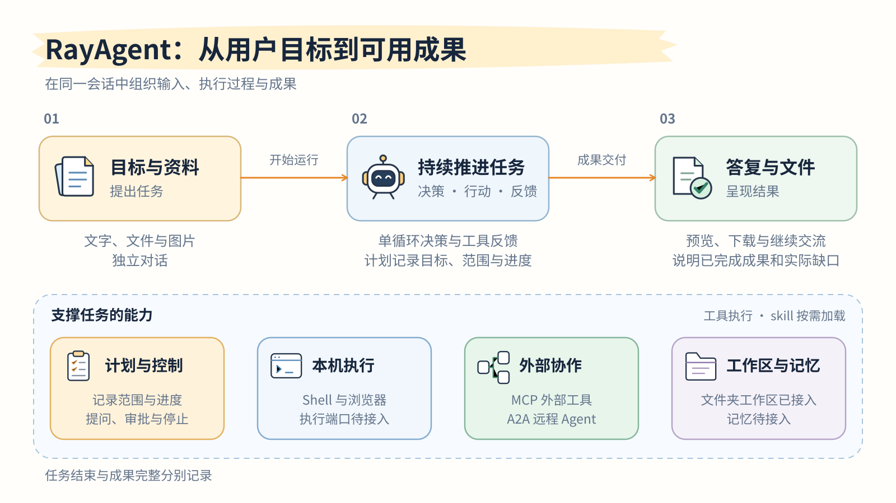

# RayAgent

RayAgent 是面向复杂任务执行的 AI Agent 应用，集成任务规划、工具执行与成果交付，并通过自研 Harness 管理执行过程、状态和资源。当前以 Mac 桌面应用运行：Tauri 宿主拉起本机 Python 核心，业务数据保存在本机数据根中。

用户通过会话提交目标和资料，Agent 在自研单循环中规划、调用工具并读取反馈，通过 MCP 与 A2A 使用外部能力，最终交付答复与文件。会话可以绑定一个本地文件夹作为工作区，Agent 直接读写其中的文件，写入有租约、备份与撤销；命令与浏览器工具依赖尚未接入的本机执行端口，当前不提供。

*计划、控制与外部协作支撑任务，文件夹工作区已接入，Shell 与浏览器的本机执行端口、工作方式与记忆尚未接入；运行结束与成果完整分别记录。*

## 为什么需要 Harness

模型生成文本和工具调用，程序负责真正执行。要让一次响应成为可持续推进的任务，还需要组织以下机制：

- **上下文与反馈**将用户要求、工具结果和任务状态交给下一次决策。
- **工具契约与适配**校验和授权动作，连接执行环境、外部工具及远程 Agent。
- **控制与生命周期**处理补充输入、提问、审批、停止和运行退出。
- **记录与交付**保存过程与资源归属，分别判断运行终态、交付结果和业务正确性。

RayAgent 通过自研 Harness 统一这些职责，保持任务执行、工具反馈和资源管理之间的边界。计划记录目标和进度，动作由同一循环决策；持久历史可以回放，任意中断点执行恢复则需要额外机制。

## 能做什么

| 能力 | 产品中的体现 |
|---|---|
| 规划与执行 | 复杂任务维护阶段与步骤，随工具反馈继续推进 |
| 检索与网页 | 搜索网页，读取无需登录的公开正文 |
| 工作区与文件 | 打开本地文件夹作为工作区，Agent 直接读写原位文件；写前备份与撤销、外部修改刷新；工作方式与记忆尚未实现 |
| 命令与进程 | 执行命令与管理进程，依赖本机执行端口，尚未接入 |
| 浏览器观察 | 页面文本、交互元素与显式视觉分析，依赖本机执行端口，尚未接入 |
| 控制与观察 | 查看过程记录，补充要求、回答问题、批准调用或停止 |
| 外部协作 | MCP 外部工具与 A2A 远程 Agent |
| 文件交付 | 上传材料并预览下载，把生成的文件交付为可下载附件 |

具体行为与使用边界见[产品说明](docs/product.md)。

## 从哪里开始

按阅读目标选择入口。`docs/` 说明产品行为与核心机制，源码是实现事实的最终依据。

| 阅读目标 | 入口 | 主要内容 |
|---|---|---|
| 快速认识产品 | [产品说明](docs/product.md) | 用户流程、可见结果与使用边界 |
| 理解执行机制 | [Harness 工程](docs/harness.md) | 决策、反馈、工具约束与结束判断 |
| 理解系统结构 | [架构说明](docs/architecture.md) | 组件协作、状态、事务与资源归属 |
| 维护或扩展功能 | [代码地图](docs/code-map.md#主执行路径)、[文档地图](docs/README.md#持续维护与审阅) | 实现定位、检查入口与说明更新归属 |
| 运行与开发 | [运行指南](ray_agent/README.md)、[桌面开发指南](ray_agent/desktop/README.md)、[API 开发指南](ray_agent/api/README.md)、[UI 开发指南](ray_agent/ui/README.md) | 模型连接配置、内部包构建、核心与界面开发入口；原 Compose 部署已删除 |
| 查询设计形成过程 | [设计背景](docs/background/README.md) | 问题、证据、方案比较与重要转折 |

新工作见[维护与优化计划](PLAN.md)，文档分工见[文档地图](docs/README.md)，问题分析与设计取舍见[设计背景](docs/background/README.md)。
