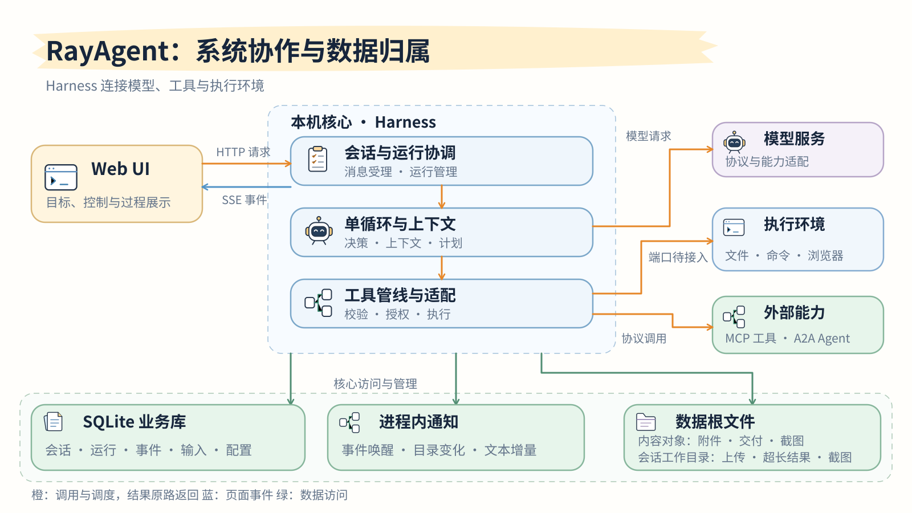

# RayAgent 架构说明

本文说明组件如何协作、状态由谁持有，以及执行、数据库与文件之间的一致性边界。循环内部的决策与反馈见 [Harness 工程](harness.md)，实现入口见[代码地图](code-map.md#主执行路径)。

## 系统边界

*橙线表示调用，结果沿原调用返回；蓝线表示页面事件，绿线表示核心的数据访问。图省略内部读写和 skill 独立文件命名空间，后者见本文“全局 skill 资源”。*

- **界面** 接收目标与控制请求，消费核心事件并展示过程和成果；页面状态由执行事实派生。
- **本机核心（Harness）** 受理消息、组织运行、调用模型与工具并保存记录。执行协程与任务注册表由当前核心进程持有；核心只监听回环地址，由桌面宿主经私有管道拉起，开发时用启动参数直接启动，启动方式见[桌面开发指南](../ray_agent/desktop/README.md)与 [API 开发指南](../ray_agent/api/README.md)。
- **执行环境** 提供文件、Shell 与浏览器。本机执行端口接入前这三项能力按能力声明关闭，相关工具不进入模型请求；保留的 Docker 沙箱适配不再装配。
- **模型服务** 根据上下文生成文本与工具调用，动作由本地工具管线执行。
- **MCP / A2A 服务** 提供外部工具与远程 Agent，经客户端适配接入同一工具层。

核心不依赖 PostgreSQL、Redis、Nginx 或 Docker；原 Compose 部署方式不再受支持。

## 核心对象与身份

用户任务可以跨多次运行推进，不能用一次运行的终态代表整个目标已经达成。

- **会话**：组织连续消息、运行和附件；创建时同事务登记一个会话工作目录根。
- **运行**：表示一次受理后持续推进的执行，有独立 ID；运行中补充和等待续接沿用该 ID。
- **持久输入**：已受理的用户消息与目标运行；进入模型历史时标记消费，所属运行结束后仍未消费的输入保持可见，由用户明确重新发起。
- **轮次**：组织一次模型决策及工具批次，可以包含失败后的多次请求尝试。
- **工具调用**：表示模型提出的一项动作，通过调用 ID 与结果配对。
- **后台任务**：持久的长操作，带代次与实例所有者，状态沿长操作契约。
- **skill 与不可变版本**：全局目录和包版本，运行引用固定实际使用的材料。
- **计划与成果记录**：保留范围、进度、核验和交付事实，可以跨运行承接，不承担动作调度。

每个会话至多有一个活动运行。会话列表中的状态是最近运行状态的冗余投影，不代表进程内协程一定存在。

## API 分层

请求沿接口、应用、领域和基础设施之间的职责边界处理：

- **接口层**：映射 HTTP 请求、响应和 SSE，并组装依赖，将外部请求交给应用服务。请求、响应、错误与事件信封以核心的 Pydantic 契约为唯一来源，UI 与桌面宿主使用由它生成的类型；失败统一为带机器可读代码的结构化错误，生成与检查见[契约指南](../ray_agent/contracts/README.md)。
- **应用层**：协调会话、文件、配置、后台任务与执行资源，组织受理、事务和跨资源操作。
- **领域层**：定义运行模型、单循环、工具管线及外部能力抽象，维护执行规则和状态约束。
- **基础设施层**：实现 SQLite 仓库与写协调、内容对象与会话工作目录、模型调用、进程内通知、公开网页读取和协议访问。

依赖在接口入口组装；数据访问通过仓库与工作单元组织。分层表达职责，具体对象放在哪个目录仍以[代码地图](code-map.md)和调用关系为准。

## 一次任务的执行

以下说明跨模块协作顺序，循环内部的反馈路径见 [Harness 决策层](harness.md#决策层)。

1. **受理输入**：应用服务在一个写事务中保存用户消息、新建或续接运行，并写入一条待消费输入；请求带幂等身份时同事务登记受理结果，可按身份读回。执行在后台启动，受理成功不代表执行开始。
2. **准备资源**：运行器按能力声明组装工具，端口未接入的文件、命令与浏览器工具不提供；附件从内容对象复制到会话工作目录。
3. **装配运行**：skill 目录在消息受理事务中已冻结并登记持久版本引用；显式选择在业务决策前加载。新运行按平台、工作目录与能力生成系统提示并冻结模型、协议、参数与工具声明；等待续接读取原快照。MCP 服务与 A2A 卡片按需发现，发现结果随运行保存。
4. **进入循环**：领域循环从持久输入取出补充消息、检查容量并请求模型；模型适配将完整响应归一后交回循环，文本增量另走临时展示通道。
5. **执行与回填**：工具管线校验、授权并执行动作；结果先进入模型记忆，再与完成事件同事务落库。整批独立白名单读取可有界并发，其他批次保持串行。
6. **等待或结束**：运行器保存等待或终态，并在同一会话锁内核对是否还有未取用的输入。

确认计划时，受理事务验证来源运行、计划身份、事件版本与请求身份并绑定新运行；重复请求读回原受理结果，过期引用返回冲突，自然语言确认仍是普通消息。计划、范围、成果与核验按完整计划事件恢复，实际文件版本及交付事实由运行器补充。机制见 [Harness 计划清单](harness.md#计划清单)。

后台启动在登记任务前再次核对运行身份；停止撤销尚未登记的启动，已组装的任务不再执行。MCP/A2A 已发现的服务身份和实际声明随运行保存，等待续接按这些身份重新发现；声明变化保存为工具修订，不能据此保证远端能力始终不变。

## 结束路径与控制平面

### 状态迁移

`running` 与 `waiting` 是活动状态；其余状态为终态，进入后不再迁移。

| 目标状态 | 触发条件 | 保存的结果 |
|---|---|---|
| `completed` | 无工具调用，有限结束反馈已处理 | 最终答复、运行汇总与成果完整程度 |
| `waiting` | Agent 提问或调用需要审批 | 问题或审批请求、待处理调用与冻结配置 |
| `failed` | 模型请求、请求预算、容量治理、启动或运行器无法继续 | 失败原因及已有执行事实 |
| `cancelled` | 用户停止 | 取消原因、未结束轮次及后续收尾结果 |
| `interrupted` | 核心重启遗留执行或审批；运行记录与本进程协程失配 | 中断原因；旧审批同时失效，未消费输入保持可见 |

工具失败通常作为反馈交回循环，只有运行无法继续时才进入 `failed`。正常完成仍可能部分交付，业务正确性需要独立核验。

受理与结束通过会话锁协调。结束判断若发现已受理但未取用的补充消息，先将其交给同一运行继续，避免消息落入已经结束的运行。

### 等待与续接

等待保存状态后退出当前协程。回复到来时重建运行器，沿原运行 ID 继续；原调用栈不会恢复。

提问和审批都要保存待处理调用与冻结配置，但续接条件不同：

- **提问等待**：回复成为该提问调用的结果，同批后续调用补为未执行，再请求模型。核心重启后保持等待，可以重新组装运行器续接。
- **审批等待**：批准后将具体调用重新交给管线，只跳过再次询问，当前禁止策略仍生效；拒绝则回填拒绝结果。同批后续调用补为未执行。核心重启使旧审批失效，补齐未执行结果并中断运行。

等待审批期间先处理审批或停止，普通聊天不注入运行。重建还恢复请求预算、有限反馈、skill 绑定及浏览器资源记录，再核对实际环境；持久记录不证明旧进程或连接仍然存在。

### 调用配对与未知结果

进入下一次模型请求前，所有助手工具调用必须有配对结果：

- 正常执行：回填工具结果，失败也保留为结果。
- 停止或失败后重新执行：已发出执行开始事件的调用补为“执行中断，结果未知”；未开始的补为“未执行”。
- 提问或审批：按上表补齐；等待审批时停止或重启，在审批失效的同一事务中完成补齐。

“结果未知”保留了可能已有副作用的事实，不能按未执行自动重放。

### 停止传播与资源收尾

1. 先在数据库事务中保存取消终态并补齐未结束轮次。
2. 取消本次执行协程，有界等待其退出。
3. 对本次登记的 Shell 会话终止进程组（执行端口接入后才有 Shell）；尝试取消 A2A 远程任务，将控制结果保存为收尾事件。失败不回改运行终态，也不保证远程任务已结束。
4. 尚未进入模型历史的补充消息保持已受理未消费，可明确重新发起。

停止不撤销已经产生的副作用。协程取消、进程终止与资源回收属于不同操作。超时与宽限见[运行参数与限额](limits.md)。

## 状态与持久化

### 信息寿命

信息按寿命分为三个范围：

- **请求装配期间**：Context 对象与编码后的模型请求只在装配过程中存在；已记录输入可以由快照与事件重建。
- **当前核心进程**：协程、任务注册表、会话锁、进程内通知订阅与局部状态随退出丢失，由下一次启动扫描处理遗留运行。
- **数据根中**：业务库、内容对象、会话工作目录与 skill 存储可以重新读取，但读取记录不等于恢复任意执行位置。

### 业务库与写协调

业务库是数据根中的一个 SQLite 文件，启用 WAL 与外键。写协调器独占一条写连接，业务写事务按进入顺序串行，以 `BEGIN IMMEDIATE` 开始；同一任务内嵌套写事务直接报错，不会自锁。读取使用只读连接池，在 WAL 下与写入并发。其他连接占用写锁时按 busy 等待，开始写事务仍忙碌只在业务代码执行前有界重试，超出后返回可重试的不可用错误。

活动运行唯一由写事务内复核与条件唯一索引共同保证；每会话事件序号取自会话行的下一序号，与事件同事务分配，`(session_id, seq)` 是主键。数据根由操作系统级实例锁独占，第二个核心无法打开同一数据根。schema 由 Alembic 管理：启动时升级到程序的最新版本，版本号进入握手与状态；业务库版本超出程序可读范围时拒绝启动。表结构变更使用批量模式。

### 持久输入、受理与启动扫描

- **受理**：用户消息、运行状态与待消费输入同事务提交；带请求身份时，受理结果与内容摘要同事务登记，同身份同内容返回原结果，内容不同返回冲突，结果未知时按身份读回。
- **消费**：运行器从持久输入取用户消息；消息写入模型记忆后，记忆、那批上下文事件与输入的消费状态在同一事务提交。
- **启动扫描**：在开始受理前，把上次进程遗留的 `running` 运行置为 `interrupted`，等待审批的运行同样中断并使审批失效，等待提问的运行保持等待；未消费输入保持已受理可见，由重新发起接口交给新运行，不自动启动执行。
- **通知**：事件提交后经进程内通知唤醒订阅方，订阅方按序号补读；通知只是唤醒，丢失或失败由补读覆盖。

### 后台任务

后台任务在业务写事务中登记，状态沿长操作契约（`queued / running / succeeded / failed / cancelled`），带类型、范围、对象版本、幂等键、实例所有者、取消请求、进度、错误与代次。执行器领取任务时记录所有者；进度与结果写回同时核对代次与所有者，重试或重启接管后迟到的写回被拒绝。取消请求先记录，由处理函数在安全点确认。启动扫描把上一实例遗留的运行中任务按类型重新排队或标为可重试失败。当前登记的类型只有数据清理，其余类型由所属工作包加入。

### 记忆与上下文的责任边界

记忆内容、请求输入和审计历史由不同部分维护：

- 领域循环维护会话工作记忆，负责结果整形、容量检查及自动压缩；压缩组件生成摘要与替换消息。
- 运行器把记忆的改动与随后落库的事件放在同一事务保存，记忆、上下文事件与输入消费不会彼此脱节；单独使用循环时（如测试）每次改动立即保存。
- 事件仓库保留原始过程，压缩不删除既有事件；手动压缩将替换记忆与事件同事务提交。

选择范围、触发条件与信息保护统一见 [Harness 上下文与记忆治理](harness.md#上下文与记忆治理)。本节只规定所有权与持久化边界，不复制压缩算法。

### 数据归属

| 数据 | 所属存储 | 保存目的 |
|---|---|---|
| 会话、运行、事件、模型记忆、计划事件与文件元数据 | 业务库 | 业务状态、历史、配置快照及来源 |
| 持久输入与受理记录 | 业务库 | 输入不丢失、不重复成为业务执行，请求结果可读回 |
| 后台任务、应用配置、skill 目录与运行引用 | 业务库 | 长操作状态，模型、Agent、工具策略、MCP 与 A2A 配置 |
| 事件与目录变更通知、模型文本增量 | 进程内通知 | 唤醒订阅方重读持久数据；增量只给当前连接，不补发 |
| 附件、交付文件与截图字节 | 数据根的内容对象 | 输入材料、交付文件及视觉资源 |
| 附件副本、超长工具结果、截图与临时文件 | 会话工作目录 | 本会话工具可用的工作文件，随会话删除回收 |
| 页面派生状态与预览缓存 | 浏览器或核心临时资源 | 展示与阅读，不作为业务产物 |

模型密钥只从环境读取，不写入业务库。资源 ID 只是引用，不能证明字节仍然存在；数据库记录可回放，文件是实际副作用，两者不能相互替代。

### 删除与业务清空

- **删除会话**：一个写事务删除会话及其运行、事件、输入、文件元数据与根登记，并登记清理任务；任务按清单回收会话工作目录与内容对象，可重复执行。正在执行的运行先取消。
- **清空业务数据**：存在运行中或等待中的对话、正在压缩上下文或已有未完成的清空时拒绝；受理事务删除全部会话与文件记录并登记清理任务，失败按同一清单重试，不扩大范围。应用配置与全局 skill 库保留。

记录先删除、字节后回收：迟到的写回找不到记录即失败，回收失败留下可辨认的孤立字节，不会出现有记录却没有字节的文件。

### 构建身份与运行快照

核心与 UI 各自产生构建清单，内容指纹覆盖显式源码、依赖清单及构建输入，排除凭据、可变运行配置和缓存。Git 提交仅辅助定位，不能区分同提交上的工作树修改；未知构建身份保持未知。

运行快照保存核心构建身份与实际提示，新运行使用当前提示，等待沿冻结提示，不重写历史请求；内容指纹不证明外部模型或运行配置正确。

## 事件与投影

### 提交与通知

持久事件是页面历史回放和运行过程审计的依据；外部动作是否发生仍需结合实际资源判断。

1. 运行账本在同一写事务中保存事件、相关运行计数与状态、会话状态，以及记忆和输入消费等附带更新。
2. 事务提交后发布新序号通知；通知失败不撤回提交，订阅方通过兜底查询补齐。
3. 带运行 ID 的写入在写事务内复核运行状态，终态后的迟到事件被丢弃，明确允许的收尾记录除外。

这个事务不包含模型请求、网络访问或文件复制，副作用与其数据库记录可能在不同时间可见。

### 记录与请求重建

运行快照固定实际提示、模型、协议、参数和工具声明。围绕这份快照保存以下过程记录：

- **轮次事件**：配对记录模型请求及工具批次，包含耗时、用量和结束原因；停止或中断时补齐未结束轮次。
- **尝试事件**：记录失败、重试与取消，不进入模型历史。
- **上下文事件**：记录追加消息、清理推理字段与压缩替换，用于重建输入，不重放动作。
- **审批事件**：记录待处理及批准、拒绝或失效结论，与对应运行状态迁移同事务保存。

请求重建由运行快照和此前上下文事件还原消息、工具定义、协议及图片引用。通信编码与图片字节在模型适配时装配；重建接口只读。压缩替换模型工作记忆，不改写原会话事件，手动压缩也不创建产品运行。

### 订阅、重连与临时增量

- **持久事件**：按会话序号补读；订阅建立后再查询一次，覆盖建立订阅时的空档。通知触发补查，无通知时兜底查询；SSE 以序号作为事件 ID，断线从最后序号继续。
- **文本增量**：不带持久序号，按运行、轮次、尝试拼成临时条目；完整消息到达后替换。重试、轮次结束、终态、刷新或重连会清除相应临时内容。
- **目录通知**：只传对象身份，列表重新读取；页面隐藏时断开，重新可见时核对。

接口投影省略工具原始大结果与上下文全文，保留展示预览和整形信息。预览从当次结果派生，不重新读取环境冒充历史画面；前端按调用身份合并开始和结果，消息只引用当时已交付的附件，不关联未来版本。详细接口与实现定位见[代码地图](code-map.md#事件观测与投影)，查询间隔见[运行参数与限额](limits.md)。

## 跨模块协作

- **公开网页读取**：在核心中直接完成，每跳固定公开地址、不带 Cookie 与认证，不需要执行环境。
- **文件、Shell 与浏览器**：随本机执行端口接入；接入前能力声明给出不可用原因，系统提示与工具集不提供它们。
- **MCP 与 A2A**：经协议客户端进入本地工具管线，保留本地运行控制。
- **输入附件与交付**：上传保存为内容对象，发送时归属会话并复制到会话工作目录；交付把工作目录内的文件保存为新的内容对象并关联会话。普通工作文件不会自动成为下载附件。
- **文件预览**：由核心直接读取附件内容对象，不启动 Agent，临时解析资源与缓存由核心回收。

MCP 别名区分同名工具，超长外部结果保留完整内容再进入统一整形；外部交互限制见 [Harness 执行适配层](harness.md#执行适配层)。

## 执行环境与限制

- **执行能力**：文件访问、本机命令与浏览器在对应端口接入前不可用，能力声明给出原因；Docker 沙箱适配代码保留到本机执行接入时删除，核心不再装配它。
- **会话工作目录**：位于数据根，按会话分开；目录名是根的不透明身份，不由客户端提交的会话 ID 推导。工作目录只用于定位文件，不是访问围栏。
- **视觉分析图**：按模型能力与容量装配，历史保存引用；临时截图在终态且到期后回收，活动图受保护。
- **文件预览**：按类型分段读取或在有界子进程解析，临时副本与缓存独立回收。

配额统一见[运行参数与限额](limits.md)。页面终态、后台协程结束与资源回收应分别确认。

## 全局 skill 资源

skill 管理由应用服务协调，包解析在领域层，GitHub 获取、不可变文件与业务库访问由基础设施实现。设置和聊天安装共用服务；业务库持有目录、版本、导入与运行引用，数据根的 skill 存储持有完整包；文件先发布再短事务登记，不宣称跨资源原子性。删除会话释放引用，清空业务数据保留全局库；回收依据持久引用。

正文和参考文本直接从 skill 存储读取；把完整材料准备到执行环境需要本机执行端口，接入前该工具不提供。加载、审批、等待与压缩的行为见[skill 机制](skills.md)。
