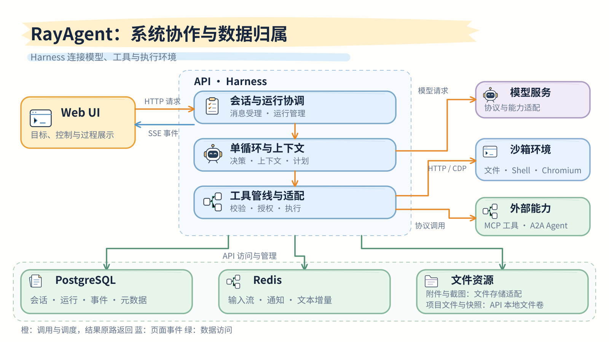

# RayAgent 架构说明

本文说明组件如何协作、状态由谁持有，以及执行、数据库与文件之间的一致性边界。循环内部的决策与反馈见 [Harness 工程](harness.md)，实现入口见[代码地图](code-map.md#主执行路径)。

## 系统边界

*橙线表示调用，结果沿原调用返回；蓝线表示页面事件，绿线表示 API 的数据访问。图省略部署转发和内部读写。*

- **Web UI** 接收目标与控制请求，消费后端事件并展示过程和成果；页面状态由执行事实派生。
- **API Harness** 受理消息、组织运行、调用模型与工具并保存记录。执行协程与任务注册表由当前 API 进程持有。
- **沙箱** 提供文件、Shell、浏览器及进程环境。它与 API 分进程，产生的文件副作用不在数据库事务内。
- **模型服务** 根据上下文生成文本与工具调用，动作由本地工具管线执行。
- **MCP / A2A 服务** 提供外部工具与远程 Agent，经客户端适配接入同一工具层。
- **Nginx** 转发 UI、API、SSE 和 WebSocket 请求，不参与运行调度。

## 核心对象与身份

用户任务可以跨多次运行推进，不能用一次运行的终态代表整个目标已经达成。

- **项目**：保存长期文件与共享背景，可以包含多个会话。
- **会话**：组织连续消息、运行和附件，创建时确定项目归属，之后不更换。
- **运行**：表示一次受理后持续推进的执行，有独立 ID；运行中补充和等待续接沿用该 ID。
- **轮次**：组织一次模型决策及工具批次，可以包含失败后的多次请求尝试。
- **工具调用**：表示模型提出的一项动作，通过调用 ID 与结果配对。
- **计划与成果记录**：保留范围、进度、核验和交付事实，可以跨运行承接，不承担动作调度。

每个会话至多有一个活动运行。会话列表中的状态是最近运行状态的冗余投影，不代表进程内协程一定存在。

## API 分层

请求沿接口、应用、领域和基础设施之间的职责边界处理：

- **接口层**：映射 HTTP 请求、响应和 SSE，并组装依赖，将外部请求交给应用服务。
- **应用层**：协调会话、项目、文件、配置与执行资源，组织准入、事务和跨资源操作。
- **领域层**：定义运行模型、单循环、工具管线及外部能力抽象，维护执行规则和状态约束。
- **基础设施层**：实现数据库仓库、模型调用、Docker、浏览器、队列和协议访问。

依赖在接口入口组装；数据访问通过仓库与工作单元组织。分层表达职责，具体对象放在哪个目录仍以[代码地图](code-map.md)和调用关系为准。

## 一次任务的执行

以下说明跨模块协作顺序，循环内部的反馈路径见 [Harness 决策层](harness.md#决策层)。

1. **受理输入**：应用服务在短事务中保存用户消息，新建或续接运行，返回可读回的受理身份。资源准备在后台进行，受理成功不代表准备成功。
2. **准备资源**：独立对话按需准备沙箱并同步附件，浏览器首次使用时连接；项目运行先取得占用、处理旧写入者并保护文件。
3. **装配运行**：新运行采用当前系统提示并冻结模型、协议、参数与工具声明；等待续接读取原快照。MCP 服务与 A2A 卡片按需发现，发现结果随运行保存。
4. **进入循环**：领域循环纳入补充输入、检查容量并请求模型；模型适配将完整响应归一后交回循环，文本增量另走临时展示通道。
5. **执行与回填**：工具管线校验、授权并执行动作；结果先进入模型记忆，再发布完成事件。整批独立白名单读取可有界并发，其他批次保持串行。
6. **等待或结束**：运行器保存等待或终态，协调未处理输入及资源收尾；项目文件占用在环境确认静止后才释放。

确认计划时，受理事务验证具体版本与请求身份并绑定新运行；重复请求读回原受理结果。计划、范围、成果与核验按完整计划事件恢复，实际文件版本及交付事实由运行器补充。机制见 [Harness 计划清单](harness.md#计划清单)。

## 结束路径与控制平面

### 状态迁移

`running` 与 `waiting` 是活动状态；其余状态为终态，进入后不再迁移。

| 目标状态 | 触发条件 | 保存的结果 |
|---|---|---|
| `completed` | 无工具调用，有限结束反馈已处理 | 最终答复、运行汇总与成果完整程度 |
| `waiting` | Agent 提问或调用需要审批 | 问题或审批请求、待处理调用与冻结配置 |
| `failed` | 模型请求、请求预算、容量治理或运行器无法继续 | 失败原因及已有执行事实 |
| `cancelled` | 用户停止 | 取消原因、未结束轮次及后续收尾结果 |
| `interrupted` | API 重启遗留执行或审批；运行记录与本进程协程失配 | 中断原因；旧审批同时失效 |

工具失败通常作为反馈交回循环，只有运行无法继续时才进入 `failed`。正常完成仍可能部分交付，业务正确性需要独立核验。

受理与结束通过会话锁协调。结束判断若发现已受理但未处理的补充消息，先将其交给同一运行继续，避免消息落入已经结束的运行。

### 等待与续接

等待保存状态后退出当前协程。回复到来时重建运行器，沿原运行 ID 继续；原调用栈不会恢复。

提问和审批都要保存待处理调用与冻结配置，但续接条件不同：

- **提问等待**：回复成为该提问调用的结果，同批后续调用补为未执行，再请求模型。API 重启后保持等待，可以重新组装运行器续接。
- **审批等待**：批准后将具体调用重新交给管线，只跳过再次询问，当前禁止策略仍生效；拒绝则回填拒绝结果。同批后续调用补为未执行。API 重启使旧审批失效，补齐未执行结果并中断运行。

等待审批期间先处理审批或停止，普通聊天不注入运行。两类等待都保留项目占用，不能因协程退出就释放共享文件。

### 调用配对与未知结果

进入下一次模型请求前，所有助手工具调用必须有配对结果：

- 正常执行：回填工具结果，失败也保留为结果。
- 停止或失败后重新执行：已发出执行开始事件的调用补为“执行中断，结果未知”；未开始的补为“未执行”。
- 提问或审批：按上表补齐；等待审批时停止或重启，在审批失效的同一事务中完成补齐。

“结果未知”保留了可能已有副作用的事实，不能按未执行自动重放。

### 停止传播与资源收尾

1. 先在数据库事务中保存取消终态并补齐未结束轮次。
2. 取消本次执行协程，有界等待其退出。
3. 对本次登记的 Shell 会话终止进程组，先发送 SIGTERM，宽限后仍存活则发送 SIGKILL；外壳已退出时不再按可能复用的进程组号补杀。
4. 尝试取消 A2A 远程任务，将控制结果保存为收尾事件。失败不回改运行终态，也不保证远程任务已结束。
5. 项目另需停止环境并确认静止，随后释放文件占用；独立对话保留沙箱供复用。

停止不撤销已经写入的文件。协程取消、进程终止、环境回收和文件回滚属于不同操作。超时与宽限见[运行参数与限额](limits.md)。

## 托管项目执行与文件保护

### 准入与所有权

项目文件由 API 文件卷长期保存，动态沙箱只将工作文件子目录挂载到 `/workspace`。只读查看和下载不要求沙箱存活。

共享文件的占用覆盖运行准备、执行、等待及环境收尾：

1. 受理运行时先锁项目，再锁会话与运行，活动运行和持久文件操作共同决定准入；冲突返回占用原因。
2. 后台文件 IO 不持有数据库长事务，回调必须核对运行或操作身份，迟到回调不能释放新占用。
3. 等待继续保留占用和环境，拒绝冲突写入。
4. 运行终态后登记环境收尾，停止容器并读回静止状态；未确认静止时保留阻止标记及重试入口。

### 文件发布、快照与恢复

- **安全访问**：统一 IO 按描述符遍历，不跟随链接，核对路径与类型；发布后统一属主。
- **保护快照**：内容哈希对象和完整清单发布成功后才登记可用，再淘汰旧记录；回收检查引用。
- **恢复**：先固定目标和恢复前清单，再在原根目录内应用。应用失败或重启保留失败状态及阻止标记，允许重试目标或回到恢复前。
- **恢复范围**：只改变项目文件，不回滚对话、笔记、摘要、运行记录或旧附件。

文件保护损坏与容量超限使用不同出口，不能将保护失败当成可以忽略的超限。详细设计关系见[项目方案](plan/projects-and-data.md)。

### 项目背景与并发编辑

- **说明与笔记**：分别保存版本；笔记内容与全文审计同事务提交，防止并发覆盖。
- **其他对话摘要**：保存来源、截止序号和生成代次，迟到响应不能覆盖新编辑。新运行选择近期材料，排除当前会话重复历史。
- **活动运行背景**：随快照保存，请求时拼接，不写入模型历史。执行及等待续接保持冻结版本，后续编辑只影响新运行。

摘要使用目标、用户更新、已完成回复与运行状态，不读取完整工具日志；生成中或失败时保留原内容，成功才替换。辅助耗时与用量单独记录。固定背景本身超限时直接返回容量原因，不反复压缩历史。

### 删除与业务清空

清理跨数据库、文件和环境，采用持久任务协调，不是跨资源原子事务：

1. 写请求持有共享数据库准入锁；清理受理取得独占锁，固定目标和资源清单。存在活动运行、等待、文件操作、摘要生成或当前进程压缩时拒绝。
2. 拒绝目标范围的新业务写入，依次处理沙箱、项目目录、附件和输入流；其他会话仍引用的附件保留。
3. 资源处理成功后事务删除业务记录，保留删除标识，阻止迟到回调复活数据；模型与服务配置保留。
4. 失败保存阶段与原因；重启将未完成任务标为可重试失败，清理工作锁防止重复处理同一清单。

## 状态与持久化

### 信息寿命

信息按寿命分为三个范围：

- **请求装配期间**：Context 对象与编码后的模型请求只在装配过程中存在；已记录输入可以由快照与事件重建。
- **当前 API 进程**：协程、注册表、会话锁、局部状态和 Shell 登记随重启丢失，当前没有跨进程认领机制。
- **进程之外**：会话、运行、事件、模型记忆、输入流和文件可以重新读取，但读取记录不等于恢复任意执行位置。

### 数据归属

| 数据 | 所属存储 | 保存目的 |
|---|---|---|
| 会话、运行、模型记忆、计划事件、项目记忆与文件元数据 | PostgreSQL | 业务状态、历史、配置快照及来源 |
| 用户输入流 | Redis Stream | 将受理消息交给运行器 |
| 事件与目录变更通知 | Redis pub/sub | 提醒订阅方重读持久数据 |
| 模型文本增量 | Redis pub/sub | 当前连接的临时展示，不补发 |
| 附件与截图字节 | 文件存储适配 | 输入材料、交付文件及视觉资源 |
| 项目文件与快照 | API 本地文件卷 | 长期工作副本与文件保护 |
| 页面派生状态与预览缓存 | 浏览器或 API 临时资源 | 展示与阅读，不作为业务产物 |

资源 ID 只是引用，不能证明容器或字节仍然存在。数据库记录可回放，文件是实际副作用；两者不能相互替代。

## 事件与投影

### 提交与通知

持久事件是页面历史回放和运行过程审计的依据；外部动作是否发生仍需结合实际资源判断。

1. 运行账本在同一数据库事务中保存事件、相关运行计数与状态、会话状态。
2. 事务提交后发布新序号通知；通知失败不撤回提交，订阅方通过兜底查询补齐。
3. 带运行 ID 的写入锁住运行行，终态后的迟到事件被丢弃，明确允许的收尾记录除外。

这个事务不包含 Shell、浏览器、文件写入或存储上传。副作用与其数据库记录可能在不同时间可见。

### 记录与请求重建

运行快照固定实际提示、模型、协议、参数和工具声明。围绕这份快照保存以下过程记录：

- **轮次事件**：配对记录模型请求及工具批次，包含耗时、用量和结束原因；停止或中断时补齐未结束轮次。
- **尝试事件**：记录失败、重试与取消，不进入模型历史。
- **上下文事件**：记录追加消息、清理推理字段与压缩替换，用于重建输入，不重放动作。
- **审批事件**：记录待处理及批准、拒绝或失效结论，与对应运行状态迁移同事务保存。

请求重建由运行快照和此前上下文事件还原消息、工具定义、协议及图片引用。通信编码与图片字节在模型适配时装配；重建接口只读。压缩替换模型工作记忆，不改写原会话事件，手动压缩也不创建产品运行。

### 订阅、重连与临时增量

- **持久事件**：按会话序号补读；订阅建立后再查询一次，覆盖建立订阅时的空档。通知触发补查，无通知时兜底查询；SSE 以序号作为事件 ID，断线从最后序号继续。
- **文本增量**：不带持久序号，按运行、轮次、尝试拼成临时条目；完整消息到达后替换。重试、轮次结束、终态、刷新或重连会清除相应临时内容。
- **目录通知**：只传对象身份，列表重新读取；页面隐藏时断开，重新可见时核对。

接口投影省略工具原始大结果与上下文全文，保留展示预览和整形信息。预览从当次结果派生，不重新读取环境冒充历史画面。详细接口与实现定位见[代码地图](code-map.md#事件观测与投影)，查询间隔见[运行参数与限额](limits.md)。

## 跨模块协作

- **文件、Shell 与公开网页读取**：经 HTTP 访问沙箱，实际动作与 API 持久化分开确认。
- **浏览器**：经 Playwright/CDP 连接沙箱 Chromium，普通动作返回文本观察，截图显式请求。
- **MCP 与 A2A**：经协议客户端进入本地工具管线，保留本地运行控制。
- **输入附件与交付**：由运行器同步或上传，存储适配保存字节；普通工作文件读写不会自动成为下载附件。
- **文件预览**：由 API 直接读取附件或项目文件，不启动 Agent 或沙箱，临时解析资源与缓存由 API 回收。

MCP 别名区分同名工具，超长外部结果保留完整内容再进入统一整形；外部交互限制见 [Harness 执行适配层](harness.md#执行适配层)。后端保留 VNC WebSocket 转发，当前 UI 没有远程桌面入口。

## 沙箱生命周期与限制

- **独立对话沙箱**：在首次工具使用或同步附件时查找、复用或创建；运行终态保留环境，之后按显式销毁或存活期回收。
- **项目沙箱**：在文件占用与保护完成后准备，等待时保留，终态停止并确认静止。
- **浏览器连接与视口**：在首次调用时连接。视口修改保存原值与运行所有权，等待保留，续接重建，结束只恢复本运行持有的标签页。
- **视觉分析图**：按模型能力与容量装配，历史保存引用；临时截图在终态且到期后回收，活动图受保护。
- **文件预览**：按类型分段读取或在有界子进程解析；项目改版后失效，临时副本与缓存独立回收。

动态创建与按地址连接已有沙箱是两种资源模式，不能共用所有权假设。隔离与权限边界如下：

- 文件系统按容器分离；工具工作目录只用于解释相对路径，不是访问围栏。
- 网络只有配置专用网络时才隔离；动态容器设置内存、CPU 与进程数限制，已有地址模式不套用创建限额。
- 沙箱服务以 `ubuntu` 运行，需要 root 的操作可用免密 sudo，supervisord 主进程仍为 root；这不是最小权限执行环境。

配额统一见[运行参数与限额](limits.md)。页面终态、后台协程结束、进程静止和资源回收应分别确认。
