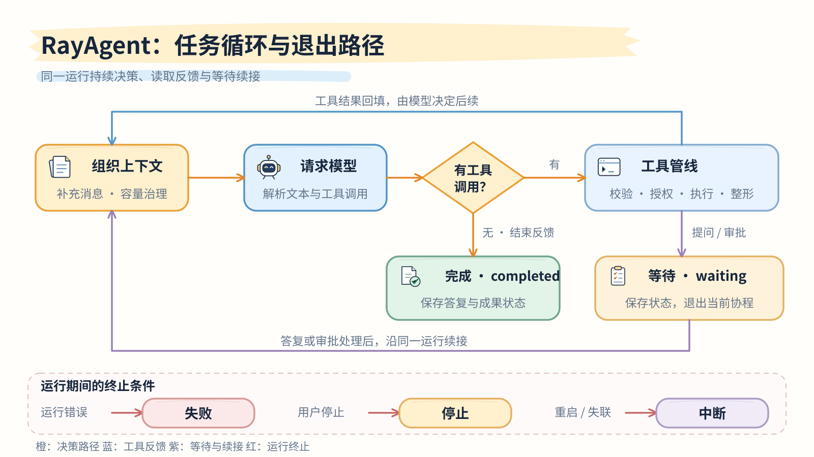
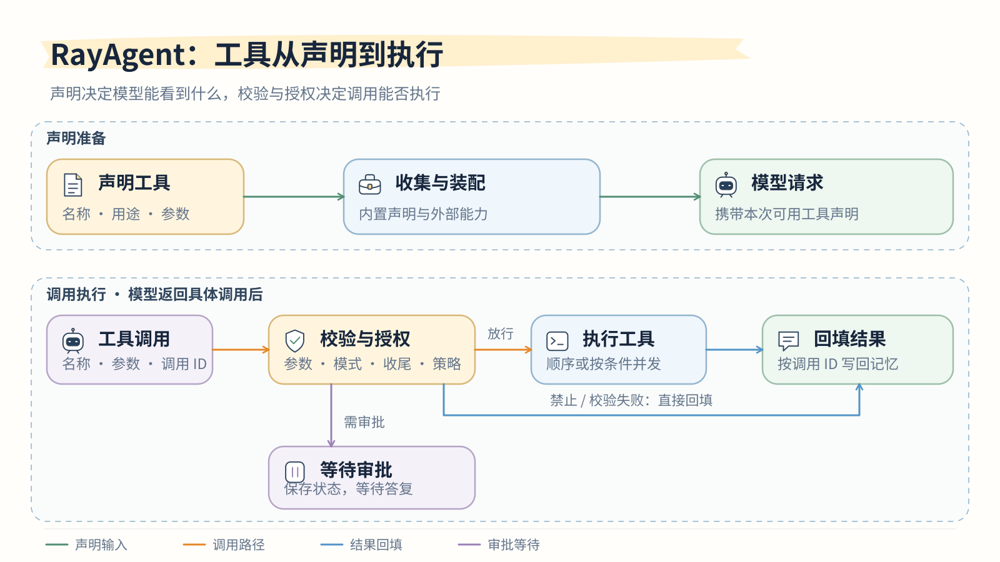
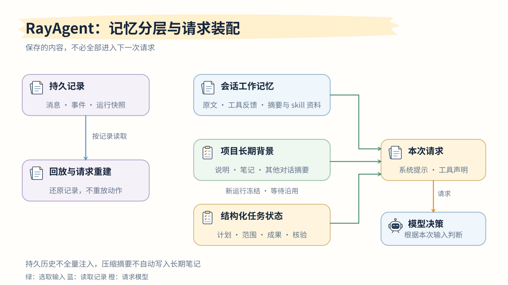
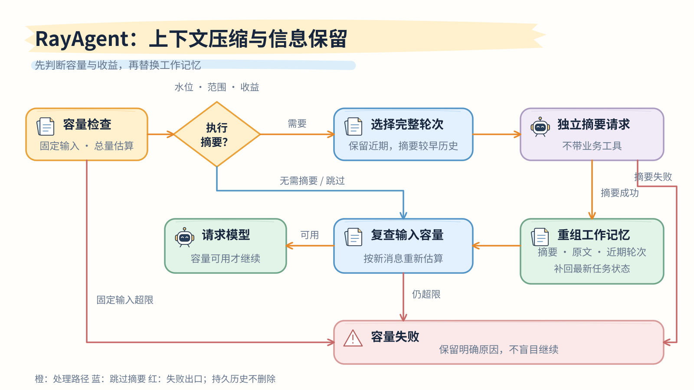

# RayAgent 的 Harness 工程

Harness 负责将模型的一次判断组织成持续执行的任务：准备上下文、执行工具、回填结果、处理等待与停止，并保存可核对的过程。RayAgent 用自研单循环承接这些职责，计划由同一模型通过工具维护。

本文解释机制及其保证范围。组件、状态迁移和资源所有权见[架构说明](architecture.md)，实现与检查入口见[代码地图](code-map.md)。

## 三类职责

- **模型判断下一步**：生成建议、参数和完成声明，正确性需要实际结果支撑。
- **工具管线与适配执行动作**：解析、校验、授权并调用环境，返回可核对的结果。
- **运行器与循环维持过程**：衔接输入与反馈，处理等待和结束，保存执行记录。

模型声明文件已写入、工具实际写入成功、文件满足用户要求，是不同层次的结论。Harness 保存它们之间的依据与边界，不将运行成功自动解释为业务通过。

## 职责分层

- **会话与任务编排**：受理输入、准备资源并控制一次运行。
- **计划清单**：保留整体目标、当前范围与剩余工作。
- **决策层**：组织上下文、模型响应和工具反馈。
- **工具契约层**：约束动作在什么条件下可以执行。
- **执行适配层**：将动作连接到实际环境或远程服务。

观测、控制和持久化贯穿各层。具体组件连接见[系统边界](architecture.md#系统边界)。

### 会话与任务编排

会话保存连续历史，一次运行组织持续执行，用户任务可以跨运行推进。完整对象关系见[核心对象与身份](architecture.md#核心对象与身份)。编排层负责：

- **受理与路由**：空闲或终态会话创建新运行，运行中补充与等待回复沿用原运行。
- **资源准备**：独立对话按需准备沙箱、同步附件及连接浏览器；项目先处理占用、旧写入者和文件保护。
- **固定执行条件**：保存模型、协议、提示、参数与工具集合，等待续接沿原快照。
- **输入衔接**：运行中补充先进入输入流，在当前工具批次结束后的模型请求前纳入，不打断正在执行的长命令。

受理、等待和停止的事务及收尾顺序统一见[控制平面](architecture.md#结束路径与控制平面)。

### 任务理解与复杂度判断

请求先经过应用受理，再进入模型判断。两者处理的是不同问题：应用根据会话与运行状态决定新建、注入还是续接，模型根据用户要求决定直接回答、使用工具或维护计划。当前没有独立的意图分类服务，也没有程序计算的任务复杂度分数。

提示要求简单问答和单次明确操作通常直接处理；需要跨阶段推进的工作先登记目标、关键判断和执行路径。这是模型遵循的行为要求，不能从“计划工具存在”推导出系统一定能正确识别所有复杂任务。

计划应承接用户目标，而不是把所有动作都变成步骤。阶段表达要完成的主要部分，子步骤表达当前阶段的关键工作；工具调用则是实现这些工作的具体动作。同一步骤可以需要多次调用，一次调用也可能推进多个成果，二者没有固定的一一对应关系。

### 计划清单

计划将目标和进度变成可恢复的结构化记录。**下一动作仍由模型决定，程序不按计划阶段调度工具。**

| 记录 | 保存目的 | 程序约束 |
|---|---|---|
| 目标与本次范围 | 保留用户要求及本轮安排 | 来源引用真实用户消息，变化需要理由 |
| 阶段与子步骤 | 稳定整体分母，逐步展开当前工作 | 最多两层、身份稳定，未完成子项阻止父阶段完成 |
| 预期成果 | 区分正文、文件及必要性 | 必要成果不能通过省略清单消失，实际版本由工具回填 |
| 核验与变更 | 保留检查、修复和重开依据 | 关联实际调用、成果版本和条件 |

**结构与更新。** 完整更新原子校验，非法更新保留原清单；状态更新可保留标题与描述，省略成果列表保留原记录。同一时刻最多一个进行中阶段和一个进行中子步骤。已有阶段不直接删除；取消、推迟已有工作需要用户来源，资源不足保留受阻。

**规划语义。** 以下由提示与工具说明要求模型遵循，结构合法不证明其语义充分：

- 主要工作前登记具体问题、关键判断与执行路径，可以与首批业务动作同轮。
- 阶段围绕目标与成果组织，推导、方案选择和内容设计也是工作，不能只列工具操作。
- 使用动作与对象组成短标题；大纲、规格和核验条件放在目标、范围或正文。
- 首次列整体阶段与首阶段关键步骤，其余进入时展开；简单任务不强制使用计划。
- 产物中的讲解、建议或模拟，不记作 Agent 已实际执行。

**承接与反馈。** 用户确认的具体版本绑定新运行，首批动作核对承接；范围变化、任务延续与结束缺口按需核对，不按固定工具批次反复声明。必要声明使用有限纠正。阶段尚未展开或没有当前子步骤时提供有限的非阻断提醒，记录可恢复。

无关新问题可以直接回答或新建计划，原任务缺口保留但不阻塞新任务。程序能验证引用和结构，不能证明自然语言授权、阶段覆盖程度或业务完成。

### 从步骤执行到计划调整

同一模型既制定计划，也在读到执行反馈后决定下一步。程序校验清单结构、来源和状态，记录实际成果，但没有独立的步骤调度器或自动重新规划状态机。这里的子步骤是同一任务的记录，不是自动启动的子 Agent。

一次阶段推进包含以下关系：

1. **明确预期**：记录目标、范围及必要成果，模型选择当前阶段与子步骤。
2. **执行动作**：请求具体工具，管线处理参数、权限与运行模式，再将真实结果交回模型。
3. **核对证据**：区分调用是否成功、成果是否产生、必要核验是否通过。程序可登记文件版本及显式断言，但不自动判断业务条件是否充分。
4. **决定后续**：依据反馈继续当前工作、更新步骤、定向修复、换方法或标记受阻；已有完成项重开保留原身份和原因。
5. **收敛交付**：结束前核对必要成果与未完成范围，完整交付与运行正常结束分别记录。

因此，工具成功不能直接将阶段标为完成，工具失败也不必立刻重建整份计划。提示要求先读错误、修正参数或换方法；范围改变或原路径不再适用时再更新计划。何时需要这种调整仍由模型判断，程序不会仅凭超时或某个退出码自动选择新的业务方案。

改变动作方法和缩减用户目标也不同。正常修复可继续推进；取消或推迟已有工作需要用户来源，预算或环境不足保留为受阻。必要核验与证据复用见[核验与成果交付](#核验与成果交付)。

### 决策层

*工具结果回到下一轮上下文；等待保存状态后退出当前协程，答复处理后重建运行器，恢复原上下文与待处理调用，沿同一管线续接。底部列出独立的终止条件。具体状态与重启边界见[控制平面](architecture.md#结束路径与控制平面)。*

**循环推进。** 每轮输入由系统提示、用户消息、助手回复、工具结果及工具声明组织；项目背景按运行快照拼接。模型工作上下文、持久历史和页面展示各有用途，不要求内容相同。

1. 纳入补充消息与最新任务状态，检查请求容量。
2. 请求模型并等待完整响应；文本增量只用于即时展示。
3. 保存全部工具调用，经管线执行并按调用 ID 配对结果。整批白名单独立读取可有界并发，其他批次按顺序执行。
4. 有调用则继续反馈循环；无调用则根据任务状态做有限结束反馈，随后保存答复及成果状态。

**请求失败。** 模型请求与工具执行采用不同恢复策略：

| 情况 | 处理 | 目的 |
|---|---|---|
| 可重试传输错误、暂时流中断或空回复 | 有界重试，每次尝试计入请求预算 | 恢复暂时失败，避免无限请求 |
| 鉴权、参数、额度或未知错误 | 按错误分类结束，不盲目原样重发 | 保留真实失败原因 |
| 输出因长度截断 | 丢弃半截回复与调用，提示缩短后有限重试；再次截断失败 | 不执行不完整参数 |
| 工具返回失败或执行异常 | 作为该调用结果交回模型，不自动重放动作 | 允许改方法，保留可能已有的副作用 |

**请求预算与收尾。** 预算限制请求次数，不是费用硬上限，也不是跨运行总预算：

- 从最近真实用户消息计数，普通请求、重试和历史压缩摘要请求都计入；补充与提问回复重置计数，审批续接沿用。
- 上限满足分阶段条件时，先提醒，再进入受限收尾；提醒追加到工作记忆，不改稳定系统前缀。
- 收尾允许读取、交付、更新计划和为预登记文本成果受限补写；已有文件保留原字节，另存系统预留版本。
- 补写有成功与尝试限制，未知结果先读回；不能借此新增任意成果、继续开发或生成二进制。计划模式及工具策略仍优先。
- 用尽后以请求上限失败，不额外赠送请求。用户后续输入可在已有上下文中开始新的预算段。

请求容量由[上下文与记忆治理](#上下文与记忆治理)统一处理。它决定每轮模型能够看到什么，不改变计划与工具执行的职责边界。

### 工具契约层

工具声明只让模型知道可请求什么，真正执行还要经过校验与授权。

一次动作从声明到执行经过以下边界：

1. **声明**将可用能力交给模型，未声明能力无法被正常选择。
2. **解析**将参数还原为结构，失败时不进入执行。
3. **校验**检查工具存在性、必填字段、顶层类型及枚举，契约不匹配时短路。
4. **授权**检查运行模式与工具策略，决定放行、禁止或等待审批。
5. **执行**将动作交给适配并取得结果。执行报错可能发生在动作之前或之后，不能一概视为没有副作用。

管线分执行前、执行、执行后：前段短路也产生结果，审批挂起则保存待处理调用；执行段调用一次，异常转为结果；后段记录耗时、整形并补充实际事实。结果进入记忆后再发布完成事件。

#### 工具如何声明、装配与分发

*上区展示声明如何进入模型请求，下区展示模型返回的具体调用如何执行；禁止与校验失败直接回填，审批保存等待。参数校验范围、模式与策略的检查顺序、读取并发条件见下文。审批答复按原调用续接，重启失效及同批后续调用的处理见[等待与续接](architecture.md#等待与续接)。*

内置工具按工具集组织。声明装饰器为方法附加函数名、用途和参数 schema，工具集通过反射收集带声明的方法并缓存定义；普通方法不会因此成为模型可调用的工具。声明描述调用接口，实现方法负责访问具体适配。

运行器将默认工具集交给循环，项目笔记按项目条件加入，循环再装配计划、成果补写与交付能力。管线汇总各工具集的声明，按需附加核验参数，供模型适配编码进请求。因此新增一个实现方法或工具类还不够，能力必须进入本次运行的工具集合，模型才能正常选择。

模型返回函数名后，管线查找声明该函数的工具集，再由工具集分发到对应方法。内置函数名需要避免冲突，当前查找采用首个匹配项，没有为重名内置工具自动建立命名空间。调用身份用于结果配对，函数名用于分发，两者职责不同。

外部能力沿同一管线接入，但声明来源不同：MCP 从指定服务发现工具后加入下一次请求，通过别名映射回原服务与函数；A2A 提供卡片发现和统一委派入口，不把卡片中的每项技能注册为本地函数。发现能力不等于批准执行，实际调用仍经过模式与策略检查。

#### 参数由谁校验

工具 schema 既帮助模型生成参数，也提供执行前检查依据；模型上游接受声明不代表参数必然合法。各层责任如下：

| 层次 | 当前检查或处理 | 保证边界 |
|---|---|---|
| 参数解析 | 将参数还原为 JSON 对象 | 拒绝无法解析或不是对象的输入 |
| 通用管线 | 必填字段是否存在、顶层基本类型与枚举 | 不递归校验嵌套结构，不执行完整 JSON Schema 校验 |
| 内置方法分发 | 按方法签名过滤参数；接收可变关键字参数的方法只额外接收 schema 声明字段 | 参数过滤不证明内容有效，也不构成授权 |
| 具体工具与执行端 | 检查嵌套内容、取值范围、引用状态及业务条件 | 以各工具实际检查为准，不能假设所有约束都已覆盖 |

通用层不因额外字段直接拒绝调用，也不检查数值范围、字符串模式或组合 schema。MCP 业务参数交给协议适配传递，不经过内置方法的参数过滤，远端仍需验证输入及自身权限；当前没有通用的外部 schema 兼容转换层。

解析或通用校验失败会短路并回填该调用的失败结果，不进入实际动作。具体工具执行中的检查或异常则可能发生在动作之前或之后，仍需保留副作用与结果未知的区别。成果核验参数由专门处理器检查，规则见[核验与成果交付](#核验与成果交付)。

#### 运行模式、工具策略与读取并发

系统没有用一个统一的“只读”标记同时决定授权与调度，三个判断各有职责：

| 判断 | 要回答的问题 | 当前处理 |
|---|---|---|
| 运行模式 | 本次运行是否允许这类动作 | 计划模式按函数名与工具集配对的允许清单放行，其余拒绝 |
| 工具策略 | 这个具体调用直接执行、询问还是禁止 | 按函数、工具集与服务身份匹配规则 |
| 读取并发 | 本批调用能否同时执行 | 整批满足独立读取允许清单、参数检查与策略放行时才启用 |

计划模式检查先于预算收尾和工具策略，被模式拒绝的调用不会进入审批；策略批准也不能绕过模式或收尾限制。允许清单包括读取与调研能力，以及计划、提问和能力发现等控制操作，并非要求这些操作完全不改变任何内部状态。Shell 不按命令文字判断是否只读，计划模式全部拒绝；新增工具默认不在允许清单内，MCP 工具也不因自称只读而自动放行。

**工具策略。**

- 策略按函数、工具集、MCP 服务或远程 Agent 匹配，具体规则优先；未命中时直接执行，计划与提问豁免。
- `allow` 执行；`deny` 回填禁止结果；`ask` 保存审批并退出当前执行，等待答复。
- 批准只放行具体调用，拒绝保留用户拒绝事实；批准后当前禁止策略仍可阻止执行。
- 策略区分工具与服务身份，不按任意参数内容、文件路径或网络地址建立访问围栏。

读取并发的允许集合更窄，限于文件读取、文件内容搜索、文件查找与公开网页读取；浏览器观察和网页搜索即使允许在计划模式使用，也不因此进入并发分支。整批不满足条件时保持顺序执行，需要审批的调用不进入读取并发。并发只覆盖执行段，校验、后处理与结果提交仍按序组织，具体并发上限见[运行参数与限额](limits.md#请求预算压缩与结果)。

工具用途、模式允许、策略放行与可并发执行不能相互推导。审批续接、停止与失效的完整状态规则见[等待与续接](architecture.md#等待与续接)。

### 超时、重试与结果未知

超时需要结合所在层判断，不能统一解释为“失败后再执行一次”：

- **模型请求失败**：传输类错误、暂时中断和空回复可有限重试；鉴权、参数等错误不盲目重发。模型响应完整前不执行其中的工具，输出截断也不采用半截调用。
- **Shell 尚未结束**：初次执行可先返回运行中，之后按原会话等待或读输出。等待超时可返回当前输出并说明仍在运行，不能因此重新启动同一命令。
- **工具或远程通信超时**：响应没收到不能证明动作没发生。管线将异常转为调用结果，不自动重放副作用；后续应由模型依据可用的状态查询或读回结果判断。
- **动作成功而观察失败**：浏览器已提交或输入后只补观察，不重放原动作；依赖该观察的后续写调用停止推进。

这些反馈先解决“发生了什么”，再支持“接下来怎么做”。如果执行结果仍未知，就保留未知事实，不能用重复执行制造确定性。各适配层的超时与模型重试参数见[运行参数与限额](limits.md)。

### 执行适配层

适配层将同一工具契约连接到不同执行环境，并将结果归一后交回循环。

- **沙箱与浏览器适配**：通过 HTTP 和 CDP 访问文件、Shell、公开网页与 Chromium，分别报告动作、观察及环境状态。
- **MCP 适配**：发现并调用外部工具，负责别名路由、参数传递和结果消费。
- **A2A 适配**：读取能力卡片、委派消息并跟踪远程 Task；远程完成、取得产物与本地任务完成分别判断。
- **模型适配**：依据能力目录选择请求规则与通信编码；配置声明、编码正确与真实上游支持分别核对。

跨进程适配需要处理同名路由、独立超时和超长结果。MCP 使用带哈希别名，外部结果在裁剪前保留完整内容交给统一整形。连接、发现及调用分别受限。

当前 MCP 不提供完整 OAuth 或工具列表订阅；A2A 的额外输入与授权等待不能接入本地续接，远程产物不自动成为本地附件。

模型目录定义思考、工具、视觉及预算规则，内部映射选择端点，环境提供地址与密钥。代理域名不决定能力；新增兼容地址也不证明参数、工具和视觉已可用。

### 模型选择与请求分工

主任务采用用户在会话中选择的模型与思考档位，未指定时按会话已有选择或应用默认处理。系统不根据业务类型、任务复杂度或工具失败自动切换模型；模型目录提供的是能力与编码规则，不是业务质量排名。

模型选择、对话参数与运行快照分别在不同时间生效：

| 对象 | 固定或更新时机 | 对后续请求的影响 |
|---|---|---|
| 应用默认与逐模型参数 | 设置更新时保存 | 提供新对话或切换模型时的配置来源 |
| 会话模型与思考选择 | 首次确定或用户主动切换 | 用于下一次新运行，不替换活动运行的模型 |
| 会话采样参数 | 首次运行记下窗口、输出上限与温度；切换模型时读取目标当前配置 | 同模型后续运行沿用，设置修改不追溯覆盖 |
| 运行快照 | 运行装配时保存模型、思考、协议、参数及实际提示等 | 执行与等待续接沿原快照，避免途中改变决策条件 |

切换模型后的新运行重新估算容量，不沿用其他模型的输入用量校准。运行快照不保存凭据，续接仍依赖当前部署提供可用端点与密钥。参数计算和限额见[运行参数与限额](limits.md#模型与上下文)，选择交互见 [UI 设计说明](../ray_agent/ui/DESIGN.md#草稿弹层与视图连续性)。

并非所有模型请求都用于主循环决策：

| 请求用途 | 模型与配置来源 | 与主任务的关系 |
|---|---|---|
| 主循环决策 | 本次运行装配并冻结的主模型 | 产生答复与业务工具调用 |
| 自动历史压缩 | 与主循环共用本运行模型客户端 | 独立请求摘要，不带业务工具，计入主运行请求预算 |
| 手动历史压缩 | 当前会话选择与保存的采样参数 | 仅在无活动运行时执行，不创建产品运行 |
| 会话标题、项目对话摘要 | 从应用默认模型配置派生辅助请求 | 独立于会话的主模型选择，失败不改变主运行结果 |

辅助请求按默认模型所属系列处理：DeepSeek 选择目录中的辅助模型，其他目录模型沿默认模型并优先关闭思考，没有关闭档时使用首个档位；自定义模型沿全局配置。辅助请求另有输出和期限约束，具体值维护在[辅助请求参数](limits.md#辅助请求)。历史压缩不走这条辅助模型选择路径。

当前提供人工选择、能力约束与配置隔离，没有按业务自动路由、失败后自动升级或跨模型自动回退。目录声明、请求编码和真实上游支持仍需分别验证。

## skill 资料与运行绑定

skill 沿现有工具管线和单循环使用，不增加独立意图模型。目录在消息受理时冻结，正文按需激活；用户显式选择在业务决策前处理，仍受加载策略和审批约束。活动正文使用内部类型资料块，压缩原样保留，区别于用户原文；新运行只保留旧资料的历史引用，等待续接恢复固定版本。资源读取不提前准备沙箱，完整包材料准备与脚本执行分别受模式和工具策略约束。安装、引用、上下文及内置发现流程的详细规则统一见[skill 机制](skills.md)。

## 上下文与记忆治理

上下文是一次请求实际交给模型的信息，Memory 是持续更新的工作消息，持久历史则保存发生过什么。它们既不要求内容相同，也不具有相同的保留策略。治理的目标是在有限输入内保留决策所需依据，而不是让模型每轮重读全部历史。

### 记忆分层与请求装配

*图中长期背景限于托管项目。持久历史不逐轮全量注入，压缩摘要也不会自动晋升为项目笔记。*

- **会话工作记忆**组织用户消息、助手回复、工具结果及压缩摘要，服务于连续决策。它会持久化，但仍会被压缩；“短期”描述用途，不表示只在进程内存在。
- **项目长期背景**由说明、版本化笔记和其他对话摘要组成，在新运行开始时选择并冻结，等待续接沿原版本。它按请求拼接，不反复追加进基础工作记忆。
- **结构化任务状态**保存计划、来源、范围、成果版本和核验记录。循环从有效记录生成精简任务状态，变化或压缩后补回，不只依靠摘要记住目标与身份。
- **持久历史与文件**保存过程依据和实际字节，支持回放、请求重建及按需读取。保存完整记录不意味着每次请求包含全部内容，也不意味着可以恢复任意执行位置。

一次请求将系统提示与运行模式、冻结项目背景、当前工作消息和工具声明组合起来，图片按能力与预算装配。模型适配负责协议编码；页面展示从事件投影，不能拿页面摘要当作完整模型输入。

### 什么进入长期背景

项目说明由用户设置，表达稳定要求。笔记由用户或 Agent 显式更新，提示要求在得出可复用结论、决策、待办或重要文件位置时整理，保留仍有效的旧结论，更新已完成事项，推断注明不确定，不保存凭据。

这条路径有明确限制：

- 笔记不是逐轮日志，不重复文件中可直接读取的大段内容；写入失败不能声称已记住。
- 程序校验版本与内容范围，冲突返回最新全文，由调用方合并。哪些结论值得长期保留、如何语义去重仍由用户或模型判断。
- 项目对话正常完成后可异步生成摘要，从原目标、近期用户更新、完成回复与运行状态中选取材料，不读取全部工具日志；手动维护的摘要不会被自动生成覆盖。
- 摘要的辅助耗时与用量独立记录，不占主运行的模型请求计数。摘要保存来源、材料截止位置与代次，新运行按近期对话和总量预算选取，排除当前会话。失败保留旧摘要，迟到响应不能覆盖较新的编辑。

因此长期材料增长通过有界内容、有限选择与显式维护控制。当前没有通用知识准入评分、语义检索或自动遗忘机制；旧材料未进入本次请求也不等于已删除。笔记写入结果可成为当前运行的新工具事实，但不会改写已经冻结的项目背景。

### 先控制输入，再压缩历史

工作记忆增长有不同来源，单靠摘要无法解决全部问题：

1. **单条结果过大**：工具结果在进入记忆前整形，完整文本写入沙箱，模型收到有界预览与读取路径，后续按需分段读回。落盘失败明确说明未展示内容不可再读。
2. **图像占用增加**：容量治理可让较早、已经得到模型响应的图片退出像素输入，保留文字引用；尚待观察的新图不能被静默挤掉。
3. **多轮累计增长**：每轮请求前估算容量，必要时压缩较早历史。历史即使每条都很短，也可能累计超过窗口。
4. **固定背景过大**：系统提示、项目背景等固定部分已经超限时直接拒绝，继续摘要对话不能消除这一问题。

完整工具输出能否读回还依赖文件及沙箱寿命。整形不能恢复源头已丢失的内容，退出像素输入也不能代替对图片内容的文字记录。

### 容量估算与压缩触发

可用输入由模型窗口扣除输出预留和安全余量得到，压缩水位在可用输入之内。每次请求前分别估算系统提示、工具声明、历史和工具结果，图片也计入容量。

有同模型的实际输入用量时，用它校准已知部分，只对新增内容近似估算；模型切换或工作记忆替换后重新估算，不继承失效计数。这个估算用于决定压缩或拒绝，不用于计费。

自动治理有两种入口：

- **预估越过水位**：先退出可退的旧图，检查固定输入，再判断是否存在值得摘要的较早轮次。可压缩内容扣除原文重注入成本后收益不足时，跳过摘要；只要未超可用上限仍可继续。
- **上游实际拒绝超长输入**：触发强制压缩，不沿用普通水位的最小收益门槛；没有可压缩历史或处理后再次被拒绝时明确失败，不循环原样重发。

水位是提前治理的条件，不是超限保证。工具声明、项目背景、估算误差和新的结果都可能改变输入大小，最终仍需复查可用上限。相关阈值统一见[运行参数与限额](limits.md#请求预算压缩与结果)。

### 怎样选择压缩范围

*主线概括自动压缩与容量复查，虚线区域分别说明保留信息与失败出口。摘要只处理较早的完整轮次，原文重注入受预算约束；活动 skill 目录与正文原样保留，具体规则见 [skill 机制](skills.md)。旧图退出、收益判断及上游超长拒绝的分支由正文解释。压缩只替换工作记忆，不删除持久历史。*

1. **保留可继续决策的尾部**：以一条助手消息及其全部工具结果为完整轮次，只在轮次边界切分。优先保留配置要求的近期轮次，保留区过大时逐步减少，但最后一轮不摘要。
2. **为摘要留空间**：范围选择同时考虑固定输入、摘要和用户原文的空间，不能让近期保留区占满预算。若根本没有较早完整轮次，则没有可摘要范围。
3. **生成有来源的摘要**：较早历史交给不带业务工具的独立请求，整理目标、明确约束、已做动作、文件、错误和剩余工作，要求区分用户要求、模型建议和实际结果。
4. **重组工作消息**：按“摘要 → 预算内用户原文 → 近期完整轮次”替换旧区段。用户原文从近期向前整条选取，遇到超额即停止，未重新注入的消息仅由摘要覆盖，内部提醒不当成用户原话。
5. **恢复任务事实并复查**：恢复最新计划、范围、成果与核验状态，重置失效的容量校准后重新估算。下一次请求仍受输入上限与请求预算约束。

摘要请求自身也受容量限制：单条材料可能被裁剪，总量仍过大时省略较早条目。压缩保留的是继续执行所需的工作表示，不是原对话的无损副本。

### 信息保护与失败边界

当前机制通过不同方式降低信息丢失风险，不能据此承诺所有重要信息始终可见：

- **近期反馈原样保留**，避免把刚产生、仍待处理的工具结果先摘要。
- **用户原文独立重注入**，与摘要冲突时以原文为准；但它有总量预算，并非全部历史要求永久逐字驻留。
- **任务状态从记录恢复**，减少稳定身份、未完成范围和成果版本仅由自然语言摘要承载的风险；未登记信息仍可能遗漏。
- **持久事件不改写**，可供回看和重建。原记录仍在，不等于模型能自动找回被摘要遗漏的事实；当前没有自动语义检索补回链路。

摘要请求失败或空结果不会以半份摘要替换历史。自动压缩后若仍超可用上限，运行以容量原因结束；摘要已经生成也可能没有减少估算，不能只凭“已压缩”声称容量足够。摘要质量、来源材料裁剪和反复摘要仍可能造成语义损失，程序没有通用的保真证明。

### 手动压缩

手动压缩共用范围选择与重组机制，不要求先越过水位，也不使用普通水位的最小收益门槛。成功时记忆与压缩事件一并提交，保留原会话历史，不新建产品运行；没有可摘要轮次则说明跳过。

操作有忙碌协调和总期限，失败不发布半份替换。超时或断连后先读回状态，不能直接再压缩一次。它仍然是有损的工作上下文整理，不是知识自动入库或任务执行恢复。

## 核验与成果交付

### 证据与成果身份

| 事实 | 依据 | 不能推导什么 |
|---|---|---|
| 文件已生成或改版 | 实际路径与字节哈希 | 内容正确、可下载 |
| 已交付 | 附件上传及关联结果 | 其他必要成果也已完成 |
| 已保存项目副本 | 独立副本结果 | 附件与副本构成原子事务 |
| 某项核验通过 | 实际结果中的显式 `passed` 布尔断言 | 条件充分覆盖全部业务要求 |

成果登记稳定身份、正文或文件形式、必要性和来源；实际版本、附件及副本由业务工具回填。相同路径与字节复用附件，改版保留旧关联；附件成功而副本失败时只补副本。

### 核验复用与结束判断

- 核验随业务调用登记成果、身份与条件。命令退出成功、执行中输出、截图和模型口头声明不自动形成通过记录。
- 同版同条件通过可复用，改版失效；当前未通过且失败次数达到限制时，需要新条件或更换方法，实际修复改版的必要复验保留。
- 成功调用未返回通过断言时只记为已执行；明确执行失败或断言为假可形成失败记录。有成果但持续缺少核验记录时提供有限非阻断提醒，不为登记另开调用。
- 结束前从计划、范围、成果与核验构造精简状态，有限纠正缺口，不绕过请求预算。当前版本明确失败的核验会影响完整声明。

`completed` 只表示循环正常结束，成果仍可为部分交付。正文成果保留完整答案，文件答复说明同一任务累计版本及实际缺口，简单问答直接回答。

程序没有通用业务验收器：核验条件的充分性、未登记遗漏、外部条件变化与语义重复，仍需模型判断和独立检查。核验及补写次数见[运行参数与限额](limits.md)。

## 托管项目的文件与记忆

项目将长期文件与运行环境分开：平台保存副本，沙箱按需访问，终态先确认旧写入者静止再释放占用，恢复只改变文件。删除通过固定清单、资源回收和失败重试协调。

项目记忆的写入、冻结与增长统一见[上下文与记忆治理](#上下文与记忆治理)；文件及记忆的存储和事务边界见[架构说明](architecture.md#托管项目执行与文件保护)。

## 两条贯穿轴

### 观测与控制

观测沿输入、记录和投影逐步收敛，页面摘要不能代替完整执行依据：

- 模型输入与工具结果解释下一步决策的依据。
- 持久事件与运行快照支持过程回放、身份关联和已记录请求重建。
- 接口投影与页面状态展示有界过程，省略不适合直接展示的原始内容。
- 临时文本增量用于生成中的即时反馈，不承担历史保存。

请求重建还原适配前输入，不重新执行动作。事件提交、通知补查和临时增量规则见[事件与投影](architecture.md#事件与投影)。

控制需要显式传播：取消协程不自动终止进程，终止进程不回滚文件，回收环境不等于回收附件。资源所有者及停止顺序见[控制平面](architecture.md#结束路径与控制平面)。

### 状态与持久化

- **进程内状态**：协程、注册表和局部变量随进程消失，持久运行记录不代表它们仍在执行。
- **持久记录**：提供读取、审计和有限续接；任意中断点恢复还需要检查点、副作用对账及跨进程所有权。
- **外部资源**：文件、容器和远程任务具有独立寿命，数据库事务不能回滚它们。

当前提供提问续接、受理去重及项目文件协调，不提供通用执行恢复。API 重启中断遗留执行与审批，提问等待保持。完整寿命和数据归属见[状态与持久化](architecture.md#状态与持久化)。

## 关键机制

维护与扩展时，至少保留以下不变量：

- 下一次模型请求前调用结果配对完整，未执行与未知效果分别表达。
- 等待从持久状态重建，不依赖原调用栈。
- 业务状态与事件提交成功后再通知，补查以已提交记录为准。
- 工具副作用与数据库提交分别确认，失败后不盲目重放或宣称回滚。
- 运行正常结束与成果正确分别判断，终态不能掩盖交付缺口。
