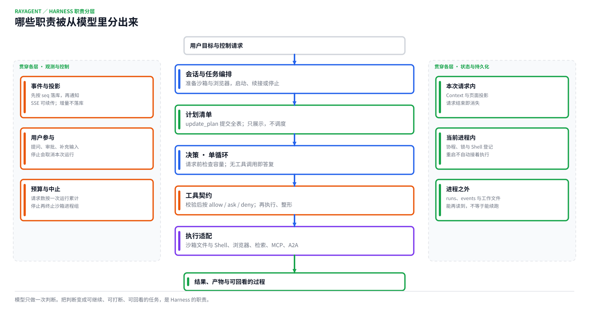

# RayAgent 的 Harness 工程

模型的一次响应可以给出文本和一个或多个工具调用请求，但动作要由程序执行。前次结果、失败反馈和下一次决策所需的上下文，也需要运行系统持续组织。把这一次判断变成一项能持续推进、能被打断、能交付成果的任务，是模型之外的工程职责——本文把这部分职责称为 **Harness**，并说明 RayAgent 把它拆成了哪几层、每层解决什么问题、为此付出什么代价。

本文维护职责分层与设计取舍，是理解这个项目的主入口。

## 三类职责

一次工具调用要真的发生，至少有三方参与，它们的失败方式完全不同：

| 角色 | 负责 | 典型失败 |
|---|---|---|
| 模型 | 判断该做什么、用什么参数 | 选错工具、参数不合法、口头声称已完成 |
| 程序 | 找到工具、校验、授权、真正执行 | 工具不存在、参数解析失败、环境不可达 |
| 流程 | 决定继续、等待还是结束，并保存过程 | 死循环、丢状态、结束了却没有成果 |

把三者混为一谈，就会出现两类典型误判：模型说"文件已写入"被当作文件真的存在；页面显示任务结束被当作目标已经达成。Harness 的价值首先在于把这三件事分开，让每一件都能被单独观察和验证。

## 职责分层

*职责分成五层。计划由 `update_plan` 记录范围与进度，不调度执行；程序校验结构、引用和可观察成果。决策层在每次请求前检查容量，无工具调用时经过有限结束反馈，再给出最终答复。工具契约在校验之后按 allow、ask 或 deny 处理，再执行一次并整形超长结果。观测控制与状态持久化贯穿各层。*

### 会话与任务编排

接收用户目标与控制请求，准备执行资源，启动、续接或停止一次运行。

这一层决定了"一次任务"的边界。RayAgent 以**会话**为单位组织目标、历史、文件和记忆，以**任务**为单位组织本轮执行；两者关联但不是同一个对象，会话存在不代表有任务在跑。独立对话按首次使用准备沙箱，纯回答无需启动容器；附件在进入模型前同步，浏览器 CDP 在首次使用时连接。项目运行保留占用、旧写入者收尾与文件保护等准备顺序。MCP 所选服务与 A2A 卡片按需发现，发现集合随运行保存，等待续接时恢复。

用户在运行中补充的消息写入输入流，循环在**每次请求模型之前**把它们作为用户消息追加，而不是打断当前工具或另起流程。所以一个正在执行的长命令不会因为新消息中止，补充要求在当前这批工具调用结束后的下一次模型请求里生效。

### 计划清单

把"还剩什么工作"写成程序可读、可展示的清单，而不是只存在于模型的上下文里。

RayAgent 没有独立规划器或外层步骤调度：计划由模型在同一循环调用 `update_plan` 维护。计划模式在同一循环中分析，通过提示和动作允许清单控制副作用。整体阶段和所属步骤分两层，身份稳定，清单按顶层项计数；生命周期与本轮/后续安排分开。目标、范围和必要成果关联真实用户消息，结构或范围变化说明原因；取消和将已有工作推迟需新的用户来源，预算不足保留受阻。完成声明不等于实际验收。

用户确认的清单由受理事务绑定新运行，首次动作仍核对承接。范围补充、任务延续与结束缺口有相应核对，正常执行不按工具批次定时要求声明；必要声明最多纠正一次，随后保留执行及其事件事实。简单直接回答不调用计划工具。分阶段清单的当前阶段尚未展开，或已有未完成子步骤但无当前步骤时，每份计划的每阶段提供一次非阻断提醒；记录从持久上下文恢复，正常推进不增加定时核对。简短标题与一句描述用于清单展示，条目用动作与具体对象或结果组成短标题，完整目标、范围与成果记录用于执行和恢复。

规划指令要求需要计划的任务在主要工作前登记具体问题、关键判断与执行路径，可以与首批业务动作同轮。推导、方案选择与内容设计和制作、核验、交付按目标组织，不套固定阶段或只列工具操作；产物讲解、建议或模拟的步骤不算现实完成。大纲、规格与核验条件留在目标、范围或正文，子步骤按阶段成果合并相关动作，不重复父阶段或逐项铺开细节。普通与计划模式均先列全部阶段和首阶段关键步骤，其余进入时展开；初版生成在所需执行路径登记之后推进。这些要求由模型遵循，程序不判定首次任务的语义复杂度，也不证明清单已充分覆盖内容决策。

| 记录 | 作用 | 程序能校验什么 |
|---|---|---|
| 整体目标与本次范围 | 保留用户所需，区分本次工作和明确安排的后续 | 来源是本会话真实用户消息，范围变更有说明；不能证明自然语言授权含义 |
| 整体阶段与子步骤 | 保持整体分母，允许细化当前工作 | 两层归属、稳定身份、最多一个进行中阶段和一个进行中子步骤；阶段不能在还有未完成子项时完成 |
| 预期成果 | 区分回复正文、文件、必要性和来源 | 完整成果清单，必要成果不能省略；版本和交付由实际工具结果回填 |
| 核验与变更 | 记录为何重开、修复或调整 | 引用、实际调用与文件版本；不判断业务断言是否充分 |

完整更新原子校验，失败不替换清单；状态更新可保留原标题和描述，省略成果列表保留原记录。已有阶段不直接删除，用户取消仍保留身份与原因。无关任务可以新建计划或直接回答，原任务的缺口不会自动消失，也不阻塞无关新问题。

清单**记录、不调度**：程序不按阶段选择下一动作，但维护结构、范围引用和成果事实，供恢复与结束检查使用。阶段完成仍是模型声明；换来的是没有额外规划模型和两份执行上下文之间的交接。简单任务平铺，有必要才分组，界面只呈现一个顶层进度。

### 决策层

装配 Context 请求模型，解析响应，决定继续调用工具还是给出最终答复。

这是 Agent 循环所在的位置，也是"上下文里到底有什么"被真正决定的地方。每次请求的输入不是一段字符串，而是按角色组装的消息序列：系统提示、会话中的用户消息、助手回复与工具结果、工具声明。模型看见的内容和页面展示的内容、以及数据库保存的内容，是三份不同的东西。

模型一次回复可以包含多个工具调用，循环全部保存；允许的白名单独立读取有界并发，其余按顺序执行，结果均按调用 ID 配对回填。回复不含 `tool_calls` 时，普通模式先检查登记的必要文件、交付失败、本次任务的未完成阶段及当前版本明确失败的关键核验，最多追加一次纠正反馈；仍有问题则加入最终说明后结束。运行完成与完整交付分别记录；缺失成果时标记部分交付。动态任务状态支持累计总结，正文就是成果时保留完整正文。这是有限检查，业务质量仍需核对实际产物。

模型请求只对传输类错误和空回复重试，每次尝试都计入请求上限；输出因长度被截断时，半截的回复和其中的调用都不采用，提示缩短后重试一次，再次截断即失败。

请求上限不只在用尽时生效。持续精修可能让必要成果直到最后仍不存在，所以模型需要提前知道剩余预算。上限足够大时，先追加一次预算提醒，最后一段进入收尾；执行前只放行读文件、交付、更新计划和受限文本收尾写入，其他调用回填“收尾阶段不执行”。收尾只处理进入该阶段前登记的文本成果：路径不存在时生成，已有文件保留原字节并使用系统预留的新版本路径，每项成功次数和尝试次数有限；结果未知时先读回再交付，不自动重复写入。二进制生成和继续开发需在正常阶段完成，计划模式与策略仍优先。提示追加到记忆而不改变稳定系统前缀。计数从最近用户消息开始，补充消息及提问回复重新计算，审批续接沿用；用尽仍以 `max_iterations` 失败，“继续”在已有上下文中开启新一段预算。阈值见[运行参数与限额](limits.md)。

上下文治理分三道，各管一种失控方式：

- **单条结果整形**：工具结果写入记忆前，序列化后超过单条上限的，把完整内容写进沙箱文件，模型只收到首尾预览、总长度和文件路径。“放不下”与“不可再读”由此分开：模型需要时用 `read_file` 按行分段读回，截断不再意味着信息丢失。写文件失败时才退回纯截断，并在结果里明说完整内容不可再读。上限见[运行参数与限额](limits.md)。
- **请求前容量检查**：每轮请求前，用上一次响应的 `prompt_tokens` 作已知部分、只对之后新增的内容按字符估算，分成系统提示词、工具 schema、对话历史、工具结果四部分。估算是偏保守的近似，目的只是决定何时压缩、何时拒绝，不是计费。
- **自动压缩**：估算越过水位时，把较早的若干轮交给不带工具的摘要请求，保留最近几轮原样，并把用户消息原文重新注入到摘要之后。水位见[运行参数与限额](limits.md)。摘要会丢细节，内部预算和核对消息不充当用户要求，压缩后立即补回最新任务状态；目标和约束因此不只依赖摘要是否写全；压缩的边界只落在完整的“调用 + 全部结果”之后，发给模型的序列里不会出现没有结果的调用。

压缩失败或压缩后仍放不下，运行以 `context_limit` 结束，**不静默丢弃历史**。这是有意的取舍：宁可让任务明确失败，也不让模型在缺了一截上下文的情况下继续做决定。新用户消息开始运行时按当前模型与协议的回传要求处理推理字段；Responses 的同模型推理条目随助手消息保留，不将其他模型的不透明推理转发；原先按浏览器工具名替换正文的定点裁剪已删除，浏览器内容和其他结果走同一套上限。

### 工具契约层

模型提出的动作要通过五个环节才会真的发生，任何一个环节都可能失败，而且失败含义不同：

| 环节 | 问题 | 失败意味着 |
|---|---|---|
| 声明 | 有哪些能力写进了请求 | 模型根本不知道这个工具存在 |
| 解析 | `arguments` 字符串能否还原成结构 | 模型输出不合法，动作没发生 |
| 校验 | 工具是否存在、字段是否合法 | 契约不匹配，动作没发生 |
| 授权 | 这个动作、这个资源是否获准 | 动作被拒绝，不是执行失败 |
| 执行 | 环境是否真的完成了操作 | 动作发生了，结果可能是失败 |

把它们分开的实际收益是：观察一次失败时能立刻区分"模型没说对"和"环境没做成"。RayAgent 把解析、校验和执行放进一条三段管线：执行前段检查工具是否存在、解析参数并按声明做轻量校验（必填字段、顶层类型、枚举），不通过就短路成失败结果；执行段只调用一次，异常也转成失败结果；执行后段记录耗时。三类失败都作为该调用的结果回填模型，由模型改参数或换方法，任务不会因此终止。

授权挂在执行前段、校验之后，查的是应用配置里的工具策略表：规则键从函数名、工具集到 MCP 服务、远程 Agent 逐级放宽，越具体越优先，每条取 allow、ask 或 deny，没有命中的调用直接执行。默认只有 MCP 与远程 Agent 两条 ask，沙箱内的内置工具不列规则；计划与提问不受约束，否则提问本身也要先等批准。deny 短路成“策略禁止”的结果；ask 不执行，本轮收尾，运行进入等待审批，由操作者在界面上批准或拒绝。批准只放行这一次调用，拒绝回填“用户拒绝执行”，两种结果都按该调用的结果回填，模型据此继续，被拒绝与执行失败在事件上分开标记。等待审批时停止或 API 重启，这次审批失效，调用补为未执行，不在重启后续接：批准针对的是重启前的那个执行环境。策略只看是哪个工具，不看参数内容，也不是沙箱里的路径或网络围栏。

工具结果按 `role: tool` 回填到模型上下文，同时作为事件发布给页面。结果先写入记忆，再发布 `called` 事件。两条路径的内容并不相同：运行器从本次调用结果派生界面预览，不为展示再次读取文件或 Shell；页面事件仍省略模型收到的原始结果。浏览器以文本观察为主，显式截图才按用途分析或交付，历史保存图片引用。

### 执行适配层

同一个"读文件"动作，在本机、在沙箱、在远程 Agent 上是三件不同的事。这一层负责把工具动作落到具体环境：文件与 Shell 走沙箱 HTTP 服务，浏览器通过 CDP 连接沙箱内的 Chromium，MCP 与 A2A 通过协议适配连接进程外的工具和远程 Agent。

MCP 与 A2A 都接进同一个工具层，但它们的契约不同：MCP 是"描述工具、传参调用、消费结果"，A2A 是"读能力卡片、委派消息、跟踪远程 Task 与产物"。远程 Task 完成、取得远程产物、本地用户任务完成，是三件需要分别确认的事。

MCP 当前不提供完整 OAuth 或工具列表订阅；A2A 的额外输入与授权等待不能接入本地续接，远程产物也不自动成为本地附件。

跨进程带来一组本地工具没有的问题：不同服务可能提供同名工具（RayAgent 用带哈希的别名路由解决）、结果可能大到撑爆上下文（进入上下文的部分按字符数和列表项数截断，截断前的完整内容交给结果整形落盘）、调用可能挂起（连接、发现、调用各有独立超时）、远程可能要求补充输入（当前不支持续接，直接按失败返回）。

模型适配同样分开能力与连接。目录定义模型的思考、工具、视觉、参数及预算规则，内部映射决定上游端点，环境读取地址和密钥。对话选择模型，正在执行或等待的运行沿自己的配置快照；模型切换后的新运行按目标配置重新估算容量。代理域名不决定模型能力，新增兼容端点也不自动证明其参数、工具和视觉都可用。

## 核验与成果交付

文件存在、上传成功和内容正确是三种证据。成果随计划登记稳定身份、回复或文件形式、必要性及来源，实际文件哈希、附件和项目副本结果由业务工具回填。一个附件或截图不会满足其他已登记成果。相同路径与实际字节复用已有附件，改版保留旧关联；附件成功但项目副本失败时只补副本，不重复执行和上传。

关键核验随业务调用登记成果、条件和身份，实际结果中的显式 `passed` 布尔断言才算通过。命令成功、运行中的输出和模型口头声明都不足以形成通过证据。同版同条件的通过可以复用，改版失效；同一核验记录的失败次数达到上限、当前仍未通过时，再执行需说明新条件或换方法；已有修复说明且实际改版的必要复验有例外。次数见[运行参数与限额](limits.md)。普通执行但未返回通过断言不自动累计失败次数，不把合理验证机械去重。有登记成果但多次调用未登记核验时，循环可追加一次核验记录提醒，不拦截正常业务，不为记录另开核对调用。

结束前使用计划、范围、成果和核验的精简任务状态，最多纠正一次缺口，预算不足不额外赠送请求。运行正常 completed 时仍可记录部分交付；明确失败的当前版本核验也影响成果完整声明。正文就是成果时保留完整答案，文件交付说明同一任务的累计版本及未完成部分，简单问答保持直接回答。

这些事实记录并未建立通用验收器。核验条件是否覆盖用户要求、未登记的遗漏、外部依赖变化与语义重复仍需模型判断和独立检查。

## 托管项目的文件与记忆

项目文件是平台保存的长期副本，沙箱只是某次运行访问它们的环境。运行前保护快照、等待占用、旧写入者收尾、上传和恢复互斥，保证操作有明确所有权；文件保护失败和资源超限采用不同出口，恢复失败保留修复入口。文件恢复只改变文件，不回滚对话与记忆。

项目记忆由说明、版本化笔记和有来源摘要组成。新运行冻结近期其他对话材料，避免重复当前历史；用户或 Agent 修改笔记按版本比较，摘要以代次和截止位置防止旧响应覆盖。执行或等待继续使用原冻结内容，之后的修改在新运行生效。可见来源和编辑让用户能纠正背景，但摘要不保证无损或长期质量，也不是向量检索。

永久删除与业务清空通过固定资源清单、准入锁、共享附件保护和失败重试协调。删除数据库记录之前先处理资源，配置保留；快照、附件、记忆和环境各自有寿命，不能用清单消失推导所有字节已回收。结构和数据归属见 [架构说明](architecture.md)，交互见 [产品说明](product.md)。

## 两条贯穿轴

### 观测与控制

计划、消息、工具、轮次与运行状态作为事件贯穿整个执行，先按会话内序号落库，再经订阅接口回到页面。这里要区分三件容易混淆的事：**内部保存的**、**接口投影出去的**、**页面展示的**，后者严格小于前者。每条事件带运行 ID 与毫秒时间，每一轮模型请求有成对的轮次事件记录耗时与用量，模型历史的每次变化也先成为事件，因此任一轮实际发给模型的请求都能由运行快照与事件逐字重建；投影给页面时仍会省略工具原始结果与消息全文。

控制能力分布在不同层次，停止一个任务不会自动向下传播到每一层：取消调度协程、终止沙箱里的 OS 进程、回收沙箱环境、撤销已经写入的文件，是四件独立的事。RayAgent 的停止做前两件——取消协程，并逐个终止本次运行启动过的 Shell 会话。终止打到该会话的进程组：先 SIGTERM，宽限后仍有进程则 SIGKILL。宽限见[运行参数与限额](limits.md)。结果记成一条收尾事件。独立对话复用环境；项目终态另需停止环境、确认旧写入者静止后释放占用。文件不回滚。

预算同理。从最近一条用户消息起有模型请求次数上限，重试次数与单次请求超时约束**单次调用**；没有跨运行的任务总预算，也没有 token 计费硬预算，因此没有"这次任务最多花多少"这样的强制上限。

### 状态与持久化

执行中的信息按寿命分成三层，混淆它们是排查问题时最常见的错误：

| 寿命 | 包含什么 | 边界 |
|---|---|---|
| 本次请求内 | Context 装配对象、页面临时状态 | 对象不持久化；已记录请求可由快照与事件重建 |
| 当前进程内 | 执行协程、任务注册表 | 进程重启即丢失，另一个进程看不到 |
| 进程之外 | 会话、运行记录、Agent 记忆、事件历史、工作文件与附件 | 能重新读到，但不等于能继续执行 |

最关键的区分是：**ID 是引用，记录是快照，工作文件是真实副作用**。数据库里存着 `sandbox_id` 不代表那个容器还在；事件历史能完整回放不代表执行能从中断处继续；取消一次任务不会回滚已经写出去的文件。

"保存"和"恢复"是两个不同的工程问题。RayAgent 做到了保存与回放，恢复执行则需要另外一套机制——通用副作用对账、幂等键、检查点和跨进程执行所有权认领；当前只提供有限受理去重及项目文件协调。它能做的是不说谎：API 重启时，启动扫描把仍在 running 的运行，以及正在等待审批的运行，标为 interrupted，而不是让会话永远显示"运行中"。等待提问的运行不依赖进程，重启后照常续接。等待审批不在重启后续接：批准针对的是重启前的那个执行环境，扫描会把这次审批标为失效，并把挂起的调用补为未执行。

## 关键机制

### 每个调用都有结果

循环对消息序列有一条硬约束：任何发给模型的助手调用，后面都必须跟着配对的工具结果。正常执行时由管线保证；运行中途离开（提问等待、用户停止、失败）则会留下没有结果的调用，下一次运行开始时统一补齐。

补什么结果取决于离开的方式：等待提问时，提问调用的结果就是用户的回复，同批次排在提问之后的调用补为"未执行，等待用户回复后重新决策"；停止或失败时，已经开始执行的调用补为"执行中断，结果未知"，从未开始的补为"未执行"。区分"没做"和"做了一半"很重要——被停止的长命令可能已经在沙箱里产生了副作用，告诉模型"未执行"会让它做出错误判断。等待审批是例外：停止或 API 重启在写审批失效的同一事务里就把挂起的调用补为"未执行"，不留到下一次运行；批准后续接时，这次调用重新经过管线执行一次。

工具的**执行失败**和运行的**失败**也要分开：前者是一次调用的结果，交给模型决定下一步；后者结束本次运行，原因是模型请求无法完成或重试耗尽、连续两次输出截断、请求数达到上限、压缩后仍放不下或摘要失败、运行器异常。同一会话仍可再发消息。

### 等待用户不是挂起

Agent 提问后，循环发出问题消息，运行器保存等待状态并**退出当前运行**；用户回复到来时重新组装运行器继续，而不是唤醒原来的协程和调用栈。这个设计让等待可以跨越进程边界，代价是"继续"必须能从保存的状态重建，任何只存在于调用栈里的信息都会丢失。

### 发布与提交不是一个事务

事件与它带来的状态变化（运行计数、运行与会话状态）在同一个数据库事务里提交，提交之后才发布通知；通知只说"某会话有了新序号"，丢了也只是晚到，订阅方靠兜底查询补上。于是页面看到的事件都已落库，也不会看到一半的状态。但数据库事务仍不包含工作文件写入、沙箱进程与文件存储上传——一次"工具完成"在沙箱里发生的副作用，与它在数据库里的记录，可见时间并不一致。

## 本文小节对照课程与代码

想看完整推导、备选方案和排除理由，去[课程](../lessons/README.md)对应章节；想看实现位置和回归测试，去[代码地图](code-map.md)对应分组。

| 本文小节 | 课程章节 | 代码地图分组 |
|---|---|---|
| 三类职责 | 第 01 章 | — |
| 会话与任务编排 | 第 06 章 | 任务控制与生命周期 |
| 计划清单 | 第 07 章 | Agent 循环与工具管线 |
| 决策层 | 第 02、04、05 章 | Agent 循环与工具管线、上下文与记忆 |
| 工具契约层 | 第 03 章 | 工具与动作 |
| 执行适配层 | 第 11、13、14、15 章 | 执行环境、外部协议 |
| 观测与控制 | 第 08、10 章 | 事件观测与投影、任务控制与生命周期 |
| 状态与持久化 | 第 09 章 | 状态与持久化 |
| 验证这些判断 | 第 16 章 | — |

模块边界见[架构说明](architecture.md)，参数见[运行参数与限额](limits.md)，历史方案比较见[演进背景](background/README.md)。课程正文仍对应 `baseline-v1` 的旧实现，当前机制以源码和本文为准。
