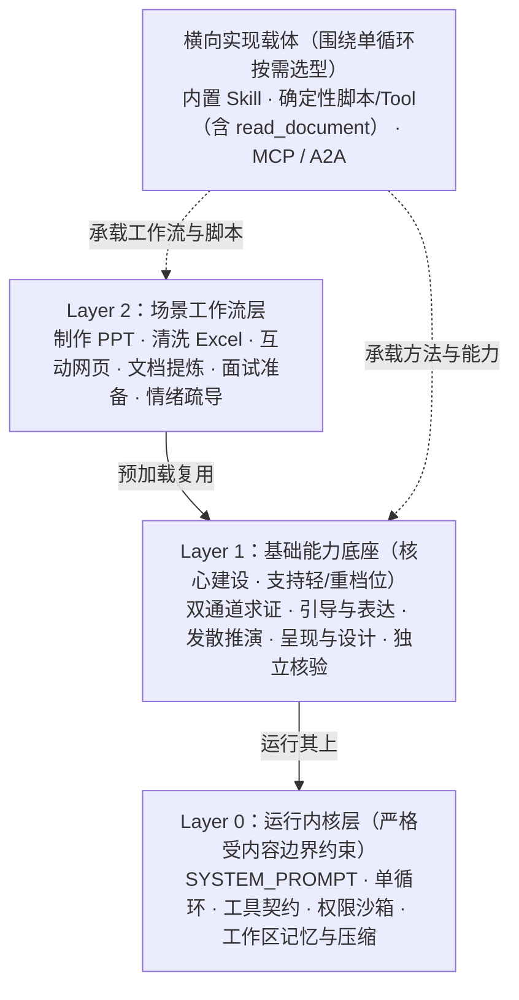

# 基础能力底座与内置场景预设工作流计划

- **状态**：已授权实施（阶段 1 决策已定稿，A + B 底座优化纳入本次实施）
- **授权范围**：本次实施覆盖后端预设引擎与 `active_preset_id` 持久化、11 项全自研内置 Skill（5 基础能力 + 6 首期预设含「情绪与压力疏导」）与纯标准库核验脚本、通用只读 `read_document` 工具、`bing_search.py` 中文语言头修复、共享契约更新及前端首页/会话预设交互。
- **来源与范围**：承接从[桌面验收修复与项目预览计划](desktop-acceptance-remediation.md)拆出的原 WP9 全部内容（含上游调整 U7 及验收问题 #6/#7/#9/#10 的场景级增强），并升级为**「运行内核边界清晰 + 基础能力底座 + 载体解耦 + 内置场景预设工作流」**的完整规划。
- **产品定位与目标**：RayAgent 面向**个人日常办公、中小任务与零散小碎活**（单次 2–15 分钟、多步骤但可控、常带本地文件读写与交付副作用，以及个人事务与状态支持），**不做**重型全能自治平台，**不做** Coding Agent。本计划旨在让 Agent **更懂人、又快又好**——在保证交付质量的同时保持轻快节奏，不把日常小事拖成繁琐的重型流程。
- **模型与协议约束**：不限制用户配置的模型（能力档位差异大，核心不做自动路由或自动换模型，见[模型连接与协议](../model-usage.md)），当前仅打通 OpenAI 兼容协议且不依赖厂商私有托管工具。因此，底座设计必须满足**「弱模型不翻车、强模型更出彩」**（可测判据见第六节）。

## 一、架构原则与分层边界

采用**能力分层与实现载体解耦**的架构模式：先划清每一层的职责、边界与触发可靠性，再按实际瓶颈选择内置 Skill、确定性脚本/Tool、MCP 或外部委派载体，不为了技术形态而过度设计。

> 注：上图为计划阶段的临时示意，合入正文时按项目配图规范改为 SVG。

### 1.1 运行内核层（Layer 0）的内容边界红线

- **定位**：包含现有自研单循环、工具契约、权限与写入保护、计划清单、上下文压缩及工作区记忆/检索存储（详见[Harness 工程](../harness.md)与[架构说明](../architecture.md)）。
- **硬约束（按内容划界，不按文件位置划界）**：
  - `SYSTEM_PROMPT` 只描述与任务类型无关的运行事实、工具边界、最小复杂度阶梯与真实性/核验底线；
  - 场景专属的规则、话术、阶段流、领域步骤一律不进入 `SYSTEM_PROMPT`；
  - 任何对所有对话始终生效的提示，都等同于内核提示词，必须受同样约束；不能通过换个文件位置绕开红线；
  - 本次仅在 `_FILE_RULES` 补充 `read_document` 工具使用事实（与 `read_file` 互补），不向内核新增场景或话术规则。

### 1.2 基础能力层（Layer 1）的职责与两类承载方式

- **定位**：沉淀跨场景高度复用的**正交元能力**，不绑定单一业务产物，全部自带**轻/重档位（默认走轻路径）**，避免杀鸡用牛刀。
- **定稿承载方式（全内置 Skill 化 + 预设预加载）**：
  1. **`C2（elicitation-communication）` 做成独立内置基础 Skill**：现有 `SYSTEM_PROMPT` 已具备「缺必要信息且无法合理假设才提问」「假设与材料事实分开」等通用规则；不复用以工作区为作用域、代表「用户确认做事方式」的 `WorkingStyle`，也不向内核新增话术。`C2` 默认不纳入自由对话目录（`default_included=False`），主要通过场景预设的 `depends_on` 预加载生效，并由前台起手按钮分担模式识别；未选预设的自由对话仅由内核既有规则兜底。
  2. **其余基础能力（`C1`/`C3`/`C4`/`C5`）做成短小精悍的内置共享基础 Skill**：默认纳入目录（`default_included=True`），自由对话下意图命中时可按需 `load_skill` 加载，同时支持被场景预设按 `depends_on` 确定性预加载。

### 1.3 场景工作流层（Layer 2）的职责与复用组合方式

- **定位**：面向高频日常办公与个人场景的前台预设入口与多轮工作流编排。
- **边界**：聚焦该场景特有的**阶段流、子模式切换、缺省背景引导、反模式护栏与产物交付规范**。
- **Layer 2 复用 Layer 1 的组合方式（已定稿方案 a）**：
  - 在内置预设注册表中声明 `depends_on`（仅内置 Skill 生效，外部 Skill 忽略），锁定预设时由程序在运行受理与循环启动阶段将预设及其 `depends_on` 基础 Skill 一并预加载；
  - 每个场景 Skill 自身保留 3–5 条兜底红线，单个基础 Skill 正文控制在 1,200–2,000 字符、场景 Skill 控制在 2,200–3,500 字符，长规范与模板拆入 `references/` 按需 `read_skill_resource` 读回。

### 1.4 围绕单循环的载体选型原则（多模型兼容 + 冷静看待多 Agent）

基于[执行循环与上下文取舍](../background/execution-and-context.md)，RayAgent 的审批挂起、停止传播、写入租约、用量记账与请求重建均深度绑定在单循环控制平面上。载体选型遵循以下务实顺序：

| 实现载体 | 适用定位 | 多模型与工程边界说明 |
|---|---|---|
| **共享内置基础 Skill + 场景 Skill** | 软性认知方法、表达与引导分寸、思维脚手架、视觉与排版标准 | 正文必须极度克制，以**清晰 IF-THEN 分支 + 3–5 条反模式红线**为主，不写冗长理论，保证中等模型能稳执行、强模型能发挥上限 |
| **通用工具 + 确定性校验脚本 + MCP** | 通用办公文档读取（`read_document`）、客观质量校验、格式结构检查、实时外部数据源 | 通用文档读取复用现有 `document_parse` 管线；能确定性检查的（`.xlsx`/`.pptx`/`.docx`/`.html`/`.pdf` 结构、公式未缓存提示与占位符检测）通过纯 CPython 3.12 标准库脚本下沉并接入现有 `verification` 协议；外部数据通道优先走 MCP |
| **前台交互分担** | 多模式场景的意图定调（如面试模拟 vs 改简历 vs 行情规划） | 通过首页预设卡片与轻起手按钮由用户一键选定模式，直接消除弱模型“猜错模式”的翻车概率 |
| **多 Agent / Subagent（不作为近期主路径）** | 仅作远期架构保留；需要独立远端能力时优先复用已有 A2A 委派接口 | 日常中小任务下，核心内自建 Subagent 会牵动整条单循环控制平面且增加等待延迟；优先吃透单循环 + 现有超长结果落盘按需读回 + 分级检索 |

---

## 二、基础能力底座规划（5 项正交元能力）

以下 5 项基础能力覆盖日常办公与中小任务从“理解人 → 查证思考 → 呈现产出 → 把关交付”的完整闭环，全部遵循**默认轻路径、按需切重路径**原则，全自研随包内置：

| 编号 | 基础能力 | 解决的本质问题 | 轻 / 重档位设计 | 承载方式与目录策略 |
|---|---|---|---|---|
| **C1** | **双通道信息求证（本地工作区深挖 + 联网分级检索）** | 结合 RayAgent 本地文档解析与联网能力，拿一手、可核验的事实，不靠过时记忆硬编： ① **内源通道**：优先通过 `read_document` 读取工作区/附件办公文档（PDF/DOCX/DOC/XLSX/PPTX），配合工作区 `knowledge_search`/`knowledge_read` 回读原文标出处； ② **外源通道**：联网查证、信源分级、深读原文、矛盾追查、事实与推断分离 | **轻档（默认）**：本地定位关键片段核对，或联网 1–2 轮读原文直给结论； **重档（按需）**：行情/选型/多材料综述时多角度拆词、交叉比对多份原文与一手信源、显式标注口径差异与盲区 | 内置共享 Skill `research-grounding`（`default_included=True`）+ `read_document` / 工作区检索 / `search_web`（含中文语言头修复）与 `web_fetch` |
| **C2** | **需求澄清与表达适配（Elicitation & Communication）** | 让 Agent **更懂人**： ① 区分阻断级前提与可假设细节，低摩擦选择题/默认初版起手，不审讯式连环追问； ② 按场景与对象切换语域（日常默认平实语言、正式交付物切专业书面语、杜绝说教与空话） | **轻档（默认）**：零废话直给，非关键细节用合理默认出初版； **重档（模糊/高风险）**：最多问 1–2 个高杠杆选择题对齐前提后再动手 | 内置共享 Skill `elicitation-communication`（`default_included=False`，不污染自由对话目录，经预设 `depends_on` 预加载或 `/` 显式选用；情绪高压节奏放慢由情绪预设自身规则承载） |
| **C3** | **结构化推演与思维发散（Reasoning & Divergence）** | 突破“顺着用户说”，在需要动脑的场景主动提供问题拆解、反方视角与盲区提醒、二阶影响分析、多方案权衡（Trade-off），并划清内部推演与必须查证的红线 | **轻档（默认）**：执行型小碎活不画蛇添足，直接高效办完； **重档（规划/分析/选型）**：先给主方案，主动补一个关键风险/盲区视角与可行替代项 | 内置共享 Skill `structured-thinking`（`default_included=True`） |
| **C4** | **信息呈现与视觉设计（Presentation & Design）** | 把结论变成好读、好用的成果，涵盖文字结构排版、信息层级、数据可视化与界面审美；为产物提供独立的跨场景视觉规范 | **轻档（默认）**：紧凑清晰的文本/表格排版； **重档（网页/PPT/报告）**：调用共享视觉规范保障版式、配色、留白与可读性 | 新建运行时内置视觉规范 Skill `presentation-design`（`default_included=True`，含 `references/visual-checklist.md`；以仓库开发用 `skills/frontend-design` 为参考来源但独立维护，后者用于 RayAgent 自身界面设计，受 [UI 设计说明](../../ray_agent/ui/DESIGN.md) 约束，两者不互相牵连） |
| **C5** | **独立核验与质量批判（Verification & Critique）** | 跳出“写完自我感觉良好”的盲区，针对不同产物做独立把关（数据口径与公式汇总核算、共享文档文本可提取与缺字校验、事实与待确认项标注、页面真实视口与交互检查） | **轻档（默认）**：交付前对照用户原话核对核心要求与明显错漏； **重档（正式文件/表格/网页）**：运行标准库校验脚本并配合 `read_document` + 对照反模式清单逐项把关 | 内置共享 Skill `verification-critique`（`default_included=True`）+ 纯 CPython 3.12 标准库核验脚本 `scripts/verify_office.py`（输出符合 `verification` 协议的 JSON） |

> 职责边界说明：**C1 与 C5 明确分工**——C1 负责取得并核对事实来源，C5 负责对产物做交付前把关（包括检查事实与待确认项的标注是否完整），不重复做检索。
>
> 注：表中条数、轮数等数字为设计引导；合入正文时改为行为描述，可调系统参数集中维护于[运行参数与限额](../limits.md)。

---

## 三、内置场景预设工作流与多轮粘性机制（承接原 WP9 与 U7）

### 3.1 工程架构定位：复用现有 Skill 引擎与单一声明式注册表

RayAgent 已有完整的 Skill 快照、版本冻结、压缩保留与按需加载体系（见[skill 机制](../skills.md)）。前台「场景预设区」直接建立在现有 Skill 引擎之上：

- 每个场景预设本身是随包发布的**内置 Workflow Skill**（含 `SKILL.md` 阶段流指令，以及必要的 `references/` 规范与 `scripts/` 校验脚本）；
- 前后端共享**单一元数据注册表**（`BUILTIN_SKILLS` 经 `GET /api/skills/presets` 下发标题、副标题、图标、placeholder、起手按钮、`depends_on` 与 `default_participate_in_memory`），避免两份维护；
- 不向用户可见消息拼接长提示词，不污染对话历史，压缩时原样保留；
- 在工作区中使用时，与工作区「工作方式（WorkingStyle）」及长期记忆/知识正交叠加。
- **内置 Skill 规模与目录去噪**：
  - 按现有实现，已纳入（界面为「每次带上」）集合放不下时，新运行只自动带上内置 Skill；且内置 Skill 可以停用，不可删除。
  - 12 项内置条目（`find-skills` + 5 基础 + 6 场景）按目录去噪策略分为两类：`find-skills`、`C1`/`C3`/`C4`/`C5` 与 4 项制作/文档场景预设默认纳入运行目录（`default_included=True`）；`C2`（`elicitation-communication`）与高交互强状态机场景（`preset-interview`、`preset-emotional-support`）默认不纳入自由对话目录（`default_included=False`），避免普通问答被误拉入角色扮演或情绪疏导模式。
  - 实算 12 项内置全部纳入也仅占目录上限约 10%，且单次激活「1 场景 + 依赖基础 Skill」约占活动正文上限 15%，预算充裕（见[运行参数与限额](../limits.md)）。用户自装同名 Skill 按既有来源优先级解析与偏好设置处理。

### 3.2 三层递进触发机制

| 触发层级 | 触发条件 | 机制与作用 |
|---|---|---|
| **第 1 层：运行内核底座（始终生效）** | 全部对话 | 纯净的 `SYSTEM_PROMPT`，只管执行纪律、工具边界与真实性/核验底线（已包含缺必要信息才提问、假设与事实分开等通用原则），不绑定业务场景 |
| **第 2 层：隐式按需增强（未选预设，但意图命中）** | 用户直接输入且命中明确动作型基础能力或制作/文档场景 | 默认纳入运行目录的内置基础能力与制作/文档场景 Skill 进入目录；模型按需调用 `load_skill` 切入，简单问答零干扰 |
| **第 3 层：显式预设锁定（用户点击预设）** | 用户在首页或工作区首页点选某预设 | 确定性预加载该场景工作流及 `depends_on` 基础 Skill，绑定为**会话级激活预设**，跨多轮稳定保持直至用户主动退出；同时借前端轻起手按钮帮弱模型直接定调模式 |

### 3.3 会话级多轮粘性预设（原 U7 调整与定稿语义）

- **保留既有单轮激活治理价值**：继续保留上下文容量控制、停用/升级即时生效、快照门控与压缩置顶保护。
- **补齐跨多轮任务连续性（已定稿语义）**：
  - 扩展会话持久字段 `active_preset_id`（可为空），用于跨轮保持所选预设，并在压缩时保留；界面清晰展示当前场景标签（如 `[制作 PPT ×]`），随时可点击退出回自由模式。
  - **边界语义**：
    1. 预设只允许指向内置场景 Skill（`category == "preset"`）；
    2. 会话中内置 Skill 版本升级时，从下一次新运行开始换用新版本，进行中的运行不切换；
    3. 本条消息再用 `/skill` 显式选择时，与锁定预设**并存**，各自计入运行绑定的活动正文容量（`skill_active_chars`），超限时明确失败并提示，不静默降级或覆盖；
    4. 计划模式下预设与依赖的基础 Skill 照常加载、照常可读；
    5. 设置中停用预设后，当前会话标签保留显示「已停用」失效状态并提示，后续新运行不再预加载，用户可点击 `×` 退出回自由模式；
    6. 工作区新建会话时根据预设 `default_participate_in_memory` 决定初始 `participate_in_memory`（情绪疏导默认 `False`，其余默认 `True`）。
  - **`/技能名` 续轮目录可见性**：维持现行[skill 机制](../skills.md)规定（「后续消息不默认沿用」），不做隐式续轮沿用改动；如后续实测发现紧邻续轮按需加载存在具体故障，再作为独立问题评估并同步更新文档。

### 3.4 首页预设区展示形态（贴合 [DESIGN.md](../../ray_agent/ui/DESIGN.md)）

- **位置**：独立对话首页（`home.tsx`）与工作区首页（`workspace.tsx`）输入框正下方；发出首条消息进入对话后自然收起，不挤占阅读区。
- **卡片信息克制三要素**：统一线描图标 + 短标题（3–5 字）+ 一句结果导向副标题（不出现 Prompt / Skill 等技术术语）。
- **点选交互与模式分担**：点击不自动发送，而是：① 输入框上方挂载可取消的场景胶囊；② 切换针对性 `placeholder`（提示关键输入与可拖入材料）；③ 在输入框下方展示 2–3 条极轻起手选项（如面试的「模拟面试官追问 / 改简历与挖亮点 / 查岗位行情与备考」，点按仅填入并聚焦输入框）。

### 3.5 首期 6 项场景预设（全自研随包交付）

| 预设名称 | 分类与策略 | 预加载底座（`depends_on`） | 阶段流、重点规范与工具配合 |
|---|---|---|---|
| **制作 PPT / 演示稿**（`preset-ppt`） | 重制作类：全自研轻量 Skill + 校验脚本（无第三方许可风险） | `C4 呈现与视觉`、`C5 独立核验` | 对齐主题/受众/页数 → 优先生成可翻页单文件 HTML 演示稿并 `register_preview` 预览与局部改页 → 按需导出 HTML 包、`.pptx` 或内嵌中文字体 `.pdf`（配合 `verify_office.py` 与 `read_document` 核验中文可提取，场景内增强验收 #9） |
| **整合与清洗 Excel**（`preset-excel`） | 重制作类：全自研轻量 Skill + 校验脚本 | `C2 引导与表达`、`C5 独立核验` | 先用 `read_document` 盘点原表结构与口径冲突 → 对齐合并汇总规则 → 用随包 CPython 生成带公式 `.xlsx` 并用代码独立核算关键汇总值 → 运行 `verify_office.py` 核验并诚实呈现核算汇总与未缓存公式说明（协同 WP5 诚实预览，场景内增强验收 #6） |
| **互动网页小工具**（`preset-web-tool`） | 重制作类：全自研轻量 Skill + 校验脚本 | `C4 呈现与视觉`、`C5 独立核验` | 对齐功能与持久化需求 → 按最小复杂度阶梯（单 HTML → 静态多文件 → 极简 stdlib 单进程服务）生成并 `register_preview` 登记预览 → 运行 `verify_office.py` 检查 HTML（有浏览器时补视口检查） |
| **文档与会议提炼**（`preset-doc-brief`） | 高交互/轻文档类 | `C1 双通道求证`、`C2 引导与表达`、`C5 独立核验` | 细分「决策速览 / 执行拆解 / 多文档对比」三子模式；优先通过 `read_document`（及工作区 `knowledge_search`）读原文；缺背景时低摩擦默认起手并在主视图就近标「待确认」；严格遵从硬篇幅与受众约束（场景内增强验收 #7、#10） |
| **面试准备与模拟**（`preset-interview`） | 高交互/轻文档类（默认不进自由目录） | `C2 引导与表达`、`C1 双通道求证`、`C3 发散推演` | 明确「① 面试官扮演（真实逐题追问/复盘）」「② 教练辅导（挖亮点/逐句打磨）」「③ 行情与备考规划（联网检索趋势与差距分析）」三模式；通过起手选项直接定调，支持 `read_document` 读简历或 2–3 句口述极速起手 |
| **情绪与压力疏导**（`preset-emotional-support`） | 高交互/轻文档类（首期交付，默认不进自由目录，工作区默认关闭记忆参与） | `C2 引导与表达` | 明确非医疗诊断边界；拆分为「① 纯粹承接与反反刍模式（共情脱钩、短句留白、严禁说教或硬推行动步骤）」与「② 客观理性拆解模式（情绪平稳并经用户同意后梳理可控项）」，常规切换控制权归用户；**硬性危机升级规则**：识别到自伤、自杀、伤人或其他危机信号时，必须立即中止当前模式，给出国家卫健委全国统一公益心理援助热线 **12356** 与急救电话 **110 / 120**（海外用户联系当地急救/危机热线）并建议联系亲友或就医，不受常规模式切换限制 |

> 职责分工说明：自由对话路径上 #9、#10 的通用修复由[桌面验收修复与项目预览计划](desktop-acceptance-remediation.md)的 WP1 承担，#6 的预览侧由 WP5 承担；本计划负责场景工作流内的核算与交付质量。

---

## 四、实施路径与底座优化范围

1. **后端预设引擎、A+B 底座改造与 11 个内置包落盘（本次实施）**
   - **A 组底座**：`BUILTIN_SKILLS` 声明式单一元数据注册表、多内置包扫描（含 `references/` 与 `scripts/`）、`depends_on` 预加载、目录分层去噪、纯 CPython 3.12 标准库 `verify_office.py` 核验脚本对接 `verification` 协议、`bing_search.py` 按中文查询动态切换 `Accept-Language`；
   - **B 组底座**：在 `FileTool` 新增通用只读 `read_document` 工具（复用现有 `document_parse`，支持 PDF/DOCX/DOC/XLSX/PPTX/CSV/HTML/文本按 sheet 或页码分段读取），在 `PlanModeGuard` 放行，并在 `system.py` / `en/system.py` 的 `_FILE_RULES` 补充说明；
   - **会话预设持久化与接口**：Alembic 迁移 `0016_session_active_preset` 为 `sessions` 新增 `active_preset_id`；支持建会话传入、情绪疏导默认 `participate_in_memory=False`、`PUT /api/sessions/{id}/preset` 切换/退出、`GET /api/skills/presets` 下发元数据、`GET /api/sessions/{id}` 返回 `active_preset` 状态；同步更新 `ray_agent/contracts`。
2. **前端首页与会话预设交互落地（本次实施）**
   - 在 `home.tsx`、`workspace.tsx`、`chat-input.tsx`、`session-detail-view.tsx` 实现 6 项预设卡片区、可取消场景胶囊、针对性 `placeholder`、模式分流起手按钮及会话态预设标签（含停用失效提示与退出操作）。
3. **自动化测试与静态检查（本次实施）**
   - 更新受迁移版本及内置条目数影响的既有单测，新增 `test_presets_and_foundation.py` 与 `test_read_document.py`；运行 `pnpm run check`（契约）、`uv run pytest`（后端）与 `pnpm run lint && pnpm run build`（前端）。
4. **用户桌面端跨模型实测与后续演进（实施交付后 / 后续专项）**
   - **跨模型真实体验评测**：用户在桌面端配置真实模型密钥后按第六节固定样本集实测；
   - **后续底座升级（C 组，留作下一阶段）**：将轻量纯 Python 办公库（如 `openpyxl`、`pypdf`、`python-docx`）打入桌面 `tool-runtime-archives` 实现完全离线生成；沉淀「HTML → Playwright Chromium → PDF」标准导出管线；将搜索层演进为可插拔 Provider 或接入专业搜索 MCP；落地自动化跨模型 Eval Runner。

---

## 五、已完成决策与待办追踪

原阶段 1 的 6 项前置决策已全部定稿并进入本次实施：
1. `C2` 落点：独立内置基础 Skill，不侵入内核；
2. 组合方式与预算：方案 (a) 预设 `depends_on` 预加载 + 目录分层去噪，预算实测可控；
3. 脚本运行环境：核验脚本纯 CPython 3.12 标准库实现，不改桌面归档体积；
4. 许可证：全部 11 个内置 Skill 自研，零第三方许可分发风险；
5. 跨轮语义：`active_preset_id` 仅限内置预设、与 `/skill` 并存共算预算、`/技能名` 维持现行续轮语义；
6. 情绪疏导：进入首期，带硬性危机升级规则与默认关闭记忆参与。

---

## 六、验证条件与文档归并口径

- **工程验证（本次交付前完成）**：
  - 后端 `pytest` 覆盖：12 项内置包加载与目录去噪、`GET /api/skills/presets` 元数据下发、情绪疏导新建工作区会话默认 `participate_in_memory=False`、`active_preset_id` 跨轮延续与 `depends_on` 预加载、压缩保留、与同条 `/skill` 并存及超 `skill_active_chars` 明确失败、计划模式正常加载、停用后失效与退出恢复、`read_document` 工具多格式读取与权限/计划模式边界、`verify_office.py` 校验构造文件输出合法 JSON、`bing_search.py` 中文请求头切换；
  - 共享契约 `pnpm run check` 与前端 `pnpm run lint && pnpm run build` 通过。
- **跨模型真实体验验证（供桌面端配置模型后实测）**：
  - **固定评测样本集**：覆盖原验收 #6/#7/#9/#10、独立对话拖入 PDF/DOCX/XLSX 提炼、多轮面试模式切换、轻/重联网检索、情绪反刍承接与危机信号识别样本；
  - **模型档位**：在至少两档具体命名的 OpenAI 兼容模型上实测（评测时记录完整模型名），分别覆盖首页选预设与自由对话两条路径；
  - **通过判据**：PDF 中文完整可提取且无缺字；Excel 关键汇总值与代码核算一致；文档提炼满足篇幅与受众约束；面试三模式切换正确；识别到危机信号即中止原模式并给出 `12356` / `110` / `120` 求助渠道；
  - **观察指标**：「未选预设时的隐式触发率」作为跨模型评测观察指标，不由 `pytest` 保证。
- **文档归并**：实施与用户桌面体验验收通过后，将有效机制与参数合入[skill 机制](../skills.md)、[产品说明](../product.md)（补充个人事务与状态支持、通用文档读取工具及场景预设说明）、[运行参数与限额](../limits.md)、[代码地图](../code-map.md)与[UI 设计说明](../../ray_agent/ui/DESIGN.md)，将本文中的 Mermaid 示意按项目配图规范替换为 SVG，并按[规划入口](README.md)清理已完成计划。
