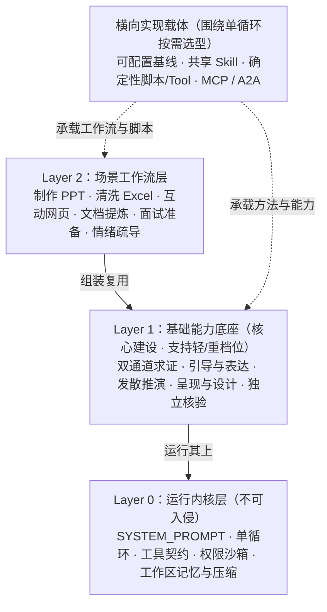

# 基础能力底座与内置场景预设工作流计划

- **状态**：设计细化中（未进入实施；产品定位、架构原则与基础能力边界已对齐，各模块细节待评审与逐项细化）
- **来源与范围**：承接从[桌面验收修复与项目预览计划](desktop-acceptance-remediation.md)拆出的原 WP9 全部内容（含上游调整 U7 及验收问题 #6/#7/#9/#10 的场景级根治），并升级为**「运行内核不入侵 + 基础能力底座 + 载体解耦 + 内置场景预设工作流」**的完整规划。
- **产品定位与目标**：RayAgent 面向**个人日常办公、中小任务与零散小碎活**（单次 2–15 分钟、多步骤但可控、常带本地文件读写与交付副作用），**不做**重型全能自治平台，**不做** Coding Agent。本计划旨在让 Agent **更懂人、又快又好**——在保证交付质量的同时保持轻快节奏，不把日常小事拖成繁琐的重型流程。
- **模型与协议约束**：不限制用户配置的模型（能力档位差异大，核心不做自动路由或自动换模型，见[模型连接与协议](../model-usage.md)），当前仅打通 OpenAI 兼容协议且不依赖厂商私有托管工具。因此，底座设计必须满足**「弱模型不翻车、强模型更出彩」**。

## 一、架构原则与分层边界

采用**能力分层与实现载体解耦**的架构模式：先划清每一层的职责、边界与触发可靠性，再按实际瓶颈选择 Prompt 基线、Skill、Tool/MCP 或外部委派载体，不为了技术形态而过度设计。

### 1.1 运行内核层（Layer 0）的不可入侵红线

- **定位**：包含现有自研单循环、工具契约、权限与写入保护、计划清单、上下文压缩及工作区记忆/检索存储（详见[Harness 工程](../harness.md)与[架构说明](../architecture.md)）。
- **硬约束**：`SYSTEM_PROMPT` 严格锁死在这一层，只描述与任务类型无关的运行事实、工具边界、最小复杂度阶梯与真实性/核验底线；**严禁将具体场景规则、对话语域习惯、引导话术、发散思维套路或行业调研步骤写入 `SYSTEM_PROMPT`**，防止内核膨胀与指令冲突。

### 1.2 基础能力层（Layer 1）的职责与两类承载方式

- **定位**：沉淀跨场景高度复用的**正交元能力**，不绑定单一业务产物，全部自带**轻/重档位（默认走轻路径）**，避免杀鸡用牛刀。
- **按触发可靠性区分两类承载**（应对不限模型下弱/中等模型在自由对话中不主动 `load_skill` 的现实问题）：
  1. **高频对话基线型**（如 `C2 需求引导与表达适配` 的核心分寸）：不能指望中等模型在开口前先调用 `load_skill` 再说话；在不入侵 `SYSTEM_PROMPT` 源码的前提下，复用 RayAgent 现有「工作方式（WorkingStyle）」的同源装配思路（独立于内核、可配置/可关闭的轻量默认基线），并由前台场景预设的起手选项帮模型分担模式识别。
  2. **动作明确型**（如 `C1 双通道求证`、`C3 发散推演`、`C4 呈现与视觉`、`C5 独立核验`）：任务意图清晰，模型易于命中目录摘要，做成短小精悍的内置共享基础 Skill 按需 `load_skill` 加载，简单问答零干扰。

### 1.3 场景工作流层（Layer 2）的职责

- **定位**：面向高频日常办公与个人场景的前台预设入口与多轮工作流编排。
- **边界**：聚焦该场景特有的**阶段流、子模式切换、缺省背景引导、反模式护栏与产物交付规范**；涉及查证、视觉、推演或核验时直接复用 Layer 1 基础能力，不重复造轮子。

### 1.4 围绕单循环的载体选型原则（多模型兼容 + 冷静看待多 Agent）

基于[执行循环与上下文取舍](../background/execution-and-context.md)，RayAgent 的审批挂起、停止传播、写入租约、用量记账与请求重建均深度绑定在单循环控制平面上。载体选型遵循以下务实顺序：

| 实现载体 | 适用定位 | 多模型与工程边界说明 |
|---|---|---|
| **轻量可配置基线 + 共享基础 Skill** | 软性认知方法、表达与引导分寸、思维脚手架、视觉与排版标准 | 正文必须极度克制，以**清晰 IF-THEN 分支 + 3–5 条反模式红线**为主，不写冗长理论，保证中等模型能稳执行、强模型能发挥上限 |
| **确定性工具 / 校验脚本 + MCP** | 客观可验证的质量红线、实时外部数据源、精准计算与格式转换 | 凡是能确定性检查的（Excel 汇总核算、PDF 中文字体可提取校验、网页视口检查）尽量下沉到脚本或工具，不靠模型自觉；外部数据通道优先走 MCP |
| **前台交互分担** | 多模式场景的意图定调（如面试模拟 vs 简历辅导 vs 行情规划） | 通过首页预设卡片与轻起手按钮由用户一键选定模式，直接消除弱模型“猜错模式”的翻车概率 |
| **多 Agent / Subagent（不作为近期主路径）** | 仅作远期架构保留；需要独立远端能力时优先复用已有 A2A 委派接口 | 日常中小任务下，核心内自建 Subagent 会牵动整条单循环控制平面且增加等待延迟；优先吃透单循环 + 现有超长结果落盘按需读回 + 分级检索 |

---

## 二、基础能力底座规划（5 项正交元能力）

以下 5 项基础能力覆盖日常办公与中小任务从“理解人 → 查证思考 → 呈现产出 → 把关交付”的完整闭环，全部遵循**默认轻路径、按需切重路径**原则：

| 编号 | 基础能力 | 解决的本质问题 | 轻 / 重档位设计 | 承载方式 |
|---|---|---|---|---|
| **C1** | **双通道信息求证（本地工作区深挖 + 联网分级检索）** | 结合 RayAgent 本地文件夹工作区优势与联网能力，拿一手、可核验的事实，不靠过时记忆硬编： ① **内源通道**：工作区多文档（PDF/DOCX/DOC/XLSX/OCR/记忆/历史摘要）检索定位 → 回读原文 → 比对口径冲突并标出处； ② **外源通道**：联网查证、信源分级、深读原文、矛盾追查、事实与推断分离 | **轻档（默认）**：本地定位关键片段核对，或联网 1–2 轮读原文直给结论； **重档（按需）**：行情/选型/多材料综述时多角度拆词、交叉比对多份原文与一手信源、显式标注口径差异与盲区 | 内置共享 Skill（`research-grounding`）+ 现有工作区检索与 `search_web`/`web_fetch` 工具（后续可经 MCP 接入更强搜索通道） |
| **C2** | **需求澄清与表达适配（Elicitation & Communication）** | 让 Agent **更懂人**： ① 区分阻断级前提与可假设细节，低摩擦选择题/默认初版起手，不审讯式连环追问； ② 按场景与对象切换语域（日常默认说人话、正式交付物切专业书面语、情绪高压期放慢节奏去说教感） | **轻档（默认）**：零废话直给，非关键细节用合理默认出初版； **重档（模糊/高风险）**：最多问 1–2 个高杠杆选择题对齐前提后再动手 | 高频核心准则走独立于内核的可配置默认基线（WorkingStyle 同源机制）+ 场景预设内针对性引导 |
| **C3** | **结构化推演与思维发散（Reasoning & Divergence）** | 突破“顺着用户说”，在需要动脑的场景主动提供问题拆解、反方视角与盲区提醒、二阶影响分析、多方案权衡（Trade-off），并划清内部推演与必须查证的红线 | **轻档（默认）**：执行型小碎活不画蛇添足，直接高效办完； **重档（规划/分析/选型）**：先给主方案，主动补一个关键风险/盲区视角与可行替代项 | 内置共享 Skill（`structured-thinking`），仅在方案、规划、复杂分析类任务按需加载 |
| **C4** | **信息呈现与视觉设计（Presentation & Design）** | 把结论变成好读、好用的成果，涵盖文字结构排版、信息层级、数据可视化与界面审美；将 `frontend-design` 下沉为跨场景共享视觉规范 | **轻档（默认）**：紧凑清晰的文本/表格排版； **重档（网页/PPT/报告）**：调用共享视觉规范保障版式、配色、留白与可读性 | 共享视觉基础 Skill（复用并演进 `frontend-design`）+ 导出/预览能力；同时服务互动网页、HTML 演示稿（PPT）与长报告 |
| **C5** | **独立核验与质量批判（Verification & Critique）** | 跳出“写完自我感觉良好”的盲区，针对不同产物做独立把关（数据口径与公式汇总核算、共享文档文本可提取与缺字校验、事实与待确认项标注、页面真实视口与交互检查） | **轻档（默认）**：交付前对照用户原话核对核心要求与明显错漏； **重档（正式文件/表格/网页）**：运行确定性校验脚本 + 对照反模式清单逐项把关 | 确定性校验脚本/工具（兜底多模型下限）+ 内置核验方法 Skill |

> 注：以上 5 项能力中，日常体感收益最直接的优先级顺序为 **`C2（更懂人）` 与 `C1（本地+联网双通道求证）` → `C4/C5（交付质感与确定性兜底）` → `C3（深度发散推演）`**。详细规范将在评审通过后逐项定稿。

---

## 三、内置场景预设工作流与多轮粘性机制（承接原 WP9 与 U7）

### 3.1 工程架构定位：复用现有 Skill 引擎

RayAgent 已有完整的 Skill 快照、版本冻结、压缩保留与按需加载体系（见[skill 机制](../skills.md)）。前台「场景预设区」直接建立在现有 Skill 引擎之上：

- 每个场景预设本身是随包发布的**内置 Workflow Skill**（含 `SKILL.md` 阶段流指令，以及必要的 `references/` 规范与 `scripts/` 导出/校验脚本）；
- 不向用户可见消息拼接长提示词，不污染对话历史，压缩时原样保留；
- 在工作区中使用时，与工作区「工作方式（WorkingStyle）」及长期记忆/知识正交叠加。

### 3.2 三层递进触发机制

| 触发层级 | 触发条件 | 机制与作用 |
|---|---|---|
| **第 1 层：运行内核底座（始终生效）** | 全部对话 | 纯净的 `SYSTEM_PROMPT`，只管执行纪律、工具边界与真实性底线，不绑定业务场景；配合独立于内核的轻量对话基线保障“说人话与基本分寸” |
| **第 2 层：隐式按需增强（未选预设，但意图命中）** | 用户直接输入且命中明确动作型基础能力或常见场景 | 内置基础能力 Skill 与场景 Skill 默认纳入运行目录（一行短摘要，低 Token 开销）；模型按需调用 `load_skill` 切入，简单问答零干扰 |
| **第 3 层：显式预设锁定（用户点击预设）** | 用户在首页或工作区首页点选某预设 | 确定性预加载该场景工作流并绑定为**会话级激活预设**，跨多轮稳定保持直至用户主动退出；同时借前端轻起手按钮帮弱模型直接定调模式 |

### 3.3 会话级多轮粘性预设（原 U7 调整）

- **保留既有单轮激活治理价值**：继续保留上下文容量控制、停用/升级即时生效、快照门控与压缩置顶保护。
- **补齐跨多轮任务连续性**：
  - 扩展会话持久字段 `active_preset_id`（指向内置场景 Skill ID，可为空）：用户选定预设发起会话后，同一会话后续新运行自动按当前有效版本保持激活并在压缩时保留；设置中停用则自动失效；界面清晰展示当前场景标签（如 `[制作 PPT ×]`），随时可点击退出回自由模式。
  - 普通自由对话中的 Skill 继续沿用渐进式披露；对上一轮通过 `/技能名` 临时选用、未设「每次带上」的 Skill，在紧邻续轮中保持目录可见，避免再次按需激活报错 404。

### 3.4 首页预设区展示形态（贴合 [DESIGN.md](../../ray_agent/ui/DESIGN.md)）

- **位置**：独立对话首页（`home.tsx`）与工作区首页（`workspace.tsx`）输入框正下方；发出首条消息进入对话后自然收起，不挤占阅读区。
- **卡片信息克制三要素**：统一线描图标 + 短标题（3–5 字）+ 一句结果导向副标题（不出现 Prompt / Skill 等技术术语）。
- **点选交互与模式分担**：点击不自动发送，而是：① 输入框挂载可取消的场景胶囊；② 切换针对性 `placeholder`（提示关键输入与可拖入材料）；③ 在输入框下方展示 2–3 条极轻起手选项（尤其针对多模式场景，如面试的「模拟面试官 / 改简历挖亮点 / 看岗位行情规划」，点按即定调，降低用户和弱模型的理解成本）。

### 3.5 初期 6 项场景预设与细化方向

| 预设名称 | 分类与建设策略 | 复用底座能力 | 阶段流与重点深化方向 |
|---|---|---|---|
| **制作 PPT / 演示稿** | 重制作类：成熟开源 Skill 引入 + 薄适配 | `C4 呈现与视觉`（复用 `frontend-design`）、`C5 独立核验`、`C1 双通道求证`（按需） | 对齐主题/受众/页数 → 应用内可翻页 HTML 预览与局部改页（协同 WP3）→ 导出 HTML 包、`.pptx` 或内嵌中文字体 `.pdf`（附确定性缺字与可提取校验脚本，根治验收 #9） |
| **整合与清洗 Excel** | 重制作类：成熟开源 Skill 引入 + 薄适配 | `C5 独立核验`、`C2 引导与表达` | 盘点表结构与口径冲突 → 对齐合并汇总规则 → 生成带公式工作簿并用代码核算关键汇总值（协同 WP5 诚实预览，根治验收 #6）→ 交付文件并给出可核对汇总 |
| **互动网页小工具** | 重制作类：现阶段基于 `frontend-design` 跑通，后续独立补强交互与数据层 | `C4 呈现与视觉`、`C5 独立核验` | 对齐功能与持久化需求 → 按最小复杂度阶梯（单 HTML → 静态多文件 → 轻脚本）生成并登记预览（协同 WP3+WP4）→ 后续重点沉淀交互流程规范、状态持久化选型与可用性自检 |
| **文档与会议提炼** | 高交互/轻文档类：细致设计模式分支与缺省引导 | `C1 双通道求证`（本地深挖）、`C2 引导与表达`、`C5 独立核验` | 细分「决策速览 / 执行拆解 / 多文档对比」子模式；缺背景时低摩擦默认起手并显式标注待确认项；严格遵从硬篇幅与受众约束（根治验收 #7、#10） |
| **面试准备与模拟** | 高交互/轻文档类：细致设计三模式状态机 + 前台起手分流 | `C1 双通道求证`、`C2 引导与表达`、`C3 发散推演` | 明确拆分为「① 面试官扮演（真实追问/压力面/结束复盘）」「② 教练辅导（挖亮点/逐句打磨）」「③ 行情与备考规划（联网深搜岗位趋势与差距分析）」三模式；通过起手选项直接定调，缺简历/JD 时支持 2–3 句口述极速起手 |
| **情绪与压力疏导** | 高交互/轻文档类：细致设计双模态切换与心理边界 | `C2 引导与表达` | 明确非医疗诊断边界；拆分为「① 纯粹承接与反反刍模式（面对已发生事实下的强烈自责/苛责，重共情脱钩、短句留白、严禁说教或硬推行动步骤）」与「② 客观理性拆解模式（情绪平稳后梳理可控项与下一步）」，切换控制权完全交给用户 |

---

## 四、分阶段实施路线

1. **阶段 1：基础能力规范与高交互场景细化定稿（当前阶段）**
   - 确认高频对话基线（`C2`）的承载落点（是否复用 WorkingStyle 同源机制并允许用户查看/开关）；
   - 逐项细化 `C1`–`C5` 五项基础能力的轻/重档位、IF-THEN 触发规范、反模式红线与确定性校验脚本边界；
   - 逐项细化「文档提炼」「面试准备」「情绪疏导」三类高交互场景的起手选项、模式切换与缺背景兜底规则；
   - 核对内置基础 Skill 与场景 Skill 共用目录时的摘要长度与加载预算（对齐[运行参数与限额](../limits.md)）。
2. **阶段 2：预设引擎、默认基线与前台交互落地**
   - 后端与共享契约：Alembic 迁移新增会话级 `active_preset_id` 与更新/取消接口，重新生成 `ray_agent/contracts`；扩展 `skill_runtime.py` 支持预设跨轮粘性保留、压缩保护与 `/技能名` 续轮目录可见；落地独立于内核的可配置对话基线装配；
   - 前端：在 `home.tsx`、`workspace.tsx`、`chat-input.tsx`、`session-detail-view.tsx` 实现首页 6 项预设区、输入框场景胶囊、引导 `placeholder`、模式分流起手选项与会话态预设标签。
3. **阶段 3：基础能力包与 6 项场景预设包交付及跨模型评测**
   - 完成重制作类（PPT、Excel、互动网页）成熟开源 Skill 选型与许可核对，完成 RayAgent 薄适配与 `frontend-design` 共享视觉复用；
   - 落盘基础能力 Skill 包与 3 项高交互场景 Skill 包及确定性校验脚本；
   - **跨模型档位实测**：同时在强思考模型与中等/轻量 OpenAI 兼容模型上跑通典型样本（含原验收 #6/#7/#9/#10、本地多文件提炼、多轮面试、反刍情绪对话与轻/重联网检索），验证“弱模型不翻车、强模型更出彩”。
4. **远期演进（按真实使用瓶颈按需评估，不预设硬排期）**
   - 联网搜索质量遇瓶颈时，优先通过 MCP 接入专业搜索/数据通道；
   - 确需重型外部异步委派时，优先复用已有 A2A 接口，保持单循环核心克制稳定。

---

## 五、下一步待细致讨论清单

文档评审通过后，按以下优先级逐项展开细化：

1. **`C2`（引导与表达）的承载机制与具体准则**：确认默认对话基线是否复用 WorkingStyle 同源机制，敲定“说人话 vs 正式书面语”切换标准与低摩擦引导规则。
2. **`C1`（双通道信息求证）的轻/重档位规范**：细化本地工作区多文档深挖流程、联网轻搜 vs 深搜的触发门槛、信源分级与矛盾追查方法。
3. **三个高交互场景的细致规格**：逐一敲定「文档与会议提炼」「面试准备与模拟」「情绪与压力疏导」的起手分流按钮、子模式规则与反模式红线。
4. **`C3`/`C4`/`C5` 的精简规范与确定性脚本边界**：敲定发散推演脚手架、`frontend-design` 跨场景复用方式，以及哪些核验下沉到脚本由工具兜底。
5. **目录与上下文预算核对**：评估基础 Skill + 场景 Skill 同时纳入目录时的 Token 预算与冲突治理（对齐[运行参数与限额](../limits.md)）。

---

## 六、验证条件与文档归并口径

- **工程验证**：后端 `pytest` 覆盖默认基线装配、基础能力包与 6 项场景预设包加载校验、显式锁定跨轮延续、随时退出、未选预设时的目录按需隐式触发、压缩保留及与工作区 `WorkingStyle` 叠加；共享契约 `pnpm run check` 与前端构建/脚本验证通过。
- **跨模型真实体验验证**：桌面端在至少两档不同能力的 OpenAI 兼容模型上实测首页选预设与自由对话按需触发两条路径，验证轻任务响应速度与重任务交付质量（PPT 导出中文完整可提取、Excel 汇总核对、本地多文件一页提纲、多轮面试模式切换、情绪反刍承接边界与分级联网检索）。
- **文档归并**：实施完成后，将有效机制与参数合入[skill 机制](../skills.md)、[产品说明](../product.md)、[运行参数与限额](../limits.md)、[代码地图](../code-map.md)与[UI 设计说明](../../ray_agent/ui/DESIGN.md)，并按[规划入口](README.md)清理已完成计划。
