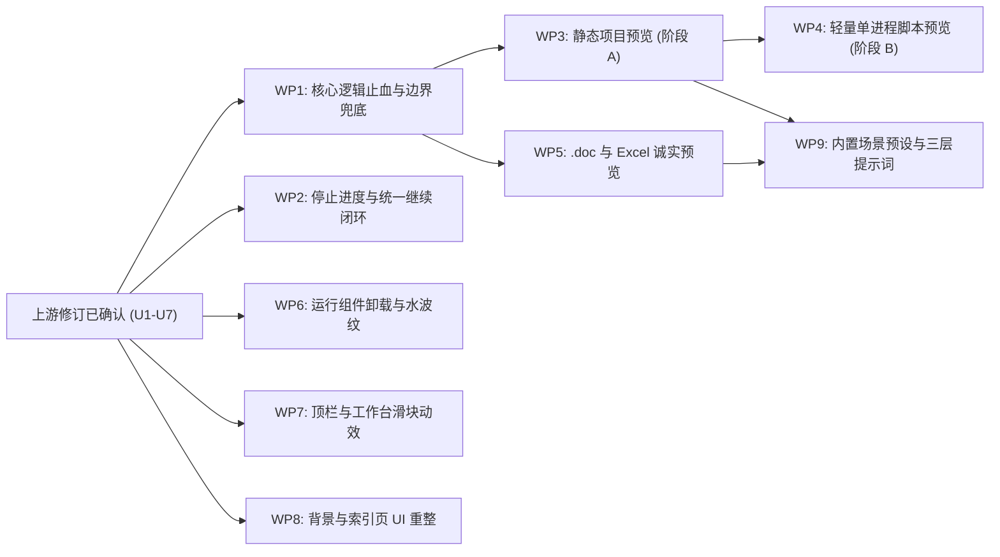

# 桌面验收问题修复、应用内项目预览与场景预设计划

- **状态**：实施中（WP1–WP8 已完成并通过自动化验证，待真实桌面端走查；WP9 暂留后续推进）
- **授权范围**：覆盖 [桌面日常使用验收待办](../todo/desktop-acceptance.md) 全部 19 项问题，合并 [首个交付收尾清单](first-delivery-remaining.md) 中的 2 项桌面通用待办，完整纳入**应用内项目预览（阶段 A 静态预览 + 阶段 B 轻量单进程脚本预览）**与**内置场景预设工作流及三层提示词工程（WP9）**。
- **执行优先级**：先解决产品能力与核心逻辑问题（WP1–WP6），完善高频场景预设工作流（WP9），再按 [UI 设计说明](../../ray_agent/ui/DESIGN.md) 推进界面交互精细化（WP7–WP8）；UI 专项也可在底座稳定后灵活穿插。

---

## 一、上游产品设计与规范修订（已采纳）

以下 7 处涉及现有架构边界、交互契约或工作规范，均已确认采纳，随对应工作包实施并同步回写上游文档。

| 编号 | 涉及文档 | 原设计 | 问题原因 | 已确认调整 | 状态 |
|---|---|---|---|---|---|
| U1 | [架构说明](../architecture.md)、[产品说明](../product.md)、[决策清单](decisions.md) | HTML 预览仅支持单文件跳系统浏览器且禁止 `fetch`/下载；执行环境「不支持主动脱离监管的后台服务」，Shell 进程一律随单次 Run 强制结束 | 单文件页面内导出被拦截；多文件 `HTML+CSS+JS` 完全无法预览；轻前端加本地脚本小工具一结束即 `ERR_CONNECTION_REFUSED`，且无法重开 | 坚守日常办公与轻工具定位（不滑向重型 Coding Agent）：① 增加独立本机只读静态预览端口与 WebView 跨域 `<iframe>` 预览，单文件与多文件静态站点统一应用内交互；② 引入由 Supervisor 全程监管、生命周期独立于单次 Run 的「轻量单进程本机小工具预览」，**不放宽**普通工作区的 `WorkspaceShellGuard` 依赖拦截，退出应用静默安全回收，绝不脱离监管 | 已采纳 |
| U2 | [架构说明](../architecture.md)（执行环境与写入保护） | 工作区会话每次 `shell_execute` 均在启动前取得独占工作区写租约，并一直持有至 Run 结束；`ShellChanges` 每运行只记单段起止快照；`WorkspaceShellGuard` 仅在工作区生效且只防内部依赖污染 | 短命令跑完仍锁死工作区至整次运行结束；受管轻服务若占写租约会阻塞后续对话；冲突文案「稍后重试」诱导模型盲重试；工作区与独立对话均可能经 Shell 误写桌面等外部目录 | ① 受管轻预览服务**不持有**独占工作区写租约；② 解耦写租约释放与 `ShellChanges`（升级为支持同 Run 多段区间合并/刷新），确认本次 Shell 子进程树全部退出后即释放进程写租约；③ 稳定占用返回结构化不可重试冲突，管线层增加连续同源冲突熔断；④ 对写往工作区与会话目录之外用户目录（如桌面、下载目录）增加单次审批拦截，同时覆盖工作区会话与开启本机执行的独立对话 | 已采纳 |
| U3 | [UI 设计说明](../../ray_agent/ui/DESIGN.md)（开发者模式、状态表达）、[首个交付收尾清单](first-delivery-remaining.md) | 所有运行结束后过程段默认收起进折叠块；停止态仅在时间线留文字提示；非进行中运行隐藏计划条；已受理计划执行失败后仅能看清单、无法直接继续 | 停止、中断或未产回复的失败没有最终正文，默认折叠后用户看不到停在哪、原因和已产成果，且普通运行与计划执行失败的恢复路径割裂 | 仅对**正常完成（`completed`）**默认收起执行过程；对停止、中断与未完成失败保持最近一次执行过程与未完成计划条可见；终态条统一提供「继续任务」入口，覆盖普通运行中断与已受理计划执行失败，并支持承接未消费输入 | 已采纳 |
| U4 | [UI 设计说明](../../ray_agent/ui/DESIGN.md)（工作区背景与记忆） | 记忆列表用拖放抓手与键盘按钮共用钉住操作，组内拖动无排序效果 | 抓手外观强烈暗示可自定义排序，实际无法排序，且后端无排序字段 | **按方案 B 收口**：保留系统装配排序规则（钉住 → 类型权重 → 最近使用），移除易误解的抓手图标，改用清晰的钉住/取消钉住行内操作并重排整行对齐 | 已采纳 |
| U5 | [UI 设计说明](../../ray_agent/ui/DESIGN.md)（设计原则）、[产品说明](../product.md)（文件预览） | 界面原则要求不放常驻说明；工作区文件预览不提供下载入口，不可预览文件仅提示「暂不支持预览」 | ① 运行组件页过简导致用户分不清装前/装后哪些能力仍可用；② 工作区不可预览文件（如 `.doc`）与需外部重算的 Excel 形成预览死胡同 | ① 在能力装配入口（运行组件页）与知识检索页允许一行结构化状态说明装前/装后边界；② 工作区文件维持不提供下载，但在不可预览及未缓存公式场景就地提供「在 Finder 中显示」入口 | 已采纳 |
| U6 | [AGENTS.md](../../AGENTS.md)（系统提示词通用原则、验收材料归属） | ① 系统提示词原则禁止写入具体产物或场景；② 不保留独立验收产物，计划完成后清理 | ① 若教条理解，会漏写本应用通用的运行时事实（交付区入口、外部目录边界、后台进程寿命、最小复杂度阶梯、预览登记方式、导出文档通用核验）；② `docs/todo/` 长期存在易与 `docs/plan/` 分叉 | ① 在 `AGENTS.md` 澄清：禁止写业务个案与样例，但应如实写入本应用通用的交付入口、运行生命周期、技术复杂度选型原则与输出核验原则；② 明确 `docs/todo/` 为临时验收工作区，成组修复统一以 `docs/plan/` 为准，关闭后清理 | 已采纳 |
| U7 | [skill 机制](../skills.md)、[产品说明](../product.md)、[UI 设计说明](../../ray_agent/ui/DESIGN.md) | 显式选中的 Skill 仅作用于当前单条消息，下一轮新运行自动降级为历史引用；首页无场景预设引导，内置 Skill 仅有 `find-skills` | 多轮任务型工作流（如制作 PPT 先定大纲再局部改页最后导出、多轮模拟面试）在第 2 轮会丢失工作流约束；小白用户面对空白输入框不知从何下手 | 新增基于内置 Workflow Skill 的「场景预设区」与轻量「会话级激活预设（可随时退出）」：显式选预设跨多轮保持生效，未选预设时仍纳入目录支持模型按需隐式 `load_skill` 增强，与工作区工作方式正交叠加 | 已采纳 |

**已确认的专项方案**：
- **传统 `.doc` 处理深度（#5）**：在 macOS 上通过系统自带 `textutil` 在解析/预览 worker 中做只读临时转换，直接补齐应用内预览与全文索引（不改动原文件），其他平台或转换失败回退为清晰提示与外部打开入口。
- **Excel 未缓存公式诚实预览（#6）**：不在预览器内自写易产生偏差的简易公式求值器；预览区显著高亮未缓存单元格、顶部给出醒目提示与外部打开/下载入口，同时在表格类工作流与脚本核验环节通过代码或可靠引擎核算汇总值并在答复摘要中呈现。
- **HTML 系统浏览器兜底下载（#2）**：在独立预览端口落地的同时，保留原单文件预览路由 `HTML_CSP` 的隔离边界（无 `allow-same-origin`、`connect-src 'none'`），补充 `allow-downloads` 防止外部打开仍拦截导出。
- **合并既有收尾待办**：将 [首个交付收尾清单](first-delivery-remaining.md) 中的「已受理计划执行失败后继续」并入 **WP2**，「会话成果列表后台刷新失败就地提示与重试」并入 **WP3**。

---

## 二、19 项验收问题 + 2 项既有待办全景映射

| # | 问题摘要 | 归属工作包 | 现状根因摘要（已核对源码） | 处理方式 |
|---|---|---|---|---|
| 1 | 交付任务误把文件写到系统桌面 | WP1 | `deliver_files` 已限根，但 Shell 具系统用户权限且无外部目录写入拦截，提示词/回执未区分应用内入口与外部目录 | 提示词/回执补强通用交付边界 + 对写往允许目录外用户目录触发单次审批（覆盖工作区与独立对话） |
| 2 | HTML 从成果打开后页面内导出日历被拦截 | WP1 + WP3 | `HTML_CSP` 缺少 `allow-downloads`；同时单文件外开 Chrome 且缺乏应用内下载承接 | WP1 先补 `allow-downloads`；WP3 切入独立静态预览端口 + 应用内 `<iframe>` + Tauri 宿主层统一承接下载 |
| 3 | 应用内缺少项目运行预览和重新打开入口 | WP1 + WP3 + WP4 | 运行结束强制 `SIGKILL` 子进程组且模型不知情；静态预览仅限单文件；无轻量受管预览与重开登记 | WP1 先止血告知进程寿命与最小复杂度阶梯；WP3 落地阶段 A 静态预览；WP4 落地阶段 B 轻量单进程脚本预览 |
| 4 | 工作区写入互斥时连续重试并要求终止他会话 | WP1 | 工作区 Shell 短命令跑完仍全运行占写租约；`ShellTool` 丢弃结构化冲突；文案「稍后重试」且无连续冲突熔断 | 子进程树退出即释放写租约（`ShellChanges` 支持同 Run 多段刷新）+ 结构化冲突透传 + 区分稳定占用提示 + 连续冲突熔断 |
| 5 | 传统 Word 原件缺少清晰应用内阅读路径 | WP5 | 索引与预览将 `.doc` 判为不支持；工作区文件无下载导致预览区无任何可执行动作 | macOS `textutil` 只读预览与全文索引（及不可预览态就地提供「在 Finder 中显示」） |
| 6 | 生成的 Excel 在预览里看不到汇总值 | WP5 + WP9 | `openpyxl(data_only=True)` 无缓存值时直接展示公式字符串；前端未区分 `uncached`，仅底栏弱提示 | 预览区显著标识未缓存单元格与顶部提示 + 外部打开/下载入口；表格工作流要求代码核对汇总值 |
| 7 | 会前提纲突破明确的一页限制 | WP9（不改硬逻辑） | 换用 `gpt-6.1-sol` 已复测为 23 行达标；通用提示已有长度遵从原则，缺场景级文档提炼工作流 | 不在通用提示写个案特例；通过 WP9「文档与会议提炼」预设系统化约束篇幅与受众 |
| 8 | 验收工具无法连接未打包的开发窗口 | 不改代码 | `tauri dev` 运行裸二进制 `rayagent-desktop` 而非 `.app` bundle | 属外部桌面自动化工具限制；验收改用内部打包 `.app` 或按 PID 接入 |
| 9 | 更新周会 PPT 后导出的 PDF 在部分工具里缺字 | WP1 + WP9 | 导出 PDF 缺完整中文字体/ToUnicode 映射，在无 CJK CMap 的 Poppler/pypdf 中缺失 | WP1 纳入通用导出文档文本可提取核验原则；WP9「制作 PPT」预设内置字体嵌入与导出核验脚本 |
| 10 | 值班页把推定的交接对象显示在正式排班里 | WP1 + WP9 | 系统提示已有「假设与材料事实分开」，未强调主视图待确认显式标注，缺场景确认流 | WP1 补强通用主视图待确认标注原则；WP9 场景预设在动手前先核对口径与待确认项 |
| 11 | 任务停止后看不到当前进度，也缺少继续入口 | WP2 | `foldSettledRuns` 对所有 `run_end` 一律折叠；`planBarMode` 隐藏计划条；无「继续任务」按钮且未接 `resume_input` | 停止/中断/未完成失败保留过程与计划可见；终态条提供「继续任务」与未消费输入承接 |
| 12 | 工作区知识检索框连续输入会丢字 | WP1 | 输入框直接受控于 URL `searchParams`，每次按键触发异步路由过渡且无 IME 守卫 | 改为本地同步 state + IME 组合态守卫 + 函数式防抖同步 URL |
| 13 | 运行组件说明没有讲清装前装后的能力 | WP6 | 组件页描述过简；知识页检索区搜索前未区分全文/语义构建中/语义就绪 | 重写组件装前/装后简明对比说明；知识页顶部明确展示当前检索模式状态 |
| 14 | 顶部切换栏与工作台的选中动画不一致 | WP7 | 顶栏未接入 `SegmentThumb`；工作台 `icons` 模式标签过冲提前全显，且 `ResizeObserver` 逐帧重置滑块 `460ms` 过渡 | 顶栏接入 `SegmentThumb`；统一两处动效曲线并消除 `icons` 模式逐帧重启拖尾 |
| 15 | 运行组件安装进度和操作入口需要重新设计 | WP6 | 现状为原生 `<progress>` 细条与文字按钮；后端无卸载接口、占用检测与安全删序 | 后端实现卸载接口、占用拦截与状态回退；前端重做原位水波纹进度、线描 SVG、卸载确认并同步核对语音页 |
| 16 | 工作方式的入口文字过多 | WP8 | 标题栏「模板」「版本历史」「编辑」及空态均为文字按钮 | 收整为对齐的线描 SVG `IconAction` 操作组，空态保留一句短提示，编辑态保留文字保存/取消 |
| 17 | 记忆列表抓手、行内操作和新增入口不好用 | WP8 | 抓手仅能跨组改钉住；抓手/正文/图标按钮基线错位；新增区与编辑区风格割裂 | **按方案 B** 移除误导抓手，改用清晰钉住操作、重构整行基线对齐并统一新增/编辑表单 |
| 18 | 按需召回区域分割线多，记忆条目难扫读 | WP8 | `border-t` + 分组标题 + drop slot + 行间 `::before` 线叠加过密 | 折叠标题集中展示状态与计数，展开后减线留白、用紧凑分组标题与统一对齐线组织 |
| 19 | 索引页的范围设置和运行操作堆在一起 | WP8 | 多选「内容类型」与单选「Agent 产出」同样式；开启后台即硬编码「后台索引中」；范围统计与文件列表割裂 | 拆分为「索引范围」与「索引运行」两组，区分单/多选与空闲/处理中/暂停态，统计紧邻文件列表 |
| R1 | 已受理的计划在执行失败后继续（收尾清单合并） | WP2 | `planConsumed` 隐藏重试按钮，仅提供「查看计划清单」 | 纳入 WP2 统一「继续任务」链路，沿当前计划续接并核对未知步骤与策略审批边界 |
| R2 | 会话成果列表后台刷新失败缺提示与重试（收尾清单合并） | WP3 | 成果列表后台刷新失败时缺少就地错误反馈与手动重试 | 随 WP3 成果页改造补齐：保留已有列表、就地展示刷新失败提示并支持重试 |

---

## 三、专题详细设计 A：应用内项目预览（阶段 A + 阶段 B）

### 3.1 产品定位与「小白 / 技术用户」三层边界

RayAgent 面向日常办公与复杂知识任务，**不做重型 Coding Agent 的多服务/数据库编排平台**；日常高频 Web 与小工具产物收敛为「**纯静态网页/前端小工具（~80%）+ 轻量单进程 Python/Node 本地脚本工具（~20%）**」。面向不懂代码的小白用户与懂技术的专业用户，采用**三层分工**统一体验：

1. **第一层：程序硬边界（安全兜底与零门槛，不依赖模型自觉）**
   - **统一的一键预览抽象**：无论底层是单文件 HTML、`HTML+CSS+JS` 目录还是单进程轻脚本服务，经 `register_preview` 登记后，用户在界面看到的都是同一张「预览卡片」，一键即可打开/拉起，无需理解端口或命令行。
   - **工作区干净守卫不变**：继续保留现有 `WorkspaceShellGuard`，禁止在普通非代码工作区中随意创建 `.venv`、`node_modules` 或大量构建碎片；同时新增写往允许范围外用户目录的单次审批拦截（覆盖工作区与独立对话）。
   - **轻服务硬天花板**：阶段 B 仅支持单条轻量本地进程命令、强制绑定回环 `127.0.0.1`（拒绝 `0.0.0.0` 暴露局域网）、限制全局与工作区并发数、纳入独立工具策略与本机执行开关约束、核心退出时由 Supervisor 静默全量回收。
   - **杜绝失效口头交付**：`shell_execute` 拉起的临时后台进程在运行结束时继续强制终止，只有经 `register_preview` 登记并通过健康检查的入口才出现在成果预览区。
2. **第二层：界面渐进披露（小白零术语，技术用户可下钻）**
   - **默认视图（面向小白）**：预览卡只展示项目名、简明状态（「可直接打开」/「点击启动」/「运行中」）与主按钮「预览」；重开轻服务时用通俗文案确认启动；报错只给一句可读原因 +「重试」或「让 Agent 修复」，不直接倾倒代码堆栈。
   - **次级入口与开发者下钻（面向技术用户）**：右上角菜单与折叠区保留「查看源码」「展开启动命令与工作目录」「查看运行日志」「在 Finder 中显示」「在系统浏览器中打开」「下载原件 / 打包导出 ZIP」，不挡小白的路，也不限制技术用户。
3. **第三层：提示词与工具引导（最小复杂度阶梯）**
   - 通用选型阶梯（写入系统提示词与 `register_preview` 说明，不写具体业务样例）：
     1. 纯前端即可完成时，**首选单个自包含 HTML**（零依赖、好预览、发给他人双击即可打开）；
     2. 需要拆分多文件但无需跨会话读写本机文件时，**次选纯静态多文件目录（`HTML+CSS+JS` 或静态构建产物）**，优先用浏览器本地存储，不无故启动后端进程；
     3. 仅当任务明确需要本机文件持久化或执行本机数据处理脚本时，**才引入极简单进程本地脚本服务**（优先采用环境已有标准库或轻量脚本，避免重型框架与大体积依赖）；
   - 默认回复先说明应用内怎么直接打开与使用；除非用户明确要求移交源码或在外部独立运行，不在主回复中堆砌命令行、端口和依赖安装步骤。

- **渲染内核选型**：复用桌面宿主自带的 **Tauri WebView** 内嵌跨域 `<iframe>`，**不复用** Playwright 自动化浏览器（无界面 Agent 工具、按需安装、按工作区互斥）。[tauri.conf.json](../../ray_agent/desktop/tauri.conf.json) 的 CSP 已允许 `frame-src 'self' blob: http://127.0.0.1:*`，且 [default.json](../../ray_agent/desktop/capabilities/default.json) 仅向主窗口开放宿主权限，跨域 `<iframe>` 天然无法访问 Tauri IPC。

| 产物形态 | 承载方式 | 核心隔离边界 | 导出移交形式 |
|---|---|---|---|
| 单文件 HTML | 阶段 A：独立只读静态预览端口 + `<iframe>` | 独立端口跨域；无法访问 Core API 与 Tauri IPC；只读单文件或交付对象 | 直接下载原 `.html`（双击即开） |
| 多文件静态站点（`HTML+CSS+JS` / 静态前端目录） | 阶段 A：同独立静态预览端口按目录只读挂载 + `<iframe>` | 独立端口跨域；复用限根文件端口防目录逃逸与敏感文件过滤；CSP 限制同挂载前缀 | 预览栏一键打包导出完整 `.zip` |
| 轻量单进程脚本工具（如前端 + 单 Python/Node 脚本） | 阶段 B：Supervisor 托管单进程 + 动态回环端口 + `<iframe>` | 独立动态端口跨域；强制 `127.0.0.1`；纳入工具策略与本机执行开关；退出静默回收 | 预览栏一键打包导出完整 `.zip`（含启动说明） |

### 3.2 阶段 A：独立只读静态预览端口与统一下载承接

1. **监听与生命周期**：
   - Core 在 `sidecar.py` / 应用生命周期中于 `127.0.0.1` 启动一个**独立于主 API 端口的只读静态预览服务器**（系统分配空闲端口，仅监听回环地址），随 Core 启动和优雅关闭。
2. **挂载模型（进程内注册表）**：
   - 主 API 新增 `/api/previews/static/mounts`（受实例令牌保护），支持三种只读来源：`attachment`（已交付单文件 HTML）、`root_file`（工作区/会话目录单 HTML）、`root_dir`（静态目录，默认入口 `index.html`）。
   - 每次挂载生成高熵随机 `mount_token`，返回 `preview_url = http://127.0.0.1:<preview_port>/s/<mount_token>/<entry>` 与有效期（容量与期限登记入 [运行参数与限额](../limits.md)）。
3. **文件读取与安全约束**：
   - 目录挂载内全部静态资源（`.html`/`.css`/`.js`/`.mjs`/`.json`/图片/字体/SVG/WASM 等）经 `WorkspaceFiles` 限根不跟随符号链接读取，自动拦截 `..` 越界、`.rayagent`、版本控制内部、凭据与数据库文件（复用 `file_rules.denied_reason()`）。
   - 响应头设置 `Cache-Control: no-store`、`X-Content-Type-Options: nosniff`、`Referrer-Policy: no-referrer`，并以精准 `Content-Security-Policy` 将 `connect-src` / `form-action` 限定到当前挂载前缀本身（防同端口不同挂载间互访），同时允许同挂载内 ES Modules、相对路径 CSS/JS/JSON `fetch` 与外部 HTTPS 静态资源。
   - `<iframe>` 属性设置 `sandbox="allow-scripts allow-same-origin allow-forms allow-modals allow-downloads allow-popups allow-popups-to-escape-sandbox"`：因预览端口与主界面、Core API 均跨源，`allow-same-origin` 仅赋予预览页自身独立源，不与主窗口或 Core API 同源。
4. **桌面端统一下载承接（覆盖阶段 A 与阶段 B）**：
   - 优先在 **Tauri v2 桌面宿主层（`lib.rs`）实现原生 `on_download` 回调**，统一接管主窗口内嵌 `<iframe>` 触发的文件下载并弹出系统保存面板（一套机制同时覆盖阶段 A 静态页面与阶段 B 轻服务页面）；
   - 实施时在 macOS WKWebView 实测 `blob:` / `data:` URL 是否触发 `on_download`：若 WKWebView 吞掉 `blob:` 导出，则为阶段 A 静态 HTML 响应补充轻量 `postMessage` -> 父窗口校验预览源 -> Tauri `save_bytes` 桥接兜底，并为阶段 B 文档化推荐 HTTP `Content-Disposition: attachment` 响应或「在系统浏览器打开」兜底。

### 3.3 阶段 B：轻量单进程本机小工具预览

1. **持久化登记表（Alembic 新迁移 `workspace_previews`）**：
   - 仅保存可重复启动的轻量声明配置，**不持久化假“运行中”状态**：
     - `id`、`workspace_id`（独立对话可空）、`session_id`、`run_id`
     - `name`、`kind`（`static` | `service`）
     - `root_id`（支持工作区根或会话工作目录根）、`relative_path`、`entry_path`
     - `start_command`（仅 `service`，单条轻量启动命令）、`health_path`（仅 `service`，默认 `/`）
     - `created_at`、`updated_at`
2. **受管进程生命周期（复用 Supervisor，极简收口）**：
   - 新增 `PreviewRuntimeService`，在内存中维护 `preview_id -> RunningPreview`（`process_id`、`port`、`state`、`started_at`、`exit_code`、`error`）。
   - 启动流程：
     1. 校验工作区未归档、目录可用、本机执行开关已开启；
     2. 校验轻量并发上限（每工作区与全局低并发上限登记入 [运行参数与限额](../limits.md)）；
     3. 分配 `127.0.0.1` 空闲端口，经 `ProcessExecutor` 启动进程，注入 `PORT=<port>`、`HOST=127.0.0.1` 及受管工具运行时 `PATH`（沿用 `build_process_env()` 与缓存重定向）；
     4. `owner` 标为 `preview` 而非 `run`，单次 Run 结束不触发 `kill_tree`；
     5. 有界轮询 `http://127.0.0.1:<port><health_path>`（仅接受回环响应）；超时或提前退出立即回收进程树并返回尾部日志。
   - **回收、租约与权限边界**：
     - 用户手动停止/重启、删除会话、删除或归档工作区、清空业务数据时自动 `kill_tree`；
     - 应用退出或核心崩溃时，由 Supervisor 静默全量回收全部预览进程树（不额外弹出退出确认打扰用户）；
     - **不持有**独占工作区 `WriteLease`，不阻塞同工作区后续对话；
     - 不放宽普通非代码工作区的 `WorkspaceShellGuard` 依赖拦截（鼓励轻脚本复用随包 Python/Node 标准库或将临时依赖放于会话工作目录）；
     - 提供 `/api/previews/{preview_id}/logs` 复用 Supervisor 增量输出缓冲，供日志抽屉按需查阅。
3. **Agent 工具与策略**：
   - 新增领域工具 `register_preview`：
     - `kind="static"`：仅需文件访问能力，工具策略默认允许；
     - `kind="service"`：需开启本机执行，纳入独立工具策略项（支持按策略配置询问/允许/禁止），创建即启动并做健康检查，启动失败把日志交回模型修复。
   - 新增领域/SSE 预览事件，时间线渲染简洁项目预览卡，右侧「成果」页置顶「可运行预览」列表。

### 3.4 前端统一 `WebPreview` 与成果页

- **统一容器**：单文件 HTML、静态目录、受管轻服务全部共用右侧 `WebPreview`，支持宽屏预览弹层放大。
- **主控件与渐进披露**：
  - 主操作保持极简：项目名、可读状态、桌面/手机视口切换、刷新、`service` 的「启动 / 停止 / 重启」主控制、大预览；
  - 次级操作收敛在右上角菜单与可折叠抽屉：单文件源码切换、查看运行日志（`service`）、查看启动命令与目录（`service`）、在系统浏览器打开、导出（单文件直接下载，静态目录/轻小工具一键打包下载 ZIP）或「在 Finder 中显示」（工作区）；
  - `stopped` 态展示友好启动卡而非死链白屏；文件夹树对含 `index.html` 的目录右键提供「作为静态站点预览」；
  - 成果列表后台刷新失败时保留已有结果，就地展示失败原因与「重试」入口（闭环 R2）。

---

## 四、专题详细设计 B：内置场景预设工作流与三层提示词工程（WP9）

### 4.1 架构定位：复用现有 Skill 引擎，不做割裂硬编码

RayAgent 已有完整的 Skill 快照、版本冻结、压缩保留与按需加载体系（见 [skill 机制](../skills.md)），但内置目录目前只有 `find-skills`。本方案将**前端「预设区」设计为官方内置 Workflow Skill 的小白前台入口**：

- 每个场景预设本身就是一个随包发布的**内置 Workflow Skill**（含 `SKILL.md` 阶段流指令 + 必要的 `references/` 规范与 `scripts/` 导出/校验脚本）；
- 不往用户可见消息里拼接丑陋的长提示词，不污染对话历史，支持压缩时原样保留；
- 在工作区中使用时，天然与工作区「工作方式（WorkingStyle）」和长期记忆/知识正交叠加。

### 4.2 三层递进触发机制（解决“不选预设时怎么工作”）

| 触发层级 | 触发条件 | 机制与作用 |
|---|---|---|
| **第 1 层：通用原则底座（始终生效）** | 全部对话 | 精炼的通用 `SYSTEM_PROMPT`：负责模糊需求先对齐、最小复杂度阶梯、事实与推定分开、交付前核验与应用内入口说明；不绑定具体业务场景 |
| **第 2 层：隐式按需增强（未选预设，但意图命中）** | 用户直接打字且命中常见任务（如“做个 8 页周会 PPT”“合并这三张报销表”） | 内置场景 Skill 默认纳入运行目录（仅占一行短摘要，极省 Token）；模型判断命中后自主调用 `load_skill` 切入对应工作流；简单问答与无关任务完全不加载、零干扰 |
| **第 3 层：显式预设锁定（用户点击预设）** | 用户在首页或工作区首页点击某预设 | **100% 确定性预加载**该工作流（不依赖模型猜测），并在输入框给出针对性引导提示；同时绑定为**会话级激活预设**，跨多轮稳定保持直至用户点击退出 |

### 4.3 会话级多轮粘性预设（保留激活治理，修补跨轮断点）

- **保留既有 `active` 激活机制的 4 项工程价值**：控制上下文容量（避免旧话题说明书永久滞留）、设置停用/升级立即生效、资源读取与快照映射门控、以及上下文压缩时的活动正文置顶保护。
- **修补跨多轮任务的机械降级**：现有机制把单次 `run_id` 当成整个任务，导致多轮协作（如「制作 PPT：定需求 → 局部改页 → 导出 PPTX」或「多轮模拟面试」）在第 2 轮把刚用过的正文抹成历史引用，迫使模型重复 `load_skill`、遗忘规范，甚至临时 `/技能名` 选中的 Skill 在第 2 轮直接 404。
- **改进方案**：
  - 扩展会话持久字段 `active_preset_id`（指向内置场景 Skill ID，可为空）：用户选中预设发起会话后，同一会话的后续新运行自动按当前最新有效版本保持激活（压缩时保留）；若在设置中停用则自动失效；界面清晰展示当前场景标签（如 `[制作 PPT ×]`），随时可点 `×` 退出回自由模式。
  - 普通自由对话中的 Skill 继续沿用主流渐进式披露（每轮带 `name` + `description` 目录，模型按需 `load_skill`）；对上一轮通过 `/技能名` 临时选用、未设「每次带上」的 Skill，可在紧邻续轮中保持目录可见，避免再次按需激活直接报错 404。

### 4.4 首页预设区展示形态（贴合 [DESIGN.md](../../ray_agent/ui/DESIGN.md)）

- **位置**：独立对话首页（`home.tsx`）与工作区首页（`workspace.tsx`）的输入框正下方；发出首条消息进入对话后自然收起，不挤占对话阅读区。
- **卡片信息克制三要素**：统一线描图标 + 短标题（3–5 字）+ 一句结果导向副标题（不出现 Prompt / Skill 等技术词）。
- **点选交互**：点击不自动发送，而是：① 在输入框挂载可取消的场景胶囊；② 切换针对性 `placeholder`（提示用户最关键的输入项与可拖入的材料）；③ 可选在输入框下方展示 2–3 条极轻起手模板句（点按填入，也可直接自由输入）。

### 4.5 初期 6 个场景预设清单与来源策略

| 预设名称 | 典型阶段流与交付重点 | 建设方式 | 依赖与协同 |
|---|---|---|---|
| **制作 PPT / 演示稿** | ① 对齐主题、受众、视觉方向与页数（有现成资料则先出大纲确认）→ ② 生成可翻页 HTML 演示稿在应用内预览，支持按页/按区域局部修改 → ③ 满意后导出 HTML 演示包、`.pptx` 或内嵌中文字体的 `.pdf`（附缺字与版式核验） | 成熟开源 Skill 引入 + 薄适配 | 强协同 **WP3**（应用内静态预览） |
| **整合与清洗 Excel** | ① 盘点原始表结构、字段差异与口径冲突 → ② 对齐合并/汇总规则 → ③ 生成带公式的新工作簿，用脚本核算关键汇总值 → ④ 交付文件并在回复中给出可立即核对的金额/条目汇总 | 成熟开源 Skill 引入 + 薄适配 | 协同 **WP5**（诚实预览 + 汇总核对） |
| **互动网页小工具** | ① 对齐功能、交互方式与数据是否需本机持久化 → ② 按最小复杂度阶梯（单 HTML → 静态多文件 → 轻脚本）生成并在应用内直接运行预览 → ③ 按需修改后导出原件或 ZIP | 成熟开源 Skill 引入 + 薄适配 | 强协同 **WP3 + WP4** |
| **文档与会议提炼** | ① 对齐读者、使用场景与明确篇幅约束（如一页会前提纲）→ ② 区分材料事实、已确认结论与待确认项 → ③ 输出紧凑结构化文档并核对篇幅 | 精简中文工作流规范（无复杂脚本） | 解决 #7、#10 场景缺口 |
| **面试准备与模拟** | ① 读取目标岗位与个人经历材料 → ② 引导选择模式（项目亮点梳理 / 逐题模拟追问 / 复盘改进）→ ③ 逐轮短对话互动打磨 → ④ 输出紧凑面试速查提纲 | 精简中文工作流规范（无复杂脚本） | 强依赖会话级多轮粘性预设 |
| **情绪与压力疏导** | ① 明确非医疗诊断边界、以共情倾听为主（不轻易展开重型计划条和长篇说教）→ ② 短轮次温和对话梳理核心压力源与可控项 → ③ 落到具体温和的小步骤 | 精简中文工作流规范（无复杂脚本） | 避免医疗化命名，注重短轮次节奏 |

- **防返工来源策略**：
  - **重制作类（PPT、Excel、互动网页）**：不从零手写复杂脚本与版式规范；优先选用许可清晰（MIT / Apache-2.0 等）的成熟开源 Skill，保留上游来源与原始许可证声明，只做极薄的 RayAgent 适配（裁剪 Docker/全局安装假设、对接 `register_preview` 与 `deliver_files`、补齐中文字体与导出核验）。
  - **纯对话/轻文档类（文档提炼、面试模拟、情绪疏导）**：采用几十行克制的中文阶段交互规则，无复杂外部依赖。
  - **选型时机与解耦**：计划阶段仅锁定以上 6 项场景清单，**具体上游开源 Skill 的技术选型与确认延至推进到 WP9 时执行**；预设机制与可插拔 Skill 包内容彻底解耦，后续可平滑替换升级。

---

## 五、分工作包实施计划（WP1–WP9）

### WP1：高优产品逻辑止血与通用行为边界（P0，已完成并过自动化验证）

**覆盖问题**：#12、#2（兜底）、#4、#1、#3（短期止血）、#9、#10

1. **知识检索框防丢字（#12）**
   - 改动位置：`ray_agent/ui/src/components/workspace/knowledge-page.tsx`
   - 要点：输入值改为本地同步 `useState`；接入 `compositionstart`/`compositionend` 组合态守卫（参考 `ime.ts`）；使用函数式 `setParams(prev => ...)` 防抖同步 URL，仅在外部导航导致 URL `q` 变化且异于已提交值时回灌本地 state。
2. **HTML 外开预览放开下载（#2 兜底）**
   - 改动位置：`ray_agent/api/app/interfaces/endpoints/preview_routes.py`、`test_file_preview.py`
   - 要点：`HTML_CSP` 的 `sandbox` 补充 `allow-downloads`，维持无 `allow-same-origin` 及 `connect-src/form-action/frame-src 'none'`。
3. **工作区写入互斥优化与写往外部目录审批兜底（#4、#1，涉及 U2）**
   - 改动位置：`tools/shell.py`、`write_leases.py`、`execution_leases.py`、`shell_changes.py`、`shell_bridge.py`、`agent_task_runner.py`、`tool_pipeline.py`、`workspace_shell_guard.py`
   - 要点：
     - 将进程写租约释放与 `ShellChanges` 区间观察解耦：每次 Shell 调用在确认当前无活跃子进程树存活后立即释放进程写租约；同步升级 `ShellChanges` 支持同 Run 内多次 Shell 区间合并/刷新（标明多段可能含外部并发修改）；
     - `ShellTool` 显式捕获 `WorkspaceFileError`，返回与 `FileTool` 一致的结构化 `code: "conflict"` 与占用详情（含占用会话名与原因）；
     - `write_leases.py` 区分瞬时写锁与持续运行的进程租约，对稳定占用不再返回误导性的「稍后重试」，指引继续只读步骤或写入会话目录交付，且不要求用户终止另一任务；
     - 在工具管线增加“同工作区同占用者写租约连续冲突熔断”，达到上限直接短路并返回明确指引；
     - 扩展 `WorkspaceShellGuard`（或独立外部写入守卫），对显式写入/复制到工作区与会话目录之外用户目录（如桌面、下载等常见外部路径）的命令走单次审批拦截，同时覆盖**工作区会话与开启本机执行的独立对话**。
4. **交付边界、最小复杂度阶梯与通用核验原则（#1、#3 止血、#9、#10，涉及 U6）**
   - 改动位置：`prompts/system.py`、`prompts/en/system.py`、`tools/deliver.py`、`tools/shell.py`、`AGENTS.md`
   - 要点（严格遵守任务类型无关的通用原则）：
     - 交付与目录边界：明确用户通过应用内成果区/交付卡片查看、预览和下载成果；未经用户明确指定外部路径，不通过命令向工作区和会话目录之外写入或复制产物；默认回复先说明应用内直接使用方式，不堆砌命令行教程。
     - 后台进程寿命与复杂度阶梯：明确 `shell_execute` 的临时后台进程在运行结束时自动终止；构建可交互页面/小工具时按「单文件 HTML → 多文件静态目录 → 极简单进程本地脚本」的最小复杂度阶梯选型（WP4 完成后衔接 `register_preview`）。
     - 事实与导出核验：未确认或推定的信息在主呈现位置显式标注为待确认；导出共享型文档/表格时核对通用阅读环境下的文字可提取性与关键汇总值。

**验证条件**：
- API：`pytest` 覆盖 `test_file_preview.py`、`test_write_protection.py`、`test_execution_leases.py`、`test_shell_changes.py`、`test_workspace_shell_guard.py`、`test_system_prompt.py` 及新增子进程退出释锁、同 Run 多段 `ShellChanges` 观察、连续冲突熔断与工作区/独立对话外部目录写入审批用例。
- UI：自动化脚本覆盖连续快速输入与中文 IME 组合态不丢字，macOS 桌面实测中文输入法选词与回车上屏。

---

### WP2：任务停止/中断及已受理计划失败的进度保留与「继续任务」闭环（P0，涉及 U3，已完成并过自动化验证）

**覆盖问题**：#11、R1（已受理计划执行失败后继续）

1. **后端续接语义统一**
   - 改动位置：`flows/agent_loop.py`、`agent_service.py`、`session_routes.py`
   - 要点：
     - 统一普通运行停止/中断/失败与已受理计划执行失败的续接路径，复用 `latest_plan` 恢复、`repair_dangling_calls`（区分 `INTERRUPTED_*` 与 `NOT_EXECUTED_*`）与 `POST /sessions/{id}/inputs/{input_id}/resume`；
     - 紧接在 `CANCELLED` / `INTERRUPTED` / `FAILED` 之后续跑且存在 `INTERRUPTED_*` 未知结果调用时，在上下文注入通用核对原则：先核对结果未确认的步骤与已有产物，避免重复写入或提交；涉及策略工具时正常走当前工具策略审批，不跳过审批；
     - 续接延续当前会话模型、计划上下文与已有交付，不重复重发原始长指令。
2. **前端过程保留、计划条可见与「继续任务」入口**
   - 改动位置：`process-blocks.ts`、`session-projection.ts`、`timeline-item.tsx`、`run-end-bar.tsx`、`plan-bar.tsx`、`session-detail-view.tsx`、`lib/api/session.ts`
   - 要点：
     - `foldSettledRuns` 仅默认折叠 `completed` 运行的过程段；最近一次 `cancelled` / `interrupted` / 未产最终回复的 `failed` 运行默认保持展开，呈现停在哪一步、原因和已交付成果；
     - `planBarMode` 在最近运行为 `cancelled` / `interrupted` / `failed` 且存在未完成计划时展示只读结束态 `PlanBar`，清楚显示停在哪个阶段/步骤；
     - `RunEndBar` 为 `cancelled` / `interrupted`、可续跑失败及 `planConsumed` 计划失败态提供「继续任务」入口（计划失败同时保留「查看计划清单」）；存在 `unconsumed_inputs` 时支持一键承接 `resume_input`。

**验证条件**：
- API：`test_task_execution_control.py`、`test_agent_loop.py`、`test_staged_plan.py` 覆盖停止/中断/计划失败续跑、未知调用核对提示及 `resume_input`。
- UI：脚本覆盖完成/停止/中断/普通失败/计划失败五种终态的折叠、计划条显隐与按钮动作；桌面端实测长任务停止与计划中途失败后一键继续完成。

---

### WP3：应用内项目预览 · 阶段 A（单文件 HTML 与多文件静态站点）与成果列表容错（P0，涉及 U1，已完成并过自动化验证）

**覆盖问题**：#2、#3（静态部分）、R2（成果列表刷新失败提示与重试）

1. **后端与桌面宿主**
   - 新增独立静态预览服务器模块与挂载服务，接入 `sidecar.py` / `main.py` 生命周期；
   - 新增 `/api/previews/static/mounts` 路由与共享契约，支持 `attachment` / `root_file` / `root_dir` 三类只读挂载，复用 `WorkspaceFiles` 限根读取与 `file_rules` 过滤，配置单挂载级精准 CSP 与 `allow-downloads`；
   - 为 `root_dir` 静态目录挂载提供一键打包导出 ZIP 接口（过滤 `.rayagent`、隐藏凭据与排除项，遵守体积与条目数上限）；
   - 在桌面宿主 [lib.rs](../../ray_agent/desktop/src/lib.rs) 实现并验证 Tauri v2 原生 `on_download` 回调，并按 macOS WKWebView 对 `blob:` 导出的实测结果补齐静态页轻量 `postMessage` -> `save_bytes` 桥接兜底。
2. **前端**
   - 新增统一 `WebPreview` 组件（内嵌 `<iframe>`、桌面/手机视口切换、刷新、单文件源码切换、在系统浏览器打开、单文件下载 / 目录一键打包导出 ZIP、在 Finder 中显示、大预览弹层）；
   - 改造 `FilePreview`、`DeliveryCard`、`SessionDetailView`、`Workbench`：单击 HTML 成果或工作区 HTML 默认在右侧应用内运行预览；
   - 工作区 `FolderTree` 右键菜单对含 `index.html` 的目录提供「作为静态站点预览」；
   - 成果列表后台刷新失败时保留已有结果、就地提示原因并提供重试（闭环 R2）。

**验证条件**：
- API：`pytest` 验证静态挂载安全边界（拒绝 `..`/符号链接/`.rayagent`/凭据文件、拒绝无效 token、跨挂载 CSP 隔离、目录打包 ZIP 过滤与限额、核心关闭释放端口）。
- 宿主：`cargo check` / `cargo test` 通过。
- 桌面端实测：单文件活动页（含筛选与「导出所选日历」ICS 原生保存成功）+ 分离的 `HTML + CSS + JS` 多文件静态站点应用内直接交互、切手机视口、刷新、一键导出 ZIP、重启应用后重开均正常。

---

### WP4：应用内项目预览 · 阶段 B（轻量单进程本机小工具预览）（P0，涉及 U1、U2，已完成并过自动化验证）

**覆盖问题**：#3（轻量本地脚本服务部分）

1. **数据模型与后端服务**
   - 新增 Alembic 迁移与 `workspace_previews` 表、领域模型、仓库及 `PreviewRuntimeService`；
   - 接入 Supervisor 进程托管（`owner.kind = "preview"`），实现 `127.0.0.1` 动态空闲端口分配、受管运行时环境注入、回环健康检查、增量日志读取、轻量并发上限及静默全量回收（停止/删除/归档/清空/核心退出/崩溃）；
   - 确保受管预览不持有独占工作区写租约，不放宽普通工作区 `WorkspaceShellGuard` 依赖拦截；支持一键打包导出项目目录 ZIP；
   - 新增 HTTP 接口（列表、启动、停止、重启、日志、导出、删除）并重新生成共享契约（`ray_agent/contracts`）。
2. **Agent 工具与策略衔接**
   - 新增 `register_preview` 工具（`static` 默认允许，`service` 需开启本机执行并纳入独立工具策略项），同步更新中英文系统提示词，引导模型按最小复杂度阶梯登记可运行预览。
3. **前端渐进披露体验**
   - 扩展 `WebPreview` 支持受管轻服务态（面向小白的简洁启动卡、启动中、运行中、失败重试；面向技术用户的可折叠启动命令/工作目录与运行日志抽屉）；
   - 时间线渲染简洁项目预览卡；右侧「成果」页置顶「可运行预览」列表，支持关掉或重开应用后一键重新启动并交互。

**验证条件**：
- API：`pytest` 覆盖 `workspace_previews` 持久读写、启动/健康检查/日志/停止/重启、超并发限额、本机执行关闭拒绝、工具策略拦截、核心关闭/删除工作区时 Supervisor 进程树彻底回收、与工作区写租约互不阻塞。
- 契约：`pnpm run check` 与 Rust `cargo test` 通过。
- 桌面端实测：使用本轮验收的「换班移动网页（前端 + 轻 Python 脚本）」样本，在应用内直接运行换班并持久化、任务结束后预览仍可用、停止后重开应用再一键重启并读回历史换班数据、退出 RayAgent 后静默回收且无残留子进程。

---

### WP5：传统 `.doc` 阅读与 Excel 未缓存公式诚实预览补强（P1，涉及 U5，已完成并过自动化验证）

**覆盖问题**：#5、#6

1. **传统 `.doc` 处理（#5）**
   - 在 `document_formats.py`、`document_parse/worker.py` 与 `file_preview/worker.py` 增加 macOS `textutil` 受控子进程只读转换路径（转入临时只读目录解析为文本/DOCX 结构，完毕立即清理临时文件，不改原文件），使 `.doc` 进入应用内阅读与全文索引；非 macOS 或转换失败返回明确原因。
   - 增强 `file-preview.tsx`：工作区不可预览状态（`preview.kind === 'unavailable'`）就地给出清晰原因说明与「在 Finder 中显示」按钮（桌面端可用）。
2. **Excel 未缓存公式诚实预览（#6）**
   - 坚持不在预览器内自写易偏差的公式求值器；
   - 前端 `TablePreview`（`file-preview.tsx`）：对 `cell.uncached` 单元格用等宽弱色与提示气泡区别于真实数值；`preview.formula_missing` 为真时在表格顶部提供醒目提示条，说明公式尚未保存计算结果并就地给出「下载」或「在 Finder 中显示」入口（具体汇总核对与呈现由 WP1 通用核验与 WP9 表格预设工作流保障）。

**验证条件**：
- API：`test_file_preview.py`、`test_document_knowledge.py` 覆盖 `.doc` 转换/索引/失败降级及 Excel 未缓存公式返回字段。
- 桌面端实测：打开含 `.doc` 申报材料的工作区验证预览与检索；打开 Python 生成的未缓存公式 Excel 核对顶部提示、单元格标识与外部打开入口。

---

### WP6：运行组件卸载全链路、能力说明与水波纹进度重做（P1，涉及 U5，已完成并过自动化验证）

**覆盖问题**：#13、#15

1. **后端组件卸载与安全回退（#15 后端）**
   - 改动位置：`runtime_components.py`、`local_components.py`、`component_service.py`、`component_routes.py`、`semantic_index_service.py` 及共享契约。
   - 要点：
     - 新增 `POST /components/{component_id}/uninstall` 接口；
     - 卸载前检查活动占用（安装进行中、`browser-chromium` 活跃会话、`embedding-e5` 活跃语义任务、`ocr` 活跃文档解析任务、`whisper-asr` 活跃转写），占用时返回结构化冲突说明；
     - 原子删序：先移除 `current.json` 再清理版本目录（规避触发“组件不完整”报错）；卸载 `embedding-e5` 时释放 `SemanticIndexService._embedder` 内存实例；
     - 明确卸载只删除组件本身（模型/浏览器程序），保留工作区原文件、全文索引、已有向量索引与浏览器资料目录，以便重装后无缝恢复。
2. **装前/装后能力说明（#13）**
   - 改动位置：`components-section.tsx`、`knowledge-page.tsx`
   - 要点：重写组件页 4 项组件说明，一行讲清「装后新增能力」与「未安装时仍可用的入口」；知识页检索区顶部明确区分「全文检索」「语义索引构建中」「全文 + 语义检索已就绪」。
3. **水波纹下载进度、统一线描 SVG、卸载二次确认与跨页一致（#15 前端）**
   - 改动位置：`icons.tsx`、`components-section.tsx`、`use-runtime-components.ts`、`lib/api/components.ts`、`voice-model-status.tsx`
   - 要点：
     - 在 `icons.tsx` 沿用 `lineIcon` 规范绘制安装（向下箭头落入托盘）、卸载（带减号的组件盒）等统一线描 SVG；所有操作提供悬浮提示、键盘聚焦与 `aria-label`；
     - 从安装图标原位进入有边界的**水波纹进度态**：已知总量随实际比例上升并旁显百分比/字节数；清晰区分等待、总量未知、校验（「正在校验」）、完成、失败；开启 `prefers-reduced-motion` 时以静态液面填充 + 数字表达；
     - 复用 `DangerConfirmDialog` 实现卸载二次确认，列出组件名、卸载影响、保留内容与「确认卸载」主按钮；
     - 同步核对设置页的 `voice-model-status.tsx`，保持 `whisper-asr` 的下载状态与卸载回退提示跨页一致。

**验证条件**：
- API：`test_components.py`、`test_semantic_ocr.py` 覆盖卸载成功、占用拦截、卸载失败容错、能力回退（FTS/OCR/浏览器/语音）与重装恢复。
- UI：`check-components-settings.cjs` 扩展覆盖水波纹各阶段、减少动态效果、图标可访问名与卸载确认；桌面端实测完整安装 → 使用 → 占用提示 → 卸载 → 能力回退 → 重装闭环。

---

### WP7：顶部切换栏与工作台选中动画统一（P1，已完成并过自动化验证）

**覆盖问题**：#14

- 改动位置：`segment-thumb.tsx`、`segmented-control.tsx`、`sidebar-chrome.tsx`、`task-layout.tsx`、`globals.css`、`check-segment-thumb.cjs`
- 要点：
  - 扩展 `useSegmentThumb` 选择器支持 `aria-current="page"`，为顶栏 `.app-view-links`（「对话 / 背景 / 知识」）接入 `SegmentThumb`，与右侧工作台共用滑块机制；
  - 根治 `SegmentedControl(appearance="icons")` 的「新文字已出、滑块滞后」问题：消除 `ResizeObserver` 在标签展开过渡期间每帧重启 CSS transition 的根因，预计算目标项稳态位置与宽度（或同步标签展开与滑块过渡曲线至同一中速档），避免 `max-w-20` + 弹簧过冲导致文字抢跑；
  - 确认 `prefers-reduced-motion: reduce` 下两处均无动画直接到位。

**验证条件**：
- UI：更新 `check-segment-thumb.cjs` 验证顶栏与工作台滑块位置/尺寸及减少动态效果；桌面端鼠标与键盘来回切换实测观感同步。

---

### WP8：工作区背景与知识索引页 UI 重整（P2，涉及 U4，已完成并过自动化验证）

**覆盖问题**：#16、#17、#18、#19

1. **工作方式入口图标化（#16）**
   - 改动位置：`working-style-settings.tsx`、`icons.tsx`
   - 要点：标题栏「设置/编辑」「模板」「版本历史」收整为一组对齐的线描 SVG `IconAction`（带 Tooltip 与可访问名）；空态仅保留一句说明用途的短提示；编辑态继续保留清晰的「保存」「取消」与「下一次运行生效」提示。
2. **记忆列表与按需召回排版重做（#17 方案 B、#18）**
   - 改动位置：`memory-panel.tsx`、`memory-sources.tsx`、`globals.css`
   - 要点：
     - 移除误导性的 `<Grip>` 拖拽抓手与跨组拖放逻辑，以清晰的行内「钉住 / 取消钉住」按钮（配合既有 FLIP 位置过渡与键盘可达）表达钉住切换；
     - 重构 `.background-memory-row` 对齐结构，使正文首行与行末图标按钮垂直居中对齐，悬浮或聚焦显露且不挤动文字；展开来源信息时保持自然阅读流；
     - 统一「添加记忆」表单与行内编辑区的布局结构（集中展示正文、类型、保存、取消）；
     - 精简「按需召回」区域：折叠标题一行集中呈现展开状态与计数，移除冗余 `border-t`/drop slot/行间多层分割线，改用留白与紧凑分组标题建立清晰扫读层级。
3. **索引页范围设置与运行操作重组（#19）**
   - 改动位置：`knowledge-page.tsx`、`knowledge-page.css`、`document-index-policy.ts`
   - 要点：
     - 拆分为主次清晰的两组：**索引范围**（「内容类型」保留多选复选表达，「Agent 产出」改用 `SegmentedControl` 二选一明确表达手动/自动）与**索引运行**（区分「后台索引已开启」「后台索引中（N 项处理中）」「后台索引已暂停」，「重新扫描」「全部重试」紧邻运行状态）；
     - 将范围统计条调整至文件列表紧上方，保证统计与文件列表连续可读。

**验证条件**：
- UI：`check-index-governance.cjs`、lint 与构建通过；桌面端逐页核对浅/深主题、窄屏、键盘焦点、多行记忆展开来源与索引空闲/运行/暂停状态切换。

---

### WP9：内置场景预设工作流与三层提示词工程（P1，涉及 U7）

**覆盖问题**：提示词工程薄弱、小白缺场景引导、#7/#9/#10 场景级质量根治

1. **后端与共享契约**
   - 新增会话级激活预设持久化（Alembic 迁移为 `sessions` 增加 `active_preset_id` 或独立绑定记录）及会话更新/取消接口，重新生成共享契约（`ray_agent/contracts`）；
   - 扩展 `skill_runtime.py` 与运行装配：当会话存在 `active_preset_id` 时，每轮新运行自动预加载该内置 Workflow Skill 正文并在压缩时保留；用户未选预设时，6 个内置场景 Skill 默认在运行目录中提供短摘要以支持按需隐式 `load_skill` 增强；
   - 将预设机制与 Skill 包内容解耦：推进到 WP9 时先开展重制作类（制作 PPT、整合 Excel、互动网页小工具）成熟开源 Skill 的技术选型与许可核对，确认后引入并做 RayAgent 薄适配；纯对话/轻文档类（文档与会议提炼、面试准备与模拟、情绪与压力疏导）编写精简中文工作流规范包，统一落盘于 `ray_agent/api/app/builtin_skills/`。
2. **前端首页预设区与会话预设态**
   - 改动位置：`pages/home.tsx`、`pages/workspace.tsx`、`components/chat-input.tsx`、`components/session-detail-view.tsx` 及新增预设区组件；
   - 独立对话首页与工作区首页输入框正下方展示克制的 6 项场景预设卡片；点选后在输入框挂上可取消的场景胶囊、切换引导 `placeholder` 与 2–3 条可选起手模板句；
   - 会话进行中清晰展示当前激活的场景预设标签，允许随时点 `×` 退出回自由模式。

**验证条件**：
- API：`pytest` 覆盖内置 6 个预设包加载校验、显式锁定与跨多轮延续、随时退出、未选预设时的目录按需隐式加载、压缩保留及与工作区 `WorkingStyle` 叠加。
- UI 与桌面端实测：首页选择「制作 PPT」走通“定需求 → 应用内 HTML 预览与局部修改 → 导出 PPTX/PDF（中文完整可提取）”闭环；同时验证不选预设直接输入“帮我做周会 PPT”能按需触发增强，简单问答不受干扰。

---

## 六、依赖关系与推荐推进顺序

- **第一阶段（产品核心能力闭环）**：`WP1 → WP2 → WP3 → WP4`
- **第二阶段（文件、组件与场景工作流补齐）**：`WP5 → WP6 → WP9`
- **第三阶段（界面动效与排版精细化）**：`WP7 → WP8`

每个 WP 独立提交与验证，跨服务契约变更（WP3、WP4、WP6、WP9）同步执行共享契约生成与检查。

---

## 七、收尾验证与文档归并口径

- **服务检查基线**：按 [API 开发指南](../../ray_agent/api/README.md)、[契约指南](../../ray_agent/contracts/README.md)、[UI 开发指南](../../ray_agent/ui/README.md) 与 [桌面开发指南](../../ray_agent/desktop/README.md) 跑通对应 pytest、`contracts` check、UI 定向脚本与 lint/build、宿主 `cargo test`/`cargo check`。
- **真实桌面验收**：使用 [验收资料](../todo/验收资料) 复测 HTML 导出、多文件静态页与打包 ZIP、轻量前端 + Python 换班小工具预览与重开、双会话写租约互斥、写往桌面审批拦截、任务停止与计划失败一键继续、`.doc` 与未缓存 Excel 预览、运行组件安装与卸载回退、6 项场景预设多轮工作流与未选按需触发、知识检索中文输入法、导航动效与背景/索引页。
- **文档回写与清理**：全部 WP 关闭后，按 [文档地图的持续维护规则](../README.md#持续维护与审阅) 将有效机制与参数合入 [产品说明](../product.md)、[架构说明](../architecture.md)、[skill 机制](../skills.md)、[运行参数与限额](../limits.md)、[代码地图](../code-map.md)、[UI 设计说明](../../ray_agent/ui/DESIGN.md) 及已采纳的 [AGENTS.md](../../AGENTS.md) 修订，并清理已完成计划与临时验收台账。
