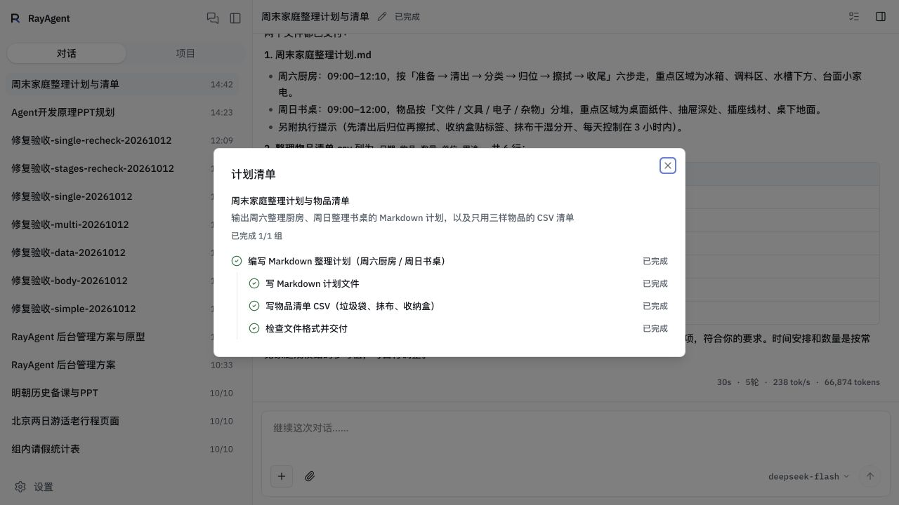
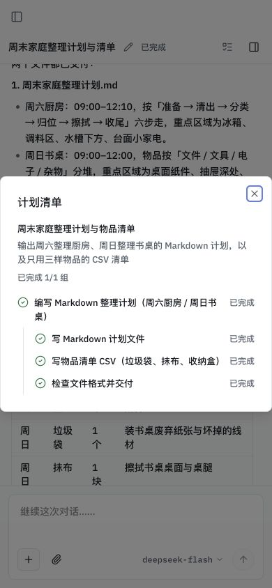

# 长任务计划与交付维护验收

日期：2026-10-12。代码基线：`6ae08486ff41d351786ccfaf661894bd7f0e4d25` 加本轮未提交修改。本轮实施和有限验收已结束；**协议与展示修复通过，长任务效率和产物业务正确性仍有失败观察，不作全面通过结论**。

范围为已授权的[长任务方案](../long-task-trust-and-delivery.md)。没有框架迁移、课程同步或旧对话迁移，也没有删除用户对话。较早的真实任务用于发现问题，最后一次测试改为日常轻量任务，不再新建后台管理任务。

## 最终实现

| 问题 | 实际处理 | 验收边界 |
|---|---|---|
| 阶段被局部清单覆盖、计数跳变 | 稳定阶段身份，阶段与步骤分层；压缩后动态上下文恢复子项 id、归属和状态；取消、延期需新的用户消息来源，资源不足保留受阻；事件读回保留层级 | 程序核对引用与结构，不能证明模型对用户语义的解释正确 |
| 清单杂乱 | 独立简短标题、一句描述；任务项和状态；简单任务平铺，必要时轻缩进；顶层按项或组计数，子项不重复计数 | 完整目标、范围、成果、变更和核验仍保存内部；内容简洁度由模型指导，不静默截断需求 |
| 周期核对和重复返工 | 取消固定三批拦截；同版本同条件明确通过证据复用；连续失败须说明新条件或换方法；有原因的实际改版后允许必要复核 | 未登记的语义重复、外部依赖变化和不充分的断言不能自动检出 |
| 有文件但交付不完整 | 成果分项保存真实版本、附件与项目副本结果；明确失败的当前版本核验影响最终 partial；相同实际字节复用附件，旧版本关联保留 | 文件已交付与内容正确分别判断；没有登记的遗漏仍可能漏检 |
| 收尾只能口头结束 | 仅补写进入收尾前登记的文本成果，已有文件另存预留新路径；结果未知先读回，不自动重复写；工具策略和计划模式仍优先 | 不提供通用路径所有权、并发原子写入或二进制生成保证 |
| 最终回复只总结末轮 | 动态任务状态与压缩恢复保留整体目标、累计成果和缺口；正文是成果时保留正文；简单回答不要求报告 | 使用同一模型，不新增通用评审模型；格式和语义质量不能仅靠协议保证 |

用户指出第一次界面修改过度暴露内部说明，本轮据此收简；该中间版不作为最终展示验收。成果在交付区查看，重要范围变化和阻碍在对话说明，清单不再重复铺开这些记录。

## 自动与真实服务检查

- 完整核心与协议检查：386 通过、62 跳过、4 个既有序列化警告。跳过主要为独立 PostgreSQL 或显式浏览器条件；不将跳过算通过。
- 独立临时 PostgreSQL：运行事件 13 项、项目交付 8 项、项目快照 6 项，共 27 通过。临时库按测试夹具重建，未用产品库运行这组测试。
- 前端：TypeScript、实际投影/计划组件、过程折叠、发送恢复脚本通过；lint 0 错误、24 个既有警告；生产镜像构建成功。
- 真实 API/业务 PostgreSQL/Docker 沙箱，无模型：专用空项目验证工作区内路径、外部路径、链接解析、同调用交付复用、部分失败保留附件、停止写入者并销毁测试沙箱、无需沙箱补存及重复补存幂等，全部通过。
- 390×844 真实视口：弹框 clientWidth 与 scrollWidth 均 388，未横向溢出；恢复默认视口。刷新后标题、描述、层级、状态和计数读回正确。

完整输入见[冻结任务输入](long-task-test-inputs-2026-10-12.json)，运行、附件哈希、分批构建身份及服务交付记录见[结构化证据](long-task-closeout-2026-10-12.json)。自动脚本不替代真实模型行为验证。

## 真实模型观察

模型 `deepseek-flash`，思考 `high`，原有 100 次请求预算。初批 8 次运行、受影响场景定向复测 3 次、最后轻量任务 1 次。期间修改过实现，每次运行的冻结 API 身份记录在 JSON 中；不能把全部任务合称最终版本端到端回归。最后轻量运行之后补齐了压缩上下文中的子项身份，以及 partial 的“仍有未完成项”文案，这两项使用实际循环/组件自动检查和部署读回验证，没有再创建模型任务。表中的请求数包含压缩请求；运行 completed 或 Done.complete 不是本报告的业务质量评级。

| 场景 | 请求数 | 协议结果与独立观察 |
|---|---:|---|
| 一次交付方案与原型（初批） | 97 | 一次压缩、必要文件交付，但末阶段受阻，Done.partial；仍有过度精修和文档数据口径偏差，未通过完整业务验收 |
| 先方案再原型（初批） | 7 + 50 | 保留同一目标两阶段、方案与原型累计交付；最终回复有标题、口径和边界；浏览器修复有实际错误依据，但成本仍高，完整指标未独立全检 |
| 开支 CSV 与分析文件 | 5 | 下载 CSV 独立计算总额 163、每日平均 54.333…，按日 43/54/66、按类 77/26/60，与交付一致 |
| 七天方案直接在回复交付 | 1 | 无计划工具与文件任务，正文保留七天操作、物品、障碍和验收，不被压缩成末轮结论 |
| 一句话解释 | 1 | 无计划、工具或成果报告 |
| 项目家务初版及改版 | 20 + 16 | 原版及新版 HTML/说明均保留；独立浏览器勾选和人员筛选有效；初版已有周末，新版扩展周末内容，不能据此宣称从零新增两天 |
| 一次交付方案与原型（定向复测） | 38 | 两个必要文件交付，Done.complete，首批稳定 ID 创建成功；独立核查仍发现留存和快速筛选重置缺陷，业务质量未全通过 |
| 家务方案后续做 HTML（定向复测） | 6 + 27 | 同 plan_id、两阶段身份保留，累计交付方案和 HTML；曾因后续文件路径尚未知被拒，最终协议已允许 future 文件暂不指定路径、启用时校验 |
| 周末整理 Markdown 与 CSV（标题/描述协议版本） | 5 | 30.692 秒、两个必要文件、Done.complete；下载哈希吻合，Markdown 含周六厨房与周日书桌，CSV 六行五列且物品仅三种；真实界面清单简洁，刷新和窄屏通过 |

这些运行没有 action=review 的纯核对调用，也没有旧的“进度未确认”主展示。仍有未登记的反复检查，不能据此宣布返工全面收敛。97 到 38 次请求涉及不同生成结果及中间修复，不是受控性能对比，不计算固定提速比例。

## 产物独立核查的失败

38 次请求的后台原型已经完整交付文件，但两个观察阻止本报告将其列为全项通过：

1. 页面与文档声称“近 30 天新增用户留存”，实际 `computeRetention` 只检查首次活跃距今天数不小于 N，没有排除 30 天以前的 18 名老用户。对同一随机种子生成的原始用户记录独立计算，D1 应为 14/28，原型为 25/46；D3 应为 8/24，原型为 17/42；D7 应为 6/17，原型为 10/35。
2. 输入不存在关键词后在 180ms 内立即重置，输入框已清空，但旧延迟回调随后使结果变成 0；再次重置才能恢复。源码重置处理未清理 `kwTimer`，与浏览器现象一致。正常筛选和任务详情可用，并不覆盖该竞态条件。

核查只读取已有交付物，没有再次生成或修改用户产物。数据生成部分在隔离的本地 Node VM 中提取，使用 Python 按页面声明的 cohort 条件计算；VM 不提供网络或文件能力。原始 HTML 哈希和实际/预期计数保存于 JSON，交付文件仍可在记录的测试对话中下载。

这些失败说明证据结构能保存检查结果，但模型可能漏选条件，或者以同一错误实现验证自身。当前版本明确失败的登记检查会影响最终 outcome；尚未登记或未实际断言的业务缺陷不会自动进入它。该边界保留在[能力与边界](../../capabilities.md#长任务核验与新协议)，不把本轮机制解释成通用业务验证器。

## 部署与界面证据

每次重建 API 前只读核对活动/等待运行数量为 0；保留实际 API 容器配置，更新 API/UI，网关重新解析上游。当前内容指纹与源码一致：API `0152bea504afe433c6858f776e6976bdbbf63023dae0cddf440dbf1b751ec141`，UI `70ce26ebfbe24d9b817338d1962170cda3b86600a3bbb52eb78a806bc7867e56`。轻量运行的冻结身份和最终补修后的身份分别保存在 JSON；最后补修以完整自动回归、内容指纹和实际 partial 文案读回验证。Git 标识为基线加 dirty 修改，未伪称已提交新版本。

数据库、Redis、已有附件、项目文件和旧会话保持原有数据；不兼容旧 later 协议，不进行数据迁移或自动清理。课程未修改。

