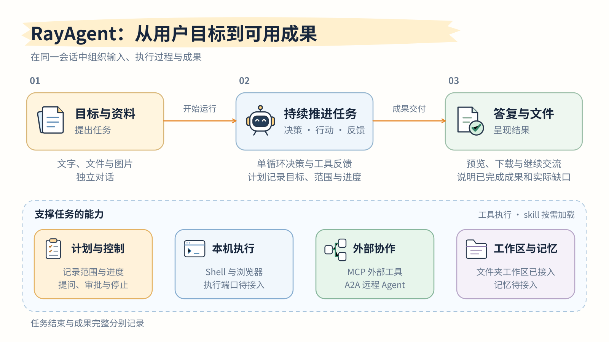

# RayAgent 产品说明

RayAgent 通过会话承接目标和资料，执行工具并交付答复与文件。当前以 Mac 桌面应用运行，会话可以独立存在，也可以属于一个绑定本地文件夹的工作区；工作区已提供工作方式、记忆与全文检索底座，本机命令与浏览器按工作区／独立对话的执行开关提供。

## 会话与执行

### 发起任务与输入材料

从首页输入目标，首次发送才创建会话；打开入口不会开始任务。历史会话保留原消息，终态后再次发送开启新运行。

- 文件或图片随消息交给 Agent；混合粘贴保留文字，图片可预览或移除。独立对话的附件放进会话工作目录，工作区对话的附件复制进工作区文件夹。
- 切换页面保留所属页面与草稿，上传期间不能发送。

图片由后台按本次模型能力与容量组织，用户无需选择技术输入模式：

- 支持视觉且符合预算时提供像素与文件路径，其余保留原文件并说明未启用视觉的原因。
- 活动运行的补图沿冻结模型处理；PNG、JPEG、WebP 和 GIF 首帧可进入像素输入，原图保持不变。
- 普通识图有像素时直接回答；OCR、属性读取和图片编辑按明确要求使用工具。

格式与容量见[运行参数与限额](limits.md)。

### 计划与继续执行

Agent 在同一循环中调用工具、读取反馈并决定下一动作。复杂任务可维护整体阶段与阶段内步骤，保留目标、范围和预期成果；计划勾选不证明业务完成。

- **补充要求**：在当前工具批次结束后的下一次模型请求前纳入。
- **回答提问**：沿同一次运行继续；结束后再发消息才开始新运行。
- **查看计划**：可了解整体进度与当前工作，展开及历史清单显示层级和状态。
- **计划模式**：先调研与制定方案，程序拒绝 Shell、写文件等副作用工具。
- **按计划执行**：在有效计划形成并结束后出现，确认具体版本后显示准备执行。
- **手动压缩**：整理模型上下文，保留会话历史；开发者模式下，斜杠命令的圆环展示当前占用，与输入框右侧一致。

输入框斜杠菜单提供附件、计划模式、压缩及已启用 skill。菜单展开期间高度稳定，鼠标悬停不触发滚动，键盘导航按需保持选中项可见。

文字确认按普通消息处理。计划条在本次运行写出或承接清单后出现，结束后仍可查看各份最新计划。展示契约见 [UI 设计说明](../ray_agent/ui/DESIGN.md#页面与状态契约)。

### 权限与等待

工具策略支持直接执行、执行前询问和禁止，具体规则优先。MCP 外部业务调用与远程委派默认询问，计划与提问豁免。

- 审批卡展示工具与参数，批准只针对具体调用，拒绝将原因交回 Agent。
- 等待审批期间先批准、拒绝或停止；刷新后可以继续处理，核心重启使旧审批失效。
- 策略匹配工具及服务身份，不对任意参数内容、文件路径或网络地址建立访问围栏。

## 工具与观察

Agent 可以按任务使用以下能力：

- 搜索网页，读取无需登录的公开正文。
- 更新计划、向用户提问，通过 MCP 调用外部工具，通过 A2A 委派远程任务。
- 在工作区会话中读写记忆、提议工作方式变更，并检索本工作区的记忆与会话摘要。
- 读写、搜索和列出文件，把文件交付为可下载附件。可访问范围是当前工作区文件夹与本会话工作目录，其他路径被拒绝；写入的保护与撤销见[工作区](#工作区)。

执行命令与自动化浏览器按工作区／独立对话的本机执行开关与组件状态提供；未启用或不具备时能力声明关闭对应工具。设置中的“运行组件”可安装浏览器、语义检索与文字识别组件，并读回安装进度、取消或重试。安装身份会保留，重启应用后可继续查询。浏览器按需启动，不接管用户默认浏览器资料。

### 过程与结果展示

- **时间线**：保存消息、工具、提问、审批、交付和终态。右侧“查看”组织对话材料与页面，没有浏览器记录时不显示页面。
- **浏览器**：普通动作提供文本观察，不自动截图。显式截图可用于模型分析、下载交付或两者兼有；分析需要视觉模型。临时观察图到期后保留引用，字节不再可下载。
- **统计**：区分本次运行与会话累计用量，生成速度为可见文本估算，缓存输入不重复加算。缺失数据不显示假数值，配置改变不重写历史统计。
- **开发者模式**：增加日志、原始结果、终端、上下文预算和请求重建，支持导出持久日志。开关只控制展示，当前 UI 没有远程桌面接管入口。

流式半截文本是临时展示，刷新或断线后不保留；已经保存的记录按序号补齐。聊天与日志切换保留草稿和阅读状态。

### 文件预览

预览用于阅读，下载保留原字节。文本分段、表格按窗口读取；损坏、超限或不支持时说明原因并提供下载。工作区文件夹里的文件用同一套预览，只能阅读，不提供下载入口。

| 类型 | 预览能力与边界 |
|---|---|
| 文本、CSV | 分段或按表格窗口读取 |
| Excel | 工作表与常见格式，显示已保存公式结果或标记未缓存；不重算公式，不还原图表、宏和完整打印布局 |
| 图片、PDF | 应用内图片预览与 PDF 阅读，缩略图以首帧为主 |
| HTML | 在系统浏览器中隔离运行脚本，不能访问应用存储或通过 fetch/XHR 取数；外部静态资源仍可加载；打开的地址短期有效，过期后从应用重新打开 |
| DOCX、PPTX、压缩包及未知类型 | 保留原件下载入口 |

HTML 的内存存储替身在刷新后清空，需要动态取数的页面可下载后本地打开。预览预算见[运行参数与限额](limits.md)。

## 工作区

工作区把一个本地文件夹作为材料与成果的原位，对话围绕它展开。不设平台托管副本、说明页或笔记；业务数据与索引在本机应用数据根，旧 Web 部署数据不迁移。每个工作区只绑定一个文件夹，工作区之间互不可见；独立对话不属于任何工作区，也不读写任何工作区的工作方式或记忆。

- **工作方式**：挂在工作区上的带版本短文本，每次新运行整段进入系统提示。可在设置中编辑；Agent 提议须经用户确认才发布。模板由用户从现有工作区另存，应用时只复制配置，不带记忆、路径或凭据。
- **记忆**：从对话沉淀的事实、偏好、决定与约束。常驻层每次注入，其余经全文检索召回；用户可钉住、确认候选、撤回。候选所依据的目标已变化时，旧确认被拒绝，需要重新审阅。新建、编辑、钉住和撤回可撤销，旧记录状态不足时明确拒绝恢复；确认与替代不能单条撤销。运行正常结束后可自动提炼；关闭自动记忆或让会话不参与后，未提交的提炼失效，重新开启不恢复旧任务，已保存记忆需单独撤回。模型判断与用户结论矛盾时转为候选，不静默覆盖用户条目；模型未识别的矛盾仍需人工纠正。
- **本次参考**：每条回复可展开查看本次实际使用的工作方式版本、常驻记忆与检索来源。
- **检索**：工作区内可全文检索记忆、会话摘要与文件夹材料片段；语义检索与 OCR 在对应组件可用时接入，缺失时全文照常。

### 创建、打开与定位

- **新建**：在默认位置下创建一个同名文件夹，默认位置可在设置中更改。
- **打开已有文件夹**：只能经系统文件夹选择器，选择后一次性授权给核心；界面不输入也不保存桌面路径。打开后给出一次扫描摘要，文件夹不能与已有工作区嵌套，也不能是应用数据目录或系统目录。
- **识别移动与复制**：文件夹内的 `.rayagent/workspace.json` 只记录身份。把文件夹移到别处后再打开，会认回原工作区并更新位置；复制出的文件夹带着已有标记时，由用户选择作为新工作区或改绑到这里（原文件夹解除绑定）。标记写不了时退回按路径绑定，移动后需手动重新定位。
- **不可用与重新定位**：文件夹被移走、改名或删除后，工作区显示不可用，已有对话仍可阅读和继续，文件工具暂停；回到原处会自动恢复，也可以选择新位置重新定位。目标已属于其他工作区、有写入占用或对话仍在运行时，重新定位被拒绝并说明原因。

### 文件夹面板与文件

工作区右侧是文件夹面板：文件树按目录读取，符号链接与特殊文件只显示不展开；点击文件在面板内预览；可以把文件添加进所选目录（同名不覆盖，改用另存名称并提示）；“在 Finder 中显示”由宿主定位目标，界面不接触绝对路径。会话里的“本次成果”列出本次交付的文件，预览交付时保存的版本。右侧在“文件夹”与“工作台”之间切换，点工具卡片会切到工作台。

`.rayagent`、版本控制内部目录、凭据与数据库文件不会被模型的文件工具读写；列举、搜索与扫描还会跳过依赖缓存目录，显式读取仍然允许。外部程序修改文件夹时，文件树与预览会刷新：只刷新受影响的目录，正在预览的文件被改动时提示“重新载入”，不自动替换正在阅读的内容。

### 写入保护与撤销

- **写入租约**：同一个文件夹同一时刻只允许一个对话写入。另一个对话（或在文件夹面板添加文件、撤销）遇到占用时立即得到占用者与原因，不排队。停止后若未能确认写入已结束，占用保持阻止状态，用“重试收尾”处理。外部进程写入者没有用户确认释放的入口。
- **写前备份**：覆盖或删除前先把原内容存为应用内备份，备份失败则不写入；备份在应用数据中，不在用户文件夹里。
- **脚本文件变化**：工作区会话可在运行下方查看 Shell 执行区间的文件观察。它比较首次执行前与进程结束后的文件大小和修改时间；扫描不完整或结束未确认会明确提示。列表可能包含同时发生的外部修改，无法确定写入者；这些观察没有内容备份，不支持撤销。
- **撤销本次修改**：运行结束后可选择文件恢复到运行前。运行之后又被外部改动过的文件显示为冲突，默认不选，确认后才覆盖；运行期间被外部改动过的文件同样提示，说明撤销会一并丢掉这些改动；运行新建的文件只有仍是运行写入的内容才会移除。撤销本身也是一次可撤回的修改，出现在“最近修改”里。撤销只恢复文件内容，不回滚对话。

### 归档与删除

归档后工作区只读，可取消归档。删除工作区会清理会话、备份和登记，并尽力移除文件夹里属于本机的标记条目，从不删除文件夹与其中的任何用户文件；全局清空数据同样如此。标记移除失败或文件夹失联时，之后再打开该文件夹会按新工作区处理。

## skill

设置中的“skill”支持公开 GitHub 地址和本地文件。本地文件可以是文件夹、ZIP、单个 Markdown，或 Markdown 与文本，也可以直接编写。GitHub 获取或本地上传后直接打开内容，无需单独预览；可点击阅读包内文档、YAML、代码和图片，再提交安装。列表内置优先、同组名称正序，支持启停、正文编辑、包更新及删除。社区入口链接到 [skills.sh](https://skills.sh/)，本机 `npx` 安装不会自动进入 RayAgent，需要回到此处导入。内置 `find-skills` 可以协助寻找、核对和推荐；它默认启用，可停用，由应用升级更新。

输入框 `/` 菜单可以选择 skill，再填写任务发送，也支持在开头直接输入 `/技能名 任务`。选择只作用于本条消息；Agent 也可按需加载相关 skill。聊天中明确要求安装时走同一服务，安装成功不代表依赖齐备或成果已经正确。已有运行固定原版本，设置更新和停用影响后续运行。完整使用边界见[skill 机制](skills.md)。

## 模型与设置

### 模型选择与生效范围

| 场景 | 使用的选择或配置 |
|---|---|
| 新对话 | 本机最近确认的模型与思考 |
| 已有会话 | 会话自己的选择；仅浏览历史不改变新对话偏好 |
| 对话首次运行 | 记录当时采样参数，同模型后续运行沿用 |
| 换模型后的新运行 | 读取目标配置并重新估算容量 |
| 执行或等待中的运行 | 使用自己的冻结快照 |

模型菜单关闭时提交变化，失败保留草稿；保存或发送成功才更新最近选择。会话字段尚未加载时由后端沿用原设置，思考档位来自模型目录，不假定跨系列等价。

### 设置与数据管理

- 普通设置提供外观、执行权限、工作区默认位置、外部协作信息和数据管理。
- 开发者模式提供执行上限、逐模型参数与外部协作连接编辑。
- 模型上游地址、密钥与各上游提供的模型写在用户配置文件中，设置页只显示文件位置、各上游状态与密钥掩码，并可打开该文件手动编辑；保存后新运行即用新值。配置方法见[运行指南](../ray_agent/README.md#模型连接)。
- 设置分区切换保留草稿，未保存退出有提醒；应用配置保存后生效，主题和阅读字号在本机即时生效。
- 全局清空需要确认短语，删除全部对话、附件与工作区登记（不删除工作区文件夹及其中的文件），保留模型、服务配置与 skill，完成后刷新列表并清除相关草稿。

首条消息后异步生成标题，手动命名优先；AI 建议保存后生效。详细交互规则见 [UI 设计说明](../ray_agent/ui/DESIGN.md)，配置数值见[参数页](limits.md)，启动方式见 [API 开发指南](../ray_agent/api/README.md#启动与接口)与[桌面开发指南](../ray_agent/desktop/README.md)。

## 完成、停止与结果核验

| 状态 | 含义 | 后续处理 |
|---|---|---|
| 等待 | 需要回答或审批，运行未结束 | 处理问题或审批后续接 |
| 已完成 | 循环正常结束，有最终回复 | 核对成果与业务要求，必要时继续提要求 |
| 失败 | 请求、容量或运行器错误使执行结束 | 保留原失败记录，可以重新发起 |
| 已停止 | 用户停止本次运行 | 已写文件保留，远程任务未必同步结束 |
| 已中断 | 核心重启或执行协程丢失 | 未进入模型的消息保留为未消费输入，可明确重新发起；等待提问可跨重启续接 |

成果与终态分别判断：

- 文件路径不代表交付，普通文件经交付工具成为下载附件；“下载本次交付”只包含明确交付文件，不混入输入材料。
- 复杂任务记录预期成果，必要成果缺失时说明部分交付；正文成果保留完整正文，文件答复说明累计成果与实际缺口。
- 结束反馈不证明业务正确，应结合实际工具结果、下载字节与内容核验，程序没有通用业务验收器。
- 停止取消执行，不回滚已写入的文件；运行中补充、尚未进入模型的消息保留为未消费输入，不会自动开始新的执行。
- 发送超时先核对受理结果，保留草稿，避免直接重发造成重复执行。
