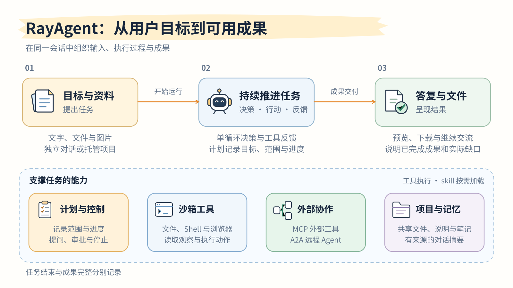

# RayAgent 产品说明

RayAgent 通过 Web 会话承接任务，组织目标、输入资料、计划、工具记录和产物。独立对话适合单项任务；托管项目让多次对话共享文件、说明、笔记与有来源的摘要。

## 会话与执行

### 发起任务与输入材料

从独立首页或项目主页输入目标。项目可以新建，也可以导入本地文件夹；打开主页或新增对话入口不会开始任务，首次发送时才创建会话。历史会话可以继续交流，已有会话不更换项目归属。侧栏切换时保留页面和草稿，项目主页按对话、文件、说明、笔记和摘要组织材料。

输入支持文件选择和图片粘贴，混合粘贴保留文字；图片可预览或移除，上传期间不能发送。输入区随内容增高，达到上限后内部滚动。

发送图片并说明目标时，后台按本次实际模型能力组织输入：支持视觉且符合预算时提供像素与沙箱路径，其余保留原文件并说明原因。活动运行的补图沿用冻结模型。PNG、JPEG、WebP 与 GIF 首帧可进入像素输入，原图保持不变；具体容量见[运行参数与限额](limits.md)。普通识图有像素时直接回答，未启用视觉时说明并建议切换；OCR、文件属性和图片编辑按用户明确要求使用工具。输入区无需选择技术输入模式。

### 计划与继续执行

发送目标开始运行，Agent 在同一循环调用工具、读取反馈并继续处理。复杂任务可维护整体阶段和阶段内步骤，记录目标、范围与进度；计划勾选不证明业务完成。主条显示整体进度和当前工作，展开及历史清单呈现层级与状态，具体展示契约见 [UI 设计说明](../ray_agent/ui/DESIGN.md#页面与状态契约)。

计划条在本次运行写出或承接清单后出现；结束后可由清单图标查看各份最新计划。计划模式先分析并列方案，程序拒绝 Shell、写文件、写笔记等副作用工具；有效计划形成并结束后，回复下方提供“按计划执行”入口，确认时显示准备执行。直接输入确认语句按普通消息处理。

运行中可补充要求，在当前工具批次结束后的下一次模型请求前纳入。Agent 提问后等待回答，答复继续同一次运行；结束后再发送开始新运行。手动压缩整理模型上下文，不删除会话历史。

复杂文件任务登记预期成果，缺少必要文件时显示部分交付；最终说明同一任务的累计成果和实际缺口。正文就是成果时保留完整正文，简单问答直接回答。

### 权限、等待与标题

工具策略支持直接执行、执行前询问和禁止，具体规则优先；默认 MCP 与远程 Agent 需要询问，计划与提问豁免。审批卡展示工具及参数，批准只执行具体调用，拒绝把原因交回 Agent。等待审批期间需先批准、拒绝或停止；刷新可继续处理，API 重启使待审批调用失效。策略不检查参数、路径或网络。

首条消息后异步生成简短标题，用户可手动重命名或取得 AI 建议；建议保存后生效，迟到自动标题不覆盖手动修改。

## 工具与观察

| 能力 | 用户可取得的结果 |
|---|---|
| 文件与 Shell | 沙箱内的读写、查找、命令输出和进程操作 |
| 网页检索与公开网页读取 | 检索结果、无需登录的网页正文 |
| 浏览器 | 页面正文与交互元素、点击输入等动作、显式截图 |
| 计划与提问 | 可查看的计划进度、等待回答的问题 |
| MCP 与 A2A | 外部工具结果、远程任务状态与回传内容 |
| 文件交付 | 已生成文件的下载附件 |

时间线保留消息、工具、提问、审批、交付和终态。右侧“查看”组织本次对话、项目文件与页面；没有浏览器记录时不显示页面。交付结果与输入材料分开，“下载本次交付”只打包明确交付文件。普通文件卡单击打开预览，下载独立操作；项目文件可查看、下载或跳转主页管理。

浏览器普通动作提供文本观察，不自动截图。显式截图可以用于模型分析、作为下载附件或两者兼有；分析需要模型支持视觉。临时观察图到期后保留历史引用，图像不再下载。当前 UI 没有远程桌面接管入口。

运行显示时长、轮次和生成速度，终态显示本次已记录的输入与输出 Token；生成中速度是可见文本估算。上下文详情另显示会话累计用量，缓存输入不重复加算。配置改变不重写旧请求的统计，缺失数据不显示假数值。

开发者模式增加日志、原始结果、终端、上下文预算与请求重建；日志可导出持久记录。聊天与日志切换保留草稿和阅读状态。流式半截文本是临时展示，刷新或断线后不保留，已经保存的记录按序号补齐。

### 文件预览

预览只用于阅读，原文件可独立下载。文本按段、表格按窗口读取，项目文件改版后需重新加载；超限、损坏或不支持类型提供说明和下载入口。Excel 还原常见格式，显示已保存的公式结果或标记未缓存公式，不重算公式，也不还原图表、宏和完整打印布局。DOCX/PPTX、压缩包和未知类型保留下载入口。

HTML 在新标签页隔离运行，不能访问本站存储或通过接口取数；内存存储替身在刷新后清空，外部静态资源仍可按页面依赖加载。需要 fetch/XHR 数据的页面可下载后本地打开。PDF 使用浏览器阅读器，图片缩略图以首帧为主。资源预算见[运行参数与限额](limits.md)。

## 托管项目

### 文件管理与副本

项目文件是平台保存的副本，不回写本地，也不接宿主机目录或 Git。文件页添加材料只保存文件，不发消息或开始任务；输入框附件随消息交给 Agent。普通列表省去系统目录层，保留用户子目录及真实路径。

本地目录导入先扫描并审核文件树，展示排除项、敏感项和覆盖确认。筛选只影响查看，不改变上传集合。上传进度区分传输和发布；失败保留成功项，取消不表示已发布文件被撤销。可下载单个文件或导出当前项目文件，导出不含对话历史。

输入附件进入项目材料区；交付文件在项目工作区内时引用原文件，工作区外产物补存成果副本。附件与项目副本分别显示结果，副本失败时仍可下载附件，并单独重试补存；状态读取失败显示未确认。

### 占用、保护与生命周期

同项目只允许一个活动运行，准备、等待回答或审批都保持占用；上传、恢复与环境收尾也阻止冲突写入。冲突说明占用原因和所属对话，首次发送被拒绝不会新增空会话。

运行前保护当前文件，保存点保留份数可配置。快照读写失败不开始执行，超限明确说明未保护；默认值见运行参数页。恢复先保护当前文件，失败保留阻止标记，用户可重试或回到恢复前。恢复只改变文件，不回滚笔记、摘要、对话和旧附件。

项目设置管理名称、归档及永久删除；恢复和操作记录使用独立入口。归档保留材料与历史，可恢复，也可清理快照。永久删除确认范围，非空项目需输入名称；活动运行、文件操作或后台记忆处理未结束时拒绝。清理先处理资源再删除记录，失败保留进度和重试入口，共享附件仍有其他引用时保留。

### 项目记忆

说明表达固定要求，笔记保存长期结论，摘要记录其他对话的工作与来源。笔记可由用户或 Agent 按版本修改；历史取回先进入草稿，保存才生效。摘要可编辑或重生成，失败保留原内容，迟到生成不覆盖新编辑；冲突提供最新版本，不静默丢失草稿。

新运行冻结说明、笔记和近期其他对话摘要，避免重复当前历史；执行与等待续接使用原冻结内容，后来修改在新运行生效。开发者上下文预览区分当前候选材料与带来源的实际运行快照。摘要有损，不提供向量检索或长期知识质量保证。

## 模型与设置

普通设置提供项目保护、外观、执行权限、外部协作信息和数据管理。开发者模式增加执行上限、逐模型参数、连接编辑和技术观察；开关只控制展示。模型提供商页不展示连接设置，上游地址和密钥由部署配置管理。

新对话及项目新对话沿用浏览器最近确认的模型与思考，已有会话保留自己的选择。仅浏览历史不更新偏好，菜单保存或发送成功才记忆；未加载会话字段时由后端沿用会话设置。菜单关闭时提交变化，失败保留草稿。档位来自模型目录，不假定跨系列等价。

对话首次运行记下采样参数，同模型后续运行沿用；换模型后新运行读取目标配置，活动或等待运行仍沿自己的快照。配置数值与目录封顶见[运行参数与限额](limits.md)，部署方法见[运行指南](../ray_agent/README.md)。

设置分区切换保留草稿，未保存退出需要处理提醒；应用配置保存后生效，主题和阅读字号在当前浏览器即时生效。全局“清空所有数据”需要确认短语，清理全部项目及业务数据，保留模型和服务配置；完成后刷新列表并清除相关草稿。

## 完成、停止与结果核验

| 状态 | 含义 |
|---|---|
| 等待 | 需要用户回答或批准，运行仍未结束 |
| 已完成 | 循环正常结束，已有最终回复 |
| 失败 | 请求、容量或运行器等错误使执行结束 |
| 已停止 | 用户停止本次运行 |
| 已中断 | 服务重启或执行协程丢失，需要重新发起 |

结束前会对登记成果与未完成工作做有限反馈，仍不证明业务正确。文件路径不等于交付，普通文件需经交付工具成为附件。应结合实际工具结果、下载字节和内容判断成果，程序没有通用业务验收器。

停止取消执行并尝试终止登记的 Shell 进程组，不回滚文件，也不保证远程任务同步结束。独立对话复用沙箱；项目终态需停止环境、确认静止后释放占用。API 重启中断执行与审批，等待回答可以续接。发送超时先核对受理结果并保留草稿，失败可重试，原始失败记录保留。
