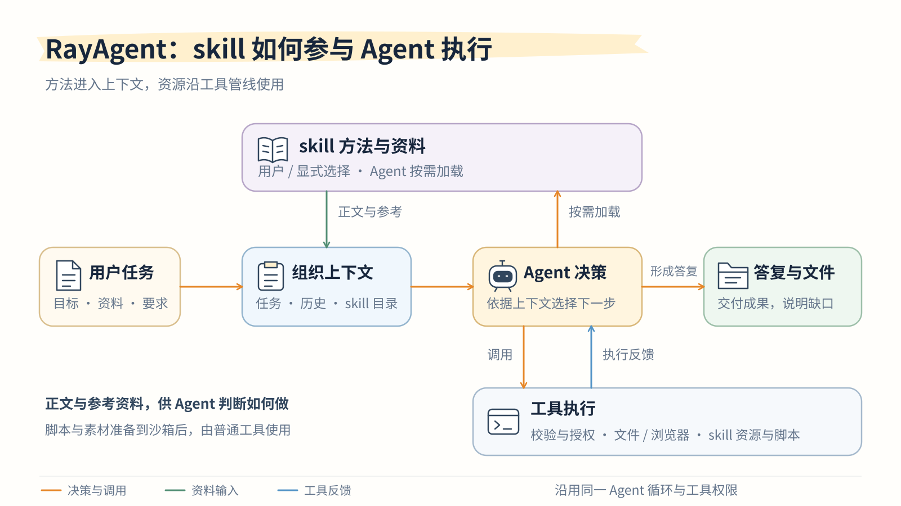

# skill 安装、多来源发现与运行使用

skill 将可复用的方法、参考资料、脚本和素材供会话使用。skill 不另建 Agent 循环，也不增加工具权限；安装或发现成功只表示包已校验并登记，依赖与任务效果仍需在使用时核对。运行按受理时冻结的内容快照使用资源，不随外部目录瞬时变化偷偷切换。

*橙线表示决策与调用，绿线表示资料输入，蓝线表示工具反馈。图聚焦 skill 在同一 Agent 流程中的作用：运行内目录先进入上下文，显式选择的正文在业务决策前加载，Agent 也可按需加载。加载、参考读取与材料准备均沿现有工具策略；脚本与素材经快照稳定路径映射后再由普通工具使用。图省略安装管理、版本冻结及等待等细节，具体规则见下文。*

## 来源与发现

支持工作区级、用户级、应用管理库、应用内置，以及设置中登记的额外目录：

| 来源 | 约定路径或入口 | 范围 |
|---|---|---|
| 工作区 | 工作区文件夹内 `.agents/skills/`、`.codex/skills/`、`.claude/skills/` | 只扫描当前工作区，不向上也不进入其他工作区 |
| 用户 | 用户主目录下同上约定路径；若设置了 `CODEX_HOME`，另含 `CODEX_HOME/skills` | 跨工作区复用；路径按 OS 用户目录解析，不硬编码开发机主目录 |
| 额外目录 | 设置中经宿主文件夹选择器登记的绝对路径 | 可逐项移除引用 |
| 应用管理库 | GitHub／本地文件／ZIP／直接编写安装 | 应用数据根内的不可变版本 |
| 内置 | 随包发布的 `find-skills` | 可停用，不可删除或覆盖 |

发现 `SKILL.md` 后登记稳定 `skill_id`、名称、描述、来源、规范路径与内容指纹（`content_hash`／版本）。工作区与用户约定目录只扫登记范围内一层包目录，不在启动时递归整棵文件树。同一规范路径的路径别名／软链接去重；包内链接仅在目标仍属已解析包根时收录，包外引用与循环链接明确不兼容。

发现只登记快照和目录项，不因为上下文预算失败。新发现的外部 Skill 可以在 `/` 中选择，不自动进入每次运行的目录。数值见[参数页](limits.md#skill)。

## 重名、链接与启停

同名不同来源保留各自稳定身份，界面始终显示来源。默认按工作区 → 用户外部目录 → 额外目录 → 应用管理库 → 内置解析；同层多份冲突要求在设置中指定偏好或显式选择，不依赖扫描顺序。输入框与受理发送稳定 `skill_id` 和版本，不以可见名称冒充身份；斜杠菜单在冲突时带上来源说明。

外部目录是用户文件：停用或移除引用不删除其内容；外部包默认只读，正文编辑仅对应用管理包开放。启用表示可以在 `/` 中选择；纳入表示进入每次运行自动带上的目录。停用后不能选择，也不进入目录。纳入时如果目录索引放不下，拒绝这一次纳入，其他 Skill 保持原状。应用内安装和内置 `find-skills` 默认纳入；放不下时安装仍然完成，但保持未纳入。活动运行记录实际加载的版本与来源；源目录之后更新或删除时，同一活动运行沿已授权快照，新运行才看到新快照。外部目录消失时条目标为缺失并停用，已绑定运行仍可读快照。

## 包快照与稳定路径

外部 Skill 不要求手工导入，也不在外部目录写应用元数据。首次发现或变更后，内部按清单完整生成内容寻址快照（数据根 `skills/versions/<content_hash>/`），经校验发布再登记可用。用户看到的是引用来源；内部缓存用于等待续接、请求重建和资源一致性。

`prepare_skill_resources` 在本机执行中映射到该运行已绑定的快照根路径并核对清单，不复制回外部目录，也不自动执行包管理器安装。脚本工作目录与产物落在获准的工作区或会话工作目录；不兼容环境与缺失依赖明确报告。

## 用户如何导入与管理

设置的“skill”分区支持搜索、阅读正文和包内文件、启停、来源开关、额外目录、编辑管理库正文、更新完整包及删除／移除引用。GitHub 与本地文件共用同一安装服务：获取来源、发现候选、预览校验、发布不可变包并登记版本。本地文件可以是文件夹、ZIP、单个 Markdown，或 Markdown 与文本；缺少 frontmatter 时补名称和描述，直接编写也生成同一份包。多个候选必须选择一个；重复内容返回已有版本，同名不同内容报冲突。更新携带所见旧版本，避免覆盖并发修改；正文编辑保留其他包文件和原来源。本地来源统一显示为本地文件。

列表按内置优先、再按来源优先级与名称展示摘要、来源标记和启停开关；同名冲突单独标出。点击 skill 打开详情弹框，默认渲染 `SKILL.md`。宽屏目录与内容并列，窄屏切换目录；文件行可点击，Markdown 可切换源码，YAML、代码等可解码文本只读显示，栅格图片可查看，其他文件提供下载。包内相对文档和图片在同一阅读器打开，不执行脚本、HTML 或 SVG。

新增弹框只分 GitHub 与本地内容；本地内容包含文件、文件夹、ZIP 和直接编写。GitHub 点击获取、本地文件选择并上传后直接打开内容；缺元数据先补齐，多候选先选择，当前不批量安装。获取的包可编辑正文并重新校验，生成新的校验材料与指纹，保留其他文件和来源；直接编写可查看排版并提交安装。安装成功转为已安装详情、刷新并定位列表项；安装成功但刷新失败分别说明。更新包在详情上打开同一导入流程，点击确认更新发布；关闭更新回到原详情。返回来源保留输入，未保存内容受关闭保护。

正文编辑只修改 `SKILL.md`，不提供任意包文件的在线编辑，也不直接改名；更换名称按新 skill 安装。同名同字节重复安装可复用原结果，来源不同但内容相同也不静默替换来源。

新增弹框保持外框高度稳定，较长内容在区内滚动；切换 GitHub 与文件时按方向滑入。列表与新增弹框右上角的社区图标链接到 [skills.sh](https://skills.sh/)。选好后复制公开 GitHub 仓库、skill 目录或 `SKILL.md` 地址，或者选择文件夹、ZIP 或 `SKILL.md` 回到设置导入。本机 CLI 安装不会自动进入应用管理库；用户目录中的标准包可被发现来源扫到。社区收录与热度不代表质量、安全或兼容性已获验证。

聊天中明确要求安装公开 GitHub 来源时，Agent 可调用 `install_skill`。唯一候选可以直接安装，多候选返回操作身份，询问用户后沿同一操作续接。只要求寻找、只发地址或 skill 正文里的安装指令，都不构成用户安装授权；自然语言授权依靠模型遵守要求，程序另外执行模式与工具策略。

## 内置 find-skills

应用随包发布固定版本的 `find-skills`，默认启用，正文按需加载。设置页标记“内置”，允许停用；编辑、手工更新和删除不开放，应用升级发布新版本，已有运行保留原引用。同名用户管理包不能覆盖内置 skill。

它先检查运行目录中已有 skill，再按需复用网页搜索、读取或浏览器寻找社区候选；推荐前核对正文、用途、依赖、工具要求和来源。无法搜索或读取时如实说明并给出社区入口。明确要求安装时调用共享安装服务；明确要求立即使用时才追加当前运行目录，然后加载。普通任务无需先搜索 skill，计划模式只查找、阅读和推荐。

## 包与来源边界

包根目录需要 UTF-8 `SKILL.md`，含 YAML frontmatter 的名称、描述及非空正文。安全解析元数据，不解释其他字段为权限、安装钩子或执行授权。名称以小写字母开头，使用稳定的小写字母、数字及连字符标识，避开内置命令；各入口共用同一解析结果。

包保留根目录内普通文件和相对目录，拒绝路径穿越、包外链接、特殊文件、重名及不可移植路径冲突；压缩体积、解压总量、文件数、单文件、层级和候选扫描均有限制。包哈希由规范化路径与内容清单确定，不受外层目录与 ZIP 时间戳影响。具体预算见[运行参数与限额](limits.md#skill)。

GitHub 适配器只访问官方 API 与归档目标，拒绝重定向和任意下载域名；默认分支、标签或含斜杠的分支先解析为固定提交。归档下载受限；明确目录时仅选取该目录材料，仓库集合只提取发现的 skill 目录，不将无关仓库文件写入 skill。来源较大或网络受限时可改用完整 skill 文件夹或 ZIP。不获取私有仓库、包外引用、子模块或 Git LFS 实际对象，不安装依赖或执行包内代码。

支持公开仓库根、目录及 `SKILL.md` 文件地址，记录仓库、目录和提交。仓库根有正文时作为一个包，没有时在受限范围扫描候选；多个候选必须选择，不按目录顺序猜测。目录内的 `references/`、`scripts/`、`assets/` 不是必需项，也不是仅允许的目录；包内 ZIP 作为普通材料保留，不递归解压。临时网络故障有界重试，地址、固定提交或包内容错误不会通过偷换分支与目录修复。

识别目录及 `SKILL.md` 不等于支持 hooks、变量替换、权限字段、子 Agent 或专用工具；只解释已实现的扩展，其余明确展示兼容边界。`agents/openai.yaml` 等可阅读但不自动执行。

## 版本、导入与文件归属

数据库保存目录、版本元数据、导入操作和运行引用；完整包快照保存在 API 的独立 skill 持久目录，区别于附件和工作区文件。导入操作包含幂等身份、来源、候选、阶段和结果；聊天导入另关联运行与工具调用。响应未知时查询原操作，不能直接宣称失败或重装；改变候选需要新操作，不能复用已发布结果冒充另一 skill。

网络和包校验在事务外完成，文件先原子发布，再在短数据库事务中登记可见版本；数据库锁保护名称、纳入目录时的预算及版本条件。文件与数据库没有跨资源原子事务：失败可能留下不可见孤立包，通过幂等核对和无引用回收处理。启动扫描将未完成获取或校验标记中断，预览过期需重新获取。

停用、更新和删除影响后续运行，不能改写已有引用。删除会话或工作区会释放相应运行引用，清空业务数据保留全局 skill；工作区私有外部引用随工作区范围管理，外部目录从不随回收删除。回收只移除确认无引用的版本和过期临时材料。数据库和 skill 文件应配套备份；登记存在而正文或所读资源缺失、损坏时返回失败，不能用空内容冒充成功。设置读取文件携带所见版本，待安装读取另外核对导入归属、候选、指纹和有效期；版本变化或材料过期需重新获取。删除重复请求幂等，结果未知时先读回；删除成功与列表刷新失败分别表达。

导入、发布、更新和删除用数据库锁与版本条件协调，不能仅依赖进程内锁。发布核对操作所有者、候选及指纹，已完成操作不能改选另一候选；设置读取不访问聊天私有导入。删除不撤销已经执行的脚本或外部副作用，也不删除任务产物；当前没有历史版本管理界面。

## 包文件如何阅读

包阅读器按当前文档目录解析相对文档和图片，只访问清单内资源，拒绝越出包根。当前文档锚点在阅读区定位，外部网页仍按安全链接打开。`agents/openai.yaml` 只是普通包文件，不解释为 RayAgent 配置；命令和脚本不会因为查看而执行。

已安装文件读取要求当前目录版本与所见版本一致，历史消息中的只读入口不提供任意旧版本下载授权。待安装内容另核对导入操作归属、阶段及有效期，存储层检查路径、链接、大小与哈希，不接受任意主机路径或版本哈希。文件响应禁止嗅探和主动内容执行，HTML、SVG 只显示源码；未知编码和二进制保留下载。文件按需读取，切换或关闭后忽略迟到响应，局部失败保留目录及重试入口。

## 选择、加载与上下文

输入框的 `/` 菜单分为命令和 skill，每项一行；鼠标悬停只改变高亮，方向键越界时才滚动列表使选中项可见。展开期间列表高度稳定，筛选不做高度动画。只输入 `/` 时列出全部；继续输入后，只用斜杠后面的文字对关键字、别名、搜索词和标题做包含匹配。选择后名称以高亮整段标记出现在正文开头，移入时换色并显示手型，点击打开只读预览；光标不能进入名称中间，在正文开头退格或在标记上退格会整段移除。也支持在开头直接输入 `/技能名 任务`，技能名按包标识使用小写字母、数字和连字符；同名冲突时应用偏好或菜单中的来源限定项。一条消息显式选择一个 skill，发出后输入框不再保留该名称，后续消息不默认沿用；没有任务正文时保留草稿。用户消息使用同一标记，不另加说明前缀。首页、工作区页、会话页、草稿、受理读回及历史都携带稳定 skill ID 和版本，相同文字但选择不同不能互相冒充已受理。

新运行在消息受理前刷新发现目录，在受理事务中冻结已纳入、且按当前工作区与名称解析之后的目录，并登记版本引用。显式选择一个尚未纳入的 Skill 时，只把这一条追加进本次运行。已经放不下的旧纳入集合不拦截发消息：这次运行只自动带上内置 Skill 和本条消息选中的 Skill，设置里标出哪些因为放不下没有进入目录。不按扫描顺序丢掉后半部分。客户端所选 skill 已被更新、停用、缺失或删除时返回冲突；运行中补充选择只能使用该运行已经绑定的版本。用户要求安装后立即使用时，仅追加这一安装结果，不刷新整个目录；同名旧绑定不替换，新版本在新运行生效。

模型先看到名称、来源和一行描述，按需要调用 `load_skill`。描述超出索引长度时截断并标明，完整说明在加载后的正文里；内容身份和版本留在服务端。显式选择则在下一次业务模型决策前由程序加载；需要审批时使用有独立身份的选择审批并等待，不伪造助手工具调用。自动加载和显式加载共用版本解析、完整性校验、正文预算和活动登记。加载失败不能假装已遵循 skill 继续原任务。

完整正文通过有内部类型、来源及版本的 skill 资料块进入上下文，工具结果仅报告激活结果，避免正文被通用长结果整形截断或重复注入。活动正文与目录在压缩时原样保留，不进入用户原文重新注入预算；仍计入实际窗口容量检查。新运行将旧资料及旧 skill 工具结果改为历史引用，重新按当前选择激活；持久事件不改写。等待中的同一运行从固定版本恢复活动资料。

重新纳入、以及向已经放得下的运行目录追加一条 Skill，都核对完整目录索引；放不下就拒绝这一次变更。发现、设置列表和没有显式选择的发消息不因目录超限失败。正文加载另检查单包和活动总量预算，必须完整成功或明确失败；重复加载同一版本不重复注入。不存在、版本缺失、内容损坏与容量不足分别反馈，自动加载失败可按原因选择其他方法，显式选择失败则先向用户说明。

## 资源、权限与停止

`read_skill_resource` 分段读取已加载包的文本资源，二进制只返回信息；仅阅读正文或参考资料不需要执行环境。需要脚本、素材或普通文件工具时，`prepare_skill_resources` 把运行绑定的快照根路径完整校验后返回；它不安装依赖、不执行包管理器。

材料准备可重复调用；等待续接时重新核对已经准备过的材料，缺失或被修改则从固定快照恢复。副本不会回写全局包或外部目录。脚本实际执行仍使用普通工具、模式和审批，准备成功不代表依赖或业务结果正确。

计划模式和预算收尾阶段允许加载与读取，禁止安装和材料准备。显式加载不豁免工具策略。停止后不再发起新的下载、加载或材料准备；已经在执行的文件与环境动作沿现有结果未知边界收尾。全局安装在提交事务内核对运行状态，已提交的安装保留，未提交聊天导入取消或中断，设置导入不随聊天停止。核心重启沿现有运行规则处理，不承诺通用崩溃自动续跑。

| 工具 | 职责 | 计划模式与预算收尾 |
|---|---|---|
| `load_skill` | 完整加载运行绑定版本的正文 | 允许，仍受策略约束 |
| `read_skill_resource` | 分段读取已加载包的文本，二进制只返回信息 | 允许，仍受策略约束 |
| `prepare_skill_resources` | 映射并核对运行绑定的快照根路径 | 禁止 |
| `install_skill` | 沿共享服务导入公开 GitHub 包 | 禁止 |

模型只指定 skill 名称与包内路径，运行身份、版本和主机位置由服务端解析；材料准备不是授权安装依赖，脚本执行另走普通工具。管理与导入失败通过持久操作读回，准备、依赖和业务执行失败分别表达，不能由安装成功推导执行成功。工程检查入口见 [API 指南](../ray_agent/api/README.md#skill-安装与运行检查)，设计取舍见[背景](background/skills.md)。
